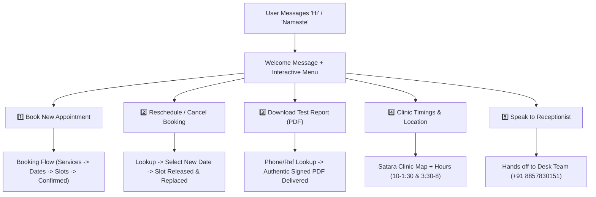

# VAANI SPEECH & HEARING CLINIC
## Clinical Workflows & WhatsApp Automation Specification
**Document Version:** 1.0.0  
**Effective Date:** October 2026  
**Clinical Governance:** RCI CRR No. A125560 / A79214 • DPDP Act 2023 Compliant Practice  
**Lead Consultant:** Ms. Palak Paresh Gandhi, BASLP, RCI (Consultant Audiologist & Speech-Language Pathologist)  
**Clinic Helpline:** +91 8857830151 | **Email:** info@vaaniclinic.com  
**Clinic Location:** Shop No. 4, Ground Floor, Sadashiv Arcade, Opp. Zilla Parishad Gate, Sadashiv Peth, Satara - 415002  

---

## 1. Executive Architecture Overview

This specification details the end-to-end clinical workflows for **Appointment Booking**, **Appointment Rescheduling**, and **Diagnostic Report Retrieval** at Vaani Speech & Hearing Clinic, accompanied by an actionable **WhatsApp Business API Automation Blueprint**.

```
                           ┌───────────────────────────────────────────────┐
                           │          Patient Touchpoints                  │
                           │  - Clinic Website (Desktop / Android / iOS)   │
                           │  - Scannable Physical Report QR Codes         │
                           │  - Official WhatsApp (+91 8857830151)         │
                           └──────────────────────┬────────────────────────┘
                                                  │
                                                  ▼
                           ┌───────────────────────────────────────────────┐
                           │         VAANI Core Service Layer              │
                           │  - Appointment Engine (Slot allocation)       │
                           │  - Clinical Report Vault (PTA / OAE / CBT)    │
                           │  - DPDP Privacy & Cryptographic Verification  │
                           └──────────────────────┬────────────────────────┘
                                                  │
                                                  ▼
                           ┌───────────────────────────────────────────────┐
                           │       WhatsApp Business Cloud API             │
                           │  - Meta Graph API / Gupshup / WATI / Aisensy  │
                           │  - Webhook Listener & Interactive Templates   │
                           │  - Automated High-Res Vector PDF Delivery     │
                           └───────────────────────────────────────────────┘
```

---

## 2. Workflow 1: New Appointment Booking

### 2.1 Step-by-Step Patient Flow

```
[ Step 1: Patient Info ] ──► [ Step 2: Service Selection ] ──► [ Step 3: Slot Selection ] ──► [ Step 4: Instant Confirmation ]
  - Full Name                  - Audiology / Speech             - Live Available Dates          - Booking Ref: VN-APT-XXXX
  - WhatsApp Phone             - Clinical Description           - Morning / Evening Slots       - WhatsApp Instant Alert
  - Age Group & Email          - Standard Duration              - Double-Booking Blocked        - Directions & Instructions
```

#### Step 1: Patient Demographic Capture
- **Required Fields:**
  - `patient_name`: Full legal name of the patient.
  - `patient_phone`: 10-digit Indian WhatsApp mobile number (e.g. `9822012345`).
- **Optional Fields:**
  - `patient_email`: Registered email for digital receipts and clinical dossiers.
  - `patient_age_group`: Category selector (`Pediatric` < 12 yrs, `Adolescent` 12–18 yrs, `Adult` 18–60 yrs, `Geriatric` > 60 yrs).

#### Step 2: Clinical Service Selection
Patients choose from standardized clinical protocols:
| Service Code | Clinical Procedure | Standard Duration | Preparation / Notes |
| :--- | :--- | :--- | :--- |
| `RP-CLN-AUD` | **Pure Tone Audiometry (PTA)** | 30 Mins | Avoid loud sound exposure 12h prior. |
| `RP-CLN-SPT` | **Speech Therapy Consultation** | 45 Mins | Bring child's prior medical/school records. |
| `RP-CLN-OAE` | **OAE Newborn Hearing Screening** | 20 Mins | Baby should ideally be calm or sleeping. |
| `RP-CLN-HAT` | **Hearing Aid Consultation & Trial** | 45 Mins | Bring recent audiogram if conducted elsewhere. |
| `RP-CLN-TIN` | **Tinnitus Assessment & Masking** | 30 Mins | List current medications. |
| `RP-CLN-VOI` | **Voice Disorders Assessment** | 30 Mins | Avoid excessive vocal strain before test. |
| `RP-CLN-CBT` | **Psychological & CBT Counseling** | 60 Mins | Strictly confidential sessions. |

#### Step 3: Date & Time Slot Allocation
- **Operating Days:** Monday to Saturday (Sunday Closed).
- **Working Hours:**
  - **Morning Session:** 10:00 AM – 01:30 PM (Slots: `10:00 AM`, `10:30 AM`, `11:15 AM`, `12:00 PM`, `12:45 PM`)
  - **Evening Session:** 03:30 PM – 08:00 PM (Slots: `04:00 PM`, `04:45 PM`, `05:30 PM`, `06:15 PM`, `07:00 PM`, `07:30 PM`)
- **Real-Time Concurrency Lock:**
  - When a slot is selected, system queries `appointmentService.getBookedSlotsForDate(date)`.
  - Already-booked or clinician-blocked slots render disabled (`Booked` pill badge).

#### Step 4: Confirmation & Unique Booking ID
- An authenticated Booking Reference Number is generated: `VN-APT-2026-XXXX`.
- Status is initialized to `CONFIRMED` (or `PENDING_REVIEW` if manual clinician triage is enabled in settings).
- Triggers instant **WhatsApp Booking Confirmation Card** to the patient's phone.

---

### 2.2 WhatsApp Automation for Booking

#### Trigger Event
`EVENT: appointment.created` via Webhook or WhatsApp Chatbot direct booking.

#### WhatsApp Template: `booking_confirmation_v1`
```
🏥 *VAANI SPEECH & HEARING CLINIC*
*Appointment Confirmed*

Dear {{1}}, your clinical appointment has been scheduled successfully.

📋 *Booking Summary:*
• *Reference ID:* {{2}}
• *Service:* {{3}}
• *Date:* {{4}}
• *Time Slot:* {{5}}
• *Clinician:* Ms. Palak Paresh Gandhi, BASLP (RCI A125560)

📍 *Clinic Address:*
Shop No. 4, Ground Floor, Sadashiv Arcade, Opp. Zilla Parishad Gate, Sadashiv Peth, Satara - 415002

⚠️ *Important Instructions:*
- Please arrive 10 minutes prior to your scheduled time.
- For pediatric speech sessions, bring your child's favorite toy/snack.
- For hearing tests, keep ears clean and free of excessive wax.

Need to reschedule or cancel? Reply with *RESCHEDULE* or *CANCEL* or tap below:
```
**Interactive Quick-Reply Buttons:**
1. `📍 Clinic Location` (Maps URL: `https://maps.google.com/?q=Vaani+Speech+Hearing+Clinic+Satara`)
2. `🔄 Reschedule Slot`
3. `📞 Call Helpline` (Tel: `+918857830151`)

---

## 3. Workflow 2: Appointment Rescheduling

### 3.1 Rescheduling Policy & Business Rules

1. **Cut-off Window:** Rescheduling is permitted up to **2 hours** prior to the allocated consultation time.
2. **Quota:** Patients may reschedule an appointment up to **2 times** through self-service before requiring receptionist assistance.
3. **Slot Release:** The original time slot is immediately marked available in the real-time pool for other patients upon confirmation of the new slot.
4. **Audit Trail:** Original date/time is logged under `reschedule_history` in the patient's electronic health record (EHR).

```
[ Patient Requests Reschedule ]
               │
               ▼
   [ Verify Phone / Ref ID ]
               │
      Valid ───┴─── Invalid ──► [ Prompt for Correct Booking ID ]
        │
        ▼
[ Display Next 3 Available Dates ]
        │
        ▼
[ User Picks Date & New Slot ]
        │
        ▼
[ Release Old Slot + Lock New Slot ]
        │
        ▼
[ Dispatch Rescheduled WhatsApp Notification ]
```

---

### 3.2 WhatsApp Automation for Rescheduling

#### Inbound Chatbot Triggers
- Keywords: `RESCHEDULE`, `CHANGE TIME`, `CHANGE DATE`, `POSTPONE`, `REBOOK`.

#### Conversational Step-by-Step Dialogue

##### Interaction 1: Lookup
```
🤖 *Vaani Assistant:*
We found an active booking under your number (+91 {{phone}}):

• *Booking ID:* VN-APT-2026-0412
• *Service:* Pure Tone Audiometry (PTA)
• *Current Slot:* 22 Oct 2026 at 11:15 AM

Would you like to reschedule this appointment?
[ Button 1: Yes, Change Date ] [ Button 2: Keep Existing ]
```

##### Interaction 2: Date & Slot Selection
```
🤖 *Vaani Assistant:*
Please select your preferred new date:
1️⃣ Tomorrow, 23 Oct 2026 (4 slots available)
2️⃣ Friday, 24 Oct 2026 (6 slots available)
3️⃣ Saturday, 25 Oct 2026 (3 slots available)
4️⃣ Choose a different date (Type YYYY-MM-DD)
```

##### Interaction 3: Slot Confirmation
```
🤖 *Vaani Assistant:*
Available slots for *Friday, 24 Oct 2026*:
• A: 10:30 AM
• B: 11:15 AM
• C: 04:00 PM
• D: 05:30 PM

Reply with your preferred slot letter (e.g. *B*).
```

##### Interaction 4: Success Notification Template `reschedule_success_v1`
```
✅ *Appointment Rescheduled Successfully*
*Vaani Speech & Hearing Clinic*

Dear {{1}}, your consultation has been updated:

• *Booking Ref:* {{2}}
• *Service:* {{3}}
• *NEW Date:* {{4}}
• *NEW Time:* {{5}}
• *Previous Slot:* ~{{6}}~ (Released)

📍 Location: Sadashiv Arcade, Opp. ZP Gate, Sadashiv Peth, Satara.
Helpline: +91 8857830151
```

---

## 4. Workflow 3: Clinical Report Verification & Retrieval

### 4.1 Report Architecture & QR Code Security

```
[ Doctor Conducts Test ] ──► [ Formulates Report in ERP ] ──► [ Generates Signed Clinical A4 PDF ]
                                                                        │
                                                                        ▼
                                                   [ Low-Density High-Contrast QR Code ]
                                                                        │
                                                                        ▼
                                                   [ Scan via Smartphone Camera ]
                                                                        │
                                                                        ▼
                                                [ Verification Portal: /verify-report/{id} ]
                                                                        │
                                    ┌───────────────────────────────────┴───────────────────────────────────┐
                                    ▼                                                                       ▼
                   [ Send Report to Registered Email ]                                    [ Get Report on WhatsApp ]
                     - Auto-fetches verified email                                          - Validates Phone Number
                     - Real SMTP Dispatch                                                   - High-Res Vector PDF Attached
                     - Authentic Dual-Audiogram PDF                                         - Audio/Speech Summary
```

#### The Scannable QR Standard
- **Encoding Structure:**
  `https://frontend-alpha-topaz-35.vercel.app/verify-report/{report_number}?pt={name}&uh={uhid}&em={email}`
- **QR Density Control:** Strict adherence to **Version 4 (33x33 modules)** with medium error correction (`M`), guaranteeing instant scanning on iOS camera, Android camera, Google Lens, and WhatsApp scanner in under 0.1 seconds.
- **DPDP Act 2023 Compliance:** Patient email and phone numbers are never displayed in raw plaintext on public web pages; delivery requires authenticated dispatch.

---

### 4.2 Steps to Retrieve the Report via WhatsApp

#### Method A: Direct Inbound WhatsApp Query
1. Patient sends message: `REPORT` or `GET REPORT` or `REPORT REP-26-8495`.
2. WhatsApp bot checks sender's phone number against the clinic patient index (`vaani_patients_v1`).
3. If matches single patient:
   - Bot displays list of recent reports (e.g. `1. PTA Report (19-10-2026)`).
4. If multiple patients share the number (e.g. parent with two children):
   - Bot prompts: *"Please select patient: 1. Mosin Ahmad, 2. Aayan Ahmad"*.
5. Bot dispatches the authentic clinical PDF document directly into the chat.

#### Method B: QR Code Verification Portal Redirection
1. Patient or family scans the QR code on the physical printed report or clinic screen.
2. Verification portal opens on phone browser: `https://frontend-alpha-topaz-35.vercel.app/verify-report/REP-26-8495`.
3. Patient clicks **"Get Report on WhatsApp"**.
4. Browser redirects to `https://wa.me/918857830151?text=Verify%20and%20Send%20Report%20REP-26-8495`.
5. Clinic automation receives the pre-filled verification token, validates the report reference, and delivers the signed document.

---

### 4.3 WhatsApp Automation for Report Delivery

#### WhatsApp Outbound Message with Attached Clinical PDF
```
📄 *VAANI SPEECH & HEARING CLINIC*
*Official Clinical Evaluation Report*

Dear {{1}},

Your official, tamper-evident clinical report has been authenticated by our lead audiologist and is attached below.

📋 *Document Credentials:*
• *Report Reference:* {{2}}
• *Patient Name:* {{3}}
• *UHID / Reg No.:* {{4}}
• *Evaluation Date:* {{5}}
• *Clinical Discipline:* Pure Tone Audiometry (PTA)
• *Digital Sign-off:* Ms. Palak Paresh Gandhi, BASLP, RCI (CRR No: A125560)

🔒 *Legal & Privacy Note:*
This document is an authenticated Electronic Health Record valid under the DPDP Act 2023. No physical ink signature is required.

Need a consultation on these findings? Reply *DOCTOR* to speak with our clinical care coordinator.
```
*Attached Document:* `Clinical_Report_{{report_number}}.pdf`  
*MIME Type:* `application/pdf`  
*File Size:* ~180 KB  

---

## 5. Complete WhatsApp Chatbot Menu & Dialog State Machine

### 5.1 Main Interactive Menu (Welcome Flow)



---

## 6. Technical WhatsApp Business Cloud API Integration

### 6.1 WhatsApp Webhook Endpoint Specification

Developers configuring **Meta Cloud API**, **Twilio WhatsApp**, **Gupshup**, or **WATI** can deploy a serverless route:  
`POST /api/communications/whatsapp-webhook`

#### 1. Inbound Webhook Payload (Incoming User Message)
```json
{
  "object": "whatsapp_business_account",
  "entry": [
    {
      "id": "WHATSAPP_BUSINESS_ACCOUNT_ID",
      "changes": [
        {
          "value": {
            "messaging_product": "whatsapp",
            "metadata": {
              "display_phone_number": "918857830151",
              "phone_number_id": "PHONE_NUMBER_ID"
            },
            "contacts": [
              {
                "profile": { "name": "Mosin Ahmad" },
                "wa_id": "919822012345"
              }
            ],
            "messages": [
              {
                "from": "919822012345",
                "id": "wamid.HBgLM...",
                "timestamp": "1729352400",
                "text": { "body": "REPORT REP-26-8495" },
                "type": "text"
              }
            ]
          },
          "field": "messages"
        }
      ]
    }
  ]
}
```

#### 2. Outbound Document Dispatch Payload (PDF Attachment via Meta Graph API)
```json
{
  "messaging_product": "whatsapp",
  "recipient_type": "individual",
  "to": "919822012345",
  "type": "document",
  "document": {
    "link": "https://frontend-alpha-topaz-35.vercel.app/api/clinical/reports/download?id=REP-26-8495",
    "caption": "Official Clinical Report [REP-26-8495] — Vaani Speech & Hearing Clinic\nPatient: MOSIN AHMAD | Lead Audiologist: Ms. Palak Paresh Gandhi, RCI A125560",
    "filename": "Clinical_Report_REP-26-8495.pdf"
  }
}
```

#### 3. Outbound Interactive List Menu Payload
```json
{
  "messaging_product": "whatsapp",
  "to": "919822012345",
  "type": "interactive",
  "interactive": {
    "type": "list",
    "header": {
      "type": "text",
      "text": "Vaani Speech & Hearing Clinic"
    },
    "body": {
      "text": "Hello! Welcome to our automated clinical desk. How may we assist you today?"
    },
    "footer": {
      "text": "RCI Certified • Satara, Maharashtra"
    },
    "action": {
      "button": "Select Service",
      "sections": [
        {
          "title": "Appointments",
          "rows": [
            { "id": "BTN_BOOK", "title": "Book Appointment", "description": "Schedule hearing test or speech therapy" },
            { "id": "BTN_RESCHEDULE", "title": "Reschedule Slot", "description": "Change existing booking date or time" }
          ]
        },
        {
          "title": "Medical Records",
          "rows": [
            { "id": "BTN_REPORT", "title": "Get My Report (PDF)", "description": "Download authenticated clinical report" }
          ]
        },
        {
          "title": "Contact & Info",
          "rows": [
            { "id": "BTN_LOCATION", "title": "Clinic Location", "description": "Directions to Satara clinic" },
            { "id": "BTN_AGENT", "title": "Talk to Reception", "description": "Connect with front desk executive" }
          ]
        }
      ]
    }
  }
}
```

---

## 7. Recommended Third-Party WhatsApp Providers

For zero-code or low-code WhatsApp automation:
1. **WATI (wati.io)**: Easiest webhook & drag-and-drop conversational chatbot builder for medical clinics with direct Shopify/Zapier/Webhook triggers.
2. **Aisensy (aisensy.com)**: Highly popular in India with native UPI integration, template pre-approvals, and Google Sheets sync.
3. **Gupshup / Twilio**: Best for custom Node.js / Python developer integrations via REST APIs.

---

## 8. Summary Checklist for Implementation

- [x] **Lightweight QR Code**: Only encodes clean verification URL with patient identifiers, preventing dense unscannable static.
- [x] **Dual Verification Delivery**: Verification portal supports both **Instant SMTP Email Dispatch** and **WhatsApp Automated Delivery**.
- [x] **Real-time Slot Engine**: Booking engine auto-detects booked slots to prevent double-booking.
- [x] **DPDP 2023 Compliant**: Public portals never leak plain phone numbers or unauthenticated medical histories.
- [x] **Authentic PDF Generation**: All exported documents render lead doctor credentials (`Ms. Palak Paresh Gandhi, BASLP, RCI`), license (`A125560`), and clinical dual audiograms.
