# VAANI - Clinic Management & Public Portal

A complete, production-grade boilerplate for a modern **React 19 (Vite + Tailwind v4)** frontend and a modular **Flask (Application Factory Pattern)** REST backend, tailored for clinical practice management (Audiology & Speech-Language Pathology).

---

## 🏗️ Architecture Overview

```mermaid
flowchart LR
    subgraph Client["Frontend (React 19 + Vite)"]
        UI[Public Website & ERP Dashboard]
        Router[React Router 7]
        Theme[ThemeContext / Tokens]
        APIClient[Fetch ApiClient + Bearer Token]
    end

    subgraph Server["Backend (Flask 3.1 API)"]
        Factory[create_app Factory]
        MW[JWT Auth & Error Middleware]
        Blueprints[API v1 Blueprints]
        Services[Business Logic Services]
        Models[Data Models & Schemas]
    end

    UI --> Router
    Router --> Theme
    Theme --> APIClient
    APIClient -- HTTP / JSON --> Factory
    Factory --> MW
    MW --> Blueprints
    Blueprints --> Services
    Services --> Models
```



---

## 📁 Repository Directory Structure

```text
VAANI/
├── frontend/                       # React 19 Single Page Application (Vite)
│   ├── public/
│   │   ├── favicon.svg             # SVG Clinic Icon
│   │   └── vite.svg
│   ├── src/
│   │   ├── theme/                  # 🎨 Dedicated Theme System
│   │   │   ├── colors.js           # Semantic light/dark color tokens (teal, indigo, status)
│   │   │   ├── typography.js       # Font stacks, sizes, weights, line heights
│   │   │   ├── spacing.js          # Spacing grid, border radii, shadows
│   │   │   ├── ThemeContext.jsx    # React Context with light/dark toggle and persistence
│   │   │   ├── useTheme.js         # Custom useTheme() hook
│   │   │   ├── theme.css           # CSS Custom properties (:root & [data-theme="dark"])
│   │   │   └── index.js            # Theme barrel export
│   │   ├── components/             # 🧩 Modular Component Library
│   │   │   ├── common/             # Reusable UI primitives
│   │   │   │   ├── Button.jsx      # Variants: primary, secondary, outline, ghost, danger
│   │   │   │   ├── Card.jsx        # Card, CardHeader, CardTitle, CardContent, CardFooter
│   │   │   │   ├── Input.jsx       # Inputs with start/end icons, labels, validation
│   │   │   │   ├── Select.jsx      # Custom accessible select dropdown
│   │   │   │   ├── Badge.jsx       # Status badges (success, warning, info, danger)
│   │   │   │   ├── Modal.jsx       # Animated backdrop-blur dialog modal (ESC key close)
│   │   │   │   ├── Loader.jsx      # Spinners & full-screen loading overlays
│   │   │   │   ├── Alert.jsx       # Dismissible notification banners
│   │   │   │   └── index.js
│   │   │   ├── layout/             # Navigation & page shells
│   │   │   │   ├── Navbar.jsx      # Sticky responsive navbar with theme toggle
│   │   │   │   ├── Sidebar.jsx     # ERP Dashboard sidebar with route highlighting
│   │   │   │   ├── Footer.jsx      # Comprehensive clinic footer with contacts
│   │   │   │   ├── PageHeader.jsx  # Page headers with breadcrumb & actions
│   │   │   │   ├── Container.jsx   # Centered max-width container wrapper
│   │   │   │   └── index.js
│   │   │   ├── forms/              # Functional domain forms
│   │   │   │   ├── AppointmentForm.jsx # Date & slot selector booking form
│   │   │   │   ├── PatientForm.jsx     # Full UHID intake registration form
│   │   │   │   ├── LoginForm.jsx       # Staff ERP login with demo preview
│   │   │   │   └── index.js
│   │   │   ├── feedback/           # User feedback & loaders
│   │   │   │   ├── Toast.jsx       # Dynamic notification toast stack
│   │   │   │   ├── Skeleton.jsx    # Pulsing placeholder skeletons
│   │   │   │   ├── EmptyState.jsx  # Zero-state illustration wrapper
│   │   │   │   └── index.js
│   │   │   └── dashboard/          # ERP widgets
│   │   │       ├── StatCard.jsx    # Key metric card with trend indicators
│   │   │       ├── RecentAppointments.jsx # Interactive clinical schedule table
│   │   │       ├── QuickActions.jsx# Rapid action shortcuts
│   │   │       └── index.js
│   │   ├── context/                # React Global State Providers
│   │   │   ├── AuthContext.jsx     # User authentication, JWT storage, role checks
│   │   │   ├── NotificationContext.jsx # Toast notification dispatcher
│   │   │   └── index.js
│   │   ├── hooks/                  # Custom React Hooks
│   │   │   ├── useAuth.js          # Authentication consumer
│   │   │   ├── useTheme.js         # Theme & mode consumer
│   │   │   ├── useNotification.js  # Toast dispatcher hook
│   │   │   ├── useFetch.js         # Generic data fetch hook with loading/error
│   │   │   ├── useLocalStorage.js  # Synced state to browser storage
│   │   │   ├── useDebounce.js      # Input debounce utility
│   │   │   └── index.js
│   │   ├── layouts/                # Route Layout Templates
│   │   │   ├── MainLayout.jsx      # Public website layout (Navbar + Page + Footer)
│   │   │   ├── DashboardLayout.jsx # ERP Dashboard layout (Sidebar + Header + Content)
│   │   │   ├── AuthLayout.jsx      # Centered authentication shell
│   │   │   └── index.js
│   │   ├── pages/                  # Application Page Views
│   │   │   ├── public/
│   │   │   │   ├── HomePage.jsx    # Hero, specialties, practitioner highlight
│   │   │   │   ├── ServicesPage.jsx# Interactive clinical catalogue with filters
│   │   │   │   ├── AboutPage.jsx   # Practitioner credentials & clinic philosophy
│   │   │   │   ├── BookingPage.jsx # Online consultation appointment request
│   │   │   │   └── ContactPage.jsx # Clinic location, map, hours, query form
│   │   │   ├── dashboard/
│   │   │   │   ├── DashboardOverviewPage.jsx # Real-time clinic stats & schedule
│   │   │   │   ├── PatientsPage.jsx          # UHID directory & intake search
│   │   │   │   ├── AppointmentsPage.jsx      # Session schedule & slot updates
│   │   │   │   ├── ReportsPage.jsx           # 10 clinical report proformas
│   │   │   │   └── SettingsPage.jsx          # Clinic configuration & theme toggle
│   │   │   ├── auth/
│   │   │   │   └── LoginPage.jsx   # Staff login view
│   │   │   ├── NotFoundPage.jsx    # 404 handler
│   │   │   └── index.js
│   │   ├── routes/
│   │   │   ├── AppRoutes.jsx       # Route tree configuration
│   │   │   └── ProtectedRoute.jsx  # Role-based route guard
│   │   ├── services/               # HTTP API Integration
│   │   │   ├── apiClient.js        # Configured fetch wrapper with auto-bearer token
│   │   │   ├── authService.js      # Login, logout, profile
│   │   │   ├── patientService.js   # CRUD methods for patients
│   │   │   ├── appointmentService.js # Booking, schedule, available slots
│   │   │   ├── clinicService.js    # Service catalogue & assessments
│   │   │   └── index.js
│   │   ├── utils/                  # Helper Utilities
│   │   │   ├── formatters.js       # Currency (₹ / paise), dates, times
│   │   │   ├── validators.js       # Email, phone, required fields
│   │   │   ├── storage.js          # Safe localStorage wrapper
│   │   │   ├── helpers.js          # Classname merger (cn), debouncer
│   │   │   └── index.js
│   │   ├── constants/
│   │   │   └── index.js            # API URLs, routes, clinic details
│   │   ├── styles/
│   │   │   └── index.css           # Tailwind v4 import & CSS custom properties
│   │   ├── App.jsx                 # Provider composition
│   │   ├── main.jsx                # DOM Mount entry point
│   │   └── index.html              # HTML shell with Google Fonts
│   ├── .env.example
│   ├── package.json
│   └── vite.config.js              # Vite config with Tailwind v4 & backend proxy
│
├── backend/                        # Flask RESTful Backend Application
│   ├── app/
│   │   ├── __init__.py             # Application Factory (`create_app`)
│   │   ├── config.py               # Development, Testing, Production configs
│   │   ├── extensions.py           # Shared Flask extensions (CORS)
│   │   ├── api/
│   │   │   └── v1/                 # API Version 1 Blueprints
│   │   │       ├── __init__.py     # Blueprint aggregator
│   │   │       ├── health_routes.py# Health check & system uptime
│   │   │       ├── auth_routes.py  # Login, logout, me, register
│   │   │       ├── patient_routes.py # CRUD operations for patients
│   │   │       ├── appointment_routes.py # Slots, scheduling, status updates
│   │   │       ├── service_routes.py # Clinical services catalogue
│   │   │       └── clinical_routes.py # Assessment proformas & notes
│   │   ├── models/                 # Domain Models
│   │   │   ├── user.py             # Staff accounts & password hashing
│   │   │   ├── patient.py          # Patient details, UHID, clinical history
│   │   │   ├── appointment.py      # Scheduled sessions & payment tracking
│   │   │   └── clinic_service.py   # Catalogue item schema
│   │   ├── services/               # Business Logic Services
│   │   │   ├── auth_service.py     # JWT token generation & authentication
│   │   │   ├── patient_service.py  # Patient lookup, search, creation
│   │   │   └── appointment_service.py # Calendar slot calculator & schedule
│   │   ├── middleware/             # Middleware & Interceptors
│   │   │   ├── auth_middleware.py  # `@token_required` and `@roles_required`
│   │   │   └── error_middleware.py # Global JSON error handlers (400, 401, 404, 500)
│   │   └── utils/                  # Backend Utilities
│   │       ├── response.py         # Standardized JSON response envelopes
│   │       ├── security.py         # PBKDF2 password hashing & JWT decode
│   │       └── validators.py       # Payload and field validators
│   ├── tests/                      # Pytest Automated Test Suite
│   │   ├── conftest.py             # App & client fixtures
│   │   ├── test_health.py          # Health check tests
│   │   ├── test_auth.py            # Authentication & RBAC tests
│   │   └── test_patients.py        # Patient CRUD tests
│   ├── .env.example
│   ├── requirements.txt            # Python dependencies
│   ├── run.py                      # Development server runner
│   └── wsgi.py                     # Production entry point
│
├── .gitignore
└── README.md
```

---

## ⚡ Quickstart Guide

### 1. Start the Flask Backend

```bash
cd backend

# Create and activate virtual environment (if not already done)
python3 -m venv venv
source venv/bin/activate

# Install dependencies
pip install -r requirements.txt

# Run the automated pytest suite (optional, verifies setup)
pytest -v

# Start the Flask API server
python run.py
```
> The API will be live at `http://127.0.0.1:5001`  
> Health check: `http://127.0.0.1:5001/api/v1/health`

### 2. Start the React Frontend

Open a new terminal:

```bash
cd frontend

# Install dependencies (if not already done)
npm install

# Start Vite development server
npm run dev
```
> The frontend application will be live at `http://localhost:5173`

---

## 🔐 Demo Credentials

Use any of these pre-configured credentials to sign into the **Staff ERP Portal** at `http://localhost:5173/login`:

| Role | Email | Password | Access |
|---|---|---|---|
| **Owner / Lead Clinician** | `palak@vaaniclinic.com` | `password123` | Full clinical & administrative access |
| **Receptionist / Front Desk** | `reception@vaaniclinic.com` | `password123` | Appointment booking & patient registration |
| **Consulting Clinician** | `clinician@vaaniclinic.com` | `password123` | Clinical assessments & therapy notes |

---

## 📡 API Reference Summary

All API endpoints return a standardized JSON envelope:
```json
{
  "success": true,
  "message": "Success message",
  "data": { ... }
}
```

| Method | Endpoint | Description | Auth Required |
|---|---|---|---|
| `GET` | `/api/v1/health` | System health, uptime & version | No |
| `POST` | `/api/v1/auth/login` | Authenticate & receive JWT bearer token | No |
| `GET` | `/api/v1/auth/me` | Fetch authenticated user profile | Yes (`Bearer <token>`) |
| `GET` | `/api/v1/services` | Retrieve clinic service catalogue | No |
| `GET` | `/api/v1/patients` | Retrieve list of registered patients | Yes |
| `POST` | `/api/v1/patients` | Register new patient (generates UHID) | Yes |
| `GET` | `/api/v1/appointments` | Retrieve appointments list with filters | No |
| `POST` | `/api/v1/appointments` | Book consultation appointment | No / Yes |
| `PATCH`| `/api/v1/appointments/:id/status` | Update session status | Yes |
| `GET` | `/api/v1/appointments/slots?date=YYYY-MM-DD` | Get available open slots | No |
| `GET` | `/api/v1/clinical/assessments` | Fetch standardized assessment records | Yes |

---

## 🎨 Theme Customization

The theme system is centralized in `frontend/src/theme/`:
- **Colors (`colors.js`)**: Adjust primary clinical teals, secondary accents, and status badges.
- **Tokens (`theme.css`)**: Defined as CSS Custom Properties for immediate light/dark transitions without flashing.
- **Hook (`useTheme()`)**: Call `const { theme, isDark, toggleTheme } = useTheme()` anywhere in your component tree.
