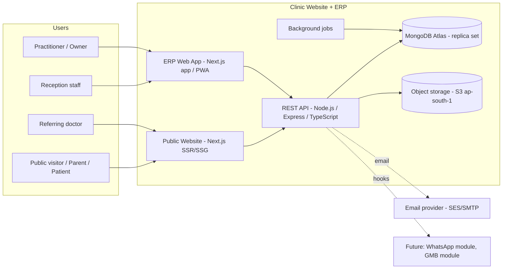
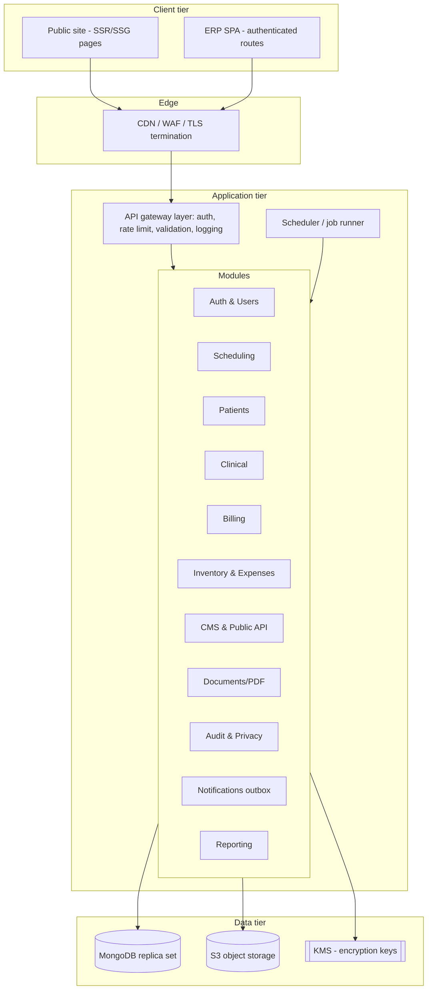
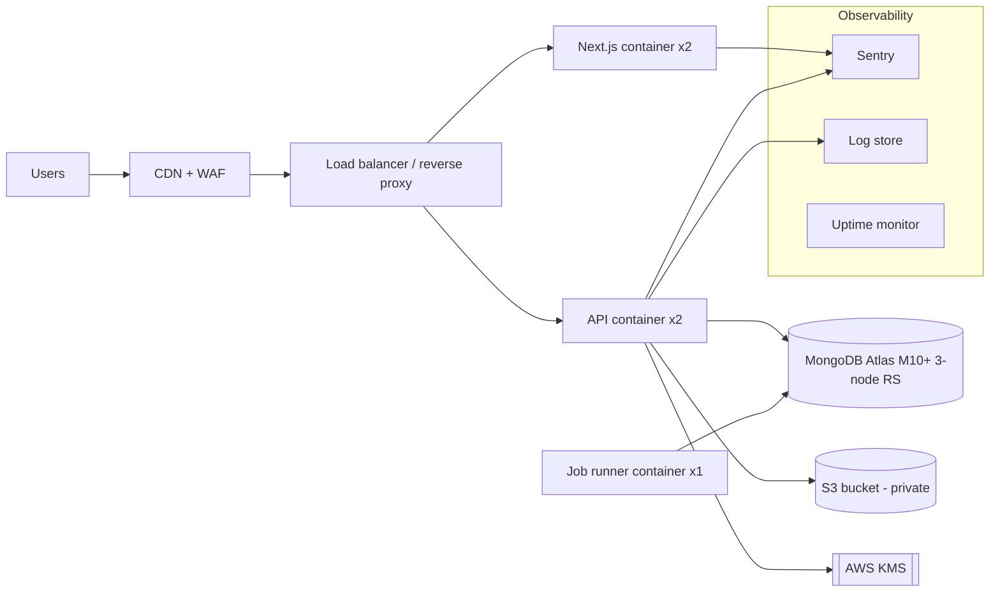
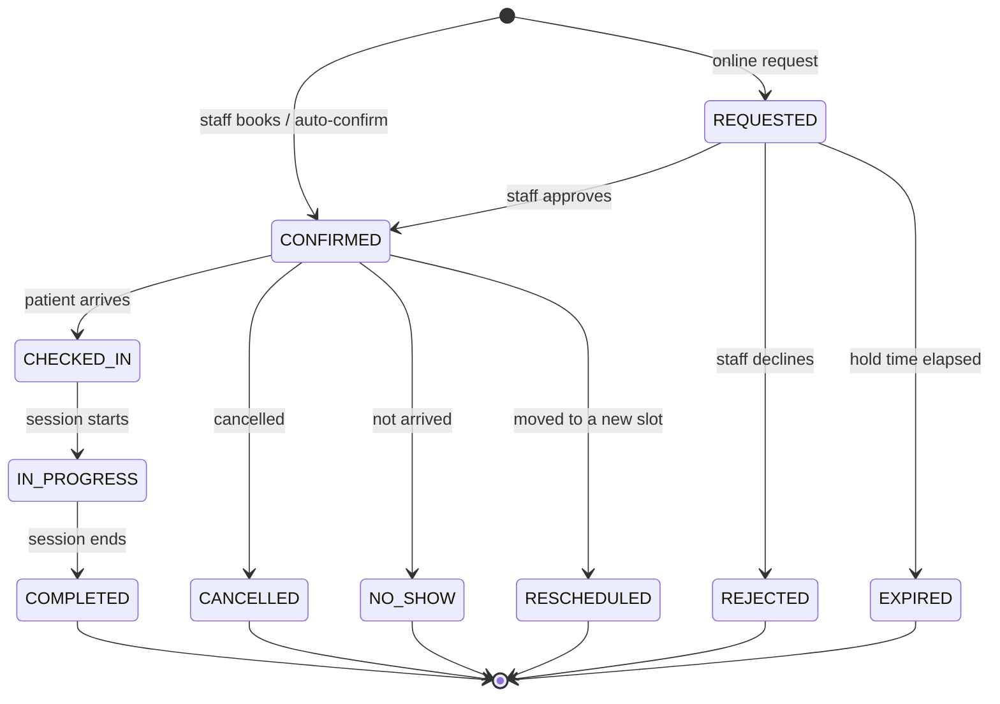
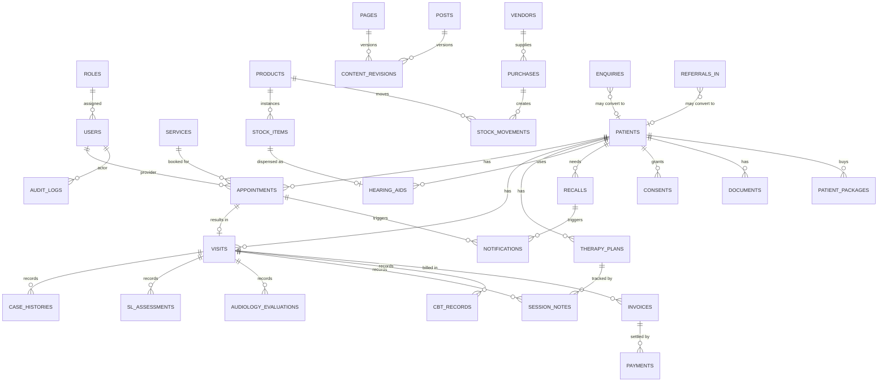
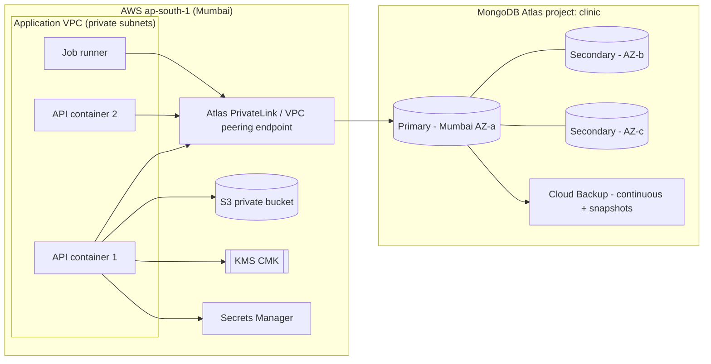

<USER_REQUEST>
# Software Requirements Specification (SRS)
## Clinic Website & Clinic ERP (Practice Management System)
### Client: Palak Paresh Gandhi, Audiology & Speech-Language Pathology Clinic, Satara, Maharashtra

| | |
|---|---|
| **Document ID** | BA-SRS-WEB-ERP-001 |
| **Version** | 1.0 (DRAFT for client and technical review) |
| **Prepared by** | Black Angler |
| **Prepared for** | Ms. Palak Paresh Gandhi |
| **Standard followed** | ISO/IEC/IEEE 29148:2018 (requirements engineering), structure influenced by IEEE 830 |
| **Related documents** | Master Services & IP Agreement; Scope Baseline v1.0; Statement of Work v1.0; Client Intake & Discovery Questionnaire |
| **Scope of this SRS** | **Public Website + Content Management + Clinic ERP** (appointments, patients, clinical records, follow-ups, billing, inventory, reporting, security). |
| **Explicitly excluded** | **Google Business Profile / local SEO operations** and **WhatsApp automation** (each has its own specification). Only neutral integration hooks are defined here (Section 4.17). |
| **Database** | **MongoDB** (Atlas, Mumbai region, replica set) accessed via Mongoose |
| **Date** | 07 October 2026 |

---

## Document control

### Revision history

| Version | Date | Author | Description |
|---|---|---|---|
| 0.1 | 07 Oct 2026 | Black Angler | Outline |
| 1.0 | 07 Oct 2026 | Black Angler | First complete draft |

### Approvals

| Role | Name | Signature | Date |
|---|---|---|---|
| Client (Product Owner) | Palak Paresh Gandhi | | |
| Black Angler Project Lead | [ ] | | |
| Black Angler Technical Lead | [ ] | | |
| Client's advocate (privacy and compliance review) | [ ] | | |

### How to read this document
- **Section 1 to 3**: what the product is, who uses it, the architecture.
- **Section 4**: every functional requirement, grouped by module, each with an ID (for example `FR-APT-012`), priority and phase.
- **Section 5 and 6**: the **complete MongoDB data model** (every collection, field, index, relationship, sample document) and **how the application connects to the database**.
- **Section 7**: REST API specification.
- **Section 8 onward**: interfaces, non-functional requirements, security, UI, business rules, testing, DevOps, risks, traceability and appendices.

---

## Table of contents

1. Introduction
2. Overall description
3. System architecture
4. Functional requirements
   - 4.1 Public website (WEB)
   - 4.2 Content management system (CMS)
   - 4.3 Authentication and session management (AUTH)
   - 4.4 Users, roles and permissions (USR)
   - 4.5 Clinic settings and configuration (SET)
   - 4.6 Service catalogue (SVC)
   - 4.7 Scheduling and appointments (APT)
   - 4.8 Patient management (PAT)
   - 4.9 Clinical records (CLN)
   - 4.10 Follow-up and recall management (REC)
   - 4.11 Reports and documents (DOC)
   - 4.12 Billing and payments (BIL)
   - 4.13 Inventory and hearing-aid stock (INV)
   - 4.14 Expenses (EXP)
   - 4.15 Dashboards and analytics (DSH)
   - 4.16 Privacy, consent, audit and compliance (PRV)
   - 4.17 Notification abstraction and integration hooks (NTF)
   - 4.18 Data import and export (IMP)
   - 4.19 Global search (SRC)
5. Data requirements: complete MongoDB design
6. Database connectivity and infrastructure
7. API specification
8. External interface requirements
9. Non-functional requirements
10. Security architecture
11. User interface requirements
12. Business rules catalogue
13. Validation rules
14. Reports catalogue
15. Testing and acceptance
16. DevOps, deployment and operations
17. Data migration and seeding
18. Assumptions, dependencies, risks and open issues
19. Traceability matrix
20. Appendices

---

# 1. Introduction

## 1.1 Purpose
This SRS defines, completely and verifiably, the functional and non-functional requirements of the **Clinic Website** and **Clinic ERP** for Ms. Palak Paresh Gandhi's speech-language pathology, audiology and counselling clinic in Satara. It is the contract between the Client and Black Angler for what will be designed, built, tested and accepted, and is the basis for estimation, development, testing, and acceptance (Scope Baseline items WS-xx, DR-xx and CB-xx map to the requirements here).

## 1.2 Product scope
The product consists of two coordinated applications backed by one MongoDB database:

1. **Public Website**: a fast, bilingual (English and Marathi), SEO-ready website that informs prospective patients, educates the public, and lets people request appointments, contact the clinic, and submit doctor referrals.
2. **Clinic ERP** (private web application, "the ERP"): a role-based system for the practitioner and reception staff to manage appointments, patients, structured clinical records for speech-language therapy, audiology and cognitive behavioural therapy (CBT), follow-ups and recalls, reports, billing, inventory (hearing aids and consumables), expenses, dashboards and compliance logs. It also includes the **CMS** to manage website content.
3. **Automated Clinical Diagnostic & Assessment Report Generator**: A specialized, high-precision clinical report generation engine embedded natively within the Clinic ERP. The software automatically compiles clinical data, executes real-time normative formula calculations (PTA1, PTA2, WRS, SNR, %SS, SSI-4, CAPE-V, GRBAS, MPT, s/z ratio, ALD-MM DQ, PHQ-9, GAD-7, FOIS, IDDSI), renders standardized dual audiogram graphs, ear outline graphics, and RCI clinical signature blocks, and produces 10 standardized clinical assessment and diagnostic reports formatted for immediate printing and digital distribution.

### In scope
- All items in Section 4.
- Single-clinic (single-tenant) deployment, with a data model prepared for a future second branch (optional `branchId`, Section 5.2).
- Responsive web UI for desktop, tablet and mobile browsers; installable as a Progressive Web App (PWA).
- English and Marathi UI for the public website; English UI for the ERP (Marathi labels for patient-facing documents and consent text; ERP UI localisation is a Could-have).

### Out of scope (this SRS)
| Item | Where specified |
|---|---|
| Google Business Profile management, local SEO operations, citations, review campaigns | Separate GMB/SEO specification |
| WhatsApp Business automation (chatbot, reminders, templates) | Separate WhatsApp automation specification |
| Native mobile apps (Android/iOS) | Not planned |
| Telemedicine video platform (a meeting-link field is stored; no built-in video) | Future |
| Online payment gateway and advance payment | Future (UPI QR display and manual payment recording are in scope) |
| Patient portal with patient login | Future (data model is prepared, Section 5.6) |
| Hospital information system, ABDM/ABHA integrations, audiometer device integration | Future |
| Insurance claims and TPA workflows | Future |
| Payroll and full accounting/GST return filing | Not in scope (export to Tally/Excel is in scope) |

### Appointment reminders (clarification)
Automated reminders are delivered through WhatsApp in the separate specification. This SRS therefore defines: (a) the **reminder schedule data** (what must be sent, to whom, when), (b) a **notification outbox** and provider-neutral interface (Section 4.17) that the WhatsApp module will plug into, and (c) **in-app and email** notifications as the baseline channels.

## 1.3 Definitions, acronyms and abbreviations

| Term | Meaning |
|---|---|
| ABR / BERA | Auditory Brainstem Response / Brainstem Evoked Response Audiometry |
| AVT | Auditory Verbal Therapy |
| AAC | Augmentative and Alternative Communication |
| BASLP | Bachelor of Audiology and Speech-Language Pathology |
| CAPD | Central Auditory Processing Disorder |
| CAPE-V | Consensus Auditory-Perceptual Evaluation of Voice |
| CBT | Cognitive Behavioural Therapy |
| CI | Cochlear implant |
| CMS | Content Management System |
| CRUD | Create, Read, Update, Delete |
| CSRF / XSS | Cross-Site Request Forgery / Cross-Site Scripting |
| DPDP Act | Digital Personal Data Protection Act, 2023 (India) |
| Data Fiduciary / Processor | As defined in the DPDP Act: the Client / Black Angler |
| EMR | Electronic Medical Record |
| ERP | Enterprise resource planning; here, the clinic practice-management system |
| FOIS | Functional Oral Intake Scale |
| GRBAS | Grade, Roughness, Breathiness, Asthenia, Strain (perceptual voice rating) |
| HNR | Harmonics-to-noise ratio |
| IDDSI | International Dysphagia Diet Standardisation Initiative (levels 0 to 7) |
| IST | Indian Standard Time (UTC+05:30) |
| JWT | JSON Web Token |
| MPT | Maximum phonation time |
| OAE | Otoacoustic emissions (TEOAE: transient evoked, DPOAE: distortion product) |
| PCC | Percentage of consonants correct |
| PHQ-9 / GAD-7 | Patient Health Questionnaire-9 / Generalised Anxiety Disorder-7 scales |
| PITR | Point-in-time recovery |
| PTA | Pure tone audiometry (also pure-tone average, disambiguated in context) |
| RBAC | Role-based access control |
| RCI | Rehabilitation Council of India |
| RPO / RTO | Recovery point objective / recovery time objective |
| SOAP | Subjective, Objective, Assessment, Plan (session note format) |
| SRT / SDS / WRS | Speech reception threshold / speech discrimination score / word recognition score |
| SSI-4 | Stuttering Severity Instrument, 4th edition |
| %SS | Percent syllables stuttered |
| THI / TFI | Tinnitus Handicap Inventory / Tinnitus Functional Index |
| TRT | Tinnitus Retraining Therapy |
| UHID | Unique Health ID (the clinic's own patient identifier) |
| UAT | User acceptance testing |
| VHI | Voice Handicap Index |

## 1.4 References

1. ISO/IEC/IEEE 29148:2018, Systems and software engineering, Life cycle processes, Requirements engineering.
2. Digital Personal Data Protection Act, 2023 and rules made under it (as in force).
3. Information Technology Act, 2000, including section 43A and the reasonable security practices rules, and section 10A (e-contracts).
4. Rehabilitation Council of India Act, 1992 (professional registration of audiologists and speech-language pathologists).
5. Consumer Protection Act, 2019 (misleading advertisements).
6. OWASP Application Security Verification Standard (ASVS) 4.0, Level 2; OWASP Top 10.
7. WCAG 2.1, Level AA (web accessibility).
8. Rights of Persons with Disabilities Act, 2016 (accessibility and dignity considerations).
9. MongoDB Manual (7.x/8.x), Mongoose documentation (8.x).
10. Master Services & IP Agreement, Scope Baseline and Statement of Work (Black Angler, 2026).

## 1.5 Document conventions

**Requirement identifiers:** `FR-<MODULE>-<NNN>` for functional, `NFR-<AREA>-<NNN>` for non-functional, `BR-<NNN>` for business rules, `DB-<NNN>` for data rules.

**Priority (MoSCoW):** **M** = Must (needed for go-live), **S** = Should (important, can follow soon after), **C** = Could (nice to have).

**Phase:** **P1** = launch release, **P2** = within 3 months after launch, **P3** = later.

**Verification method:** **T** = Test, **D** = Demonstration, **I** = Inspection, **A** = Analysis.

**Normative language:** "shall" = mandatory, "should" = recommended, "may" = optional.

**Dates and time:** stored in **UTC** as BSON `Date`; displayed in **IST**. Date-only values (date of birth) are stored as `YYYY-MM-DD` strings.

**Currency:** INR, stored as integer **paise** (1 INR = 100 paise) to avoid floating-point errors.

## 1.6 Intended audience

| Audience | Use |
|---|---|
| Client (practitioner) | Confirm that features match her needs; approve clinical fields. |
| Black Angler designers and developers | Build the system. |
| QA | Derive test cases (Section 15). |
| Client's advocate and CA | Review privacy, consent, billing and tax behaviour. |
| Future maintainers | Understand design decisions. |

---

# 2. Overall description

## 2.1 Product perspective

The product is a new, self-contained system with no legacy predecessor. It will be accessed over the internet through browsers and uses a small number of external services (email delivery, object storage, maps embedding, optional UPI QR generation) behind adapters.



## 2.2 Product functions (summary)

| Module | Summary |
|---|---|
| Public Website | Bilingual informational site: home, about, 15 service pages, blog, FAQs, testimonials, contact, map, booking request, doctor referral, self-check tools, legal pages. |
| CMS | Manage pages, blog posts, FAQs, testimonials, media, menus, SEO metadata and site settings without a developer. |
| Authentication and RBAC | Secure login, optional 2FA, roles and granular permissions, session control. |
| Scheduling | Working hours, holidays, slot engine, online booking requests, approvals, reschedule/cancel, waitlist, walk-ins, therapy series, calendar views. |
| Patients | Registration with UHID, guardian management, duplicate detection, profile, timeline, consent. |
| Clinical records | Structured case history and assessments for speech-language, audiology and CBT; therapy plans and session notes; hearing aid register; attachments. |
| Follow-up and recall | Rule-driven recall tasks (therapy review, annual audiometry, hearing aid servicing, newborn re-screen). |
| Reports and documents | PDF generation: audiology report, therapy summary, referral letter, hearing aid warranty slip, receipt, invoice, certificates. |
| Automated Clinical Reports | Automated generation of 10 standardized clinical assessment reports (OAE Screening, Pure Tone & Speech Audiological Evaluation, Voice Disorders Proforma, Fluency Disorders Proforma, Comprehensive Speech-Language Battery, CBT & Psychological Screening, Dysphagia, Hearing Aid Fitting, Therapy Progress, Discharge Summary) with single-page A4 layouts, bilateral SVG audiograms, ear indicators, RCI clinical stamps, and bilingual Devanagari output. |
| Billing | Price list, invoices, receipts, packages, discounts, payments, refunds, daily collection. |
| Inventory | Hearing aids and accessories with serial tracking, stock movements, vendors, reorder alerts. |
| Expenses | Expense capture and categorisation. |
| Dashboards | Daily operations, clinical, financial and marketing-source analytics. |
| Privacy and audit | Consent records, access logs, data subject requests, retention, break-glass access. |

## 2.3 User classes and characteristics

| User class | Description | Technical skill | Access |
|---|---|---|---|
| **Public visitor / parent / patient** | Satara and nearby residents, many using low-end Android phones, preferring Marathi, often parents of children with speech or hearing concerns, or older adults and their families. | Low | Public website only |
| **Owner / Practitioner** (`OWNER`) | Ms. Palak Gandhi. Full clinical and administrative authority. | Low to medium | Full ERP |
| **Receptionist / Front desk** (`RECEPTIONIST`) | Manages appointments, registration, billing, enquiries. No clinical details beyond what is needed. | Low to medium | Limited ERP |
| **Clinician (visiting or additional)** (`CLINICIAN`) | Optional future audiologist/SLP/psychologist working in the clinic. Access to own patients' clinical records. | Medium | Clinical + scheduling for own calendar |
| **Content editor** (`EDITOR`) | Optional person managing blog and website content. | Low | CMS only |
| **System administrator** (`ADMIN`) | Black Angler support staff. Infrastructure and configuration; **no access to clinical content** by default (Section 10). | High | Admin console, no patient data |
| **Referring doctor** | ENT, paediatrician, neurologist, school staff submitting referrals. | Low | Public referral form (no login) |

## 2.4 Operating environment

| Item | Specification |
|---|---|
| Client devices | Android 9+ (Chrome 100+), iOS 14+ (Safari 14+), Windows 10/11, macOS 12+, ChromeOS; screens 360 px width and above |
| Browsers (supported) | Latest two major versions of Chrome, Edge, Firefox, Safari, Samsung Internet |
| Server runtime | Node.js 20 LTS (or later LTS), Linux containers |
| Database | MongoDB 7.0+ (Atlas M10 or higher for production), replica set with 3 nodes, region AWS Mumbai (`ap-south-1`) |
| Object storage | Amazon S3 (`ap-south-1`) with server-side encryption (SSE-KMS) |
| Network | HTTPS/TLS 1.2+ only; the clinic needs 2 Mbps or better broadband plus a mobile data fallback |

## 2.5 Design and implementation constraints

| ID | Constraint |
|---|---|
| C-01 | **MongoDB** is the system of record. No other primary database. |
| C-02 | All patient and personal data shall be stored and processed in **India** (Mumbai region) unless the Client approves otherwise in writing. |
| C-03 | The system shall comply with the DPDP Act, 2023 (consent, purpose limitation, security safeguards, breach notification, data principal rights). |
| C-04 | The public website shall not publish any professional claim or title (RCI number, "Dr.", CBT) unless flagged **verified** in settings (Section 4.5, BR-041). |
| C-05 | Sensitive CBT/mental-health records shall be encrypted at field level and visible only to users with explicit permission. |
| C-06 | The UI shall be usable by non-technical staff and with older adults' needs in mind: large touch targets (min 44x44 px), plain language, Marathi availability. |
| C-07 | Aadhaar numbers shall **not** be collected or stored. |
| C-08 | Money amounts shall be stored in integer paise. |
| C-09 | The code shall be TypeScript end to end, with automated tests and CI. |
| C-10 | Custom code ownership and Background IP boundaries follow the MSA. |
| C-11 | Open-source dependencies shall have licences permitting commercial closed-source use (MIT, Apache-2.0, BSD, ISC); copyleft (GPL/AGPL) libraries are not allowed in the shipped application unless approved. |

## 2.6 Assumptions and dependencies

| ID | Assumption / dependency |
|---|---|
| A-01 | Clinic is single-location, one primary practitioner, 1 to 2 reception/support staff at launch. |
| A-02 | Expected load: up to 40 appointments/day, 100 patients/month new, 10 concurrent ERP users, 1,000 website visits/day at launch (design headroom 20x). |
| A-03 | The Client provides clinical field lists, sample report formats and approves all clinical content (Questionnaire Q11). |
| A-04 | A domain, hosting accounts and email sender identity are available in the Client's name. |
| A-05 | Reliable broadband in the clinic. Offline-first operation is not required; transient offline tolerance (draft saving) is a Should. |
| A-06 | WhatsApp and GMB specifications will integrate through the hooks in Section 4.17 and the public APIs in Section 7. |
| A-07 | Legal text (privacy notice, consent forms, disclaimers) is approved by the Client's advocate; the SRS provides structures, not legal wording. |

## 2.7 Apportioning of requirements (release plan)

| Release | Contents |
|---|---|
| **P1 Launch** | Website, CMS, auth/RBAC, settings, service catalogue, scheduling, patients, clinical records (all three service lines), recalls, PDF reports, billing and receipts, dashboards (core), audit, backups. |
| **P2 (up to 3 months)** | Inventory with serial tracking, expenses, advanced analytics, packages, waitlist automation, data import tools, PWA refinements. |
| **P3 (later)** | Patient portal, online payments, multi-branch, ERP Marathi UI, e-prescription-style home programme sharing, integrations. |

---

# 3. System architecture

## 3.1 Architectural goals
Simplicity for a small clinic; security of health data; fast public pages on low-end devices; clean modular boundaries so WhatsApp, GMB, payments and a patient portal can be added without rewriting; a data model that is auditable and migration-friendly.

## 3.2 Logical architecture



## 3.3 Technology stack (baseline decisions)

| Layer | Choice | Rationale |
|---|---|---|
| Public website and ERP front end | **Next.js (React, App Router) with TypeScript**; `next-intl` for English/Marathi; Tailwind CSS; shadcn/ui components; TanStack Query; React Hook Form + Zod | SSR/SSG for SEO and speed; one codebase; accessible components |
| Rich text (CMS) | TipTap editor, sanitised HTML output | Safe, bilingual editing |
| Charts | Recharts (audiogram drawn with SVG component) | Open licence, light weight |
| API | **Node.js 20 + Express + TypeScript**; Zod request validation; OpenAPI 3.1 generated docs | Mature, simple to maintain |
| Database | **MongoDB 7+ on Atlas (Mumbai)** with **Mongoose 8** ODM | Document model fits clinical templates; flexible per-service structures |
| Authentication | Email/phone + password (Argon2id), JWT access tokens (15 min) + rotating refresh tokens (httpOnly, Secure, SameSite=Strict cookie), TOTP 2FA | Strong, standards-based |
| Background jobs | `agenda` (MongoDB-backed) or `node-cron` + outbox pattern | No extra infrastructure (no Redis required at this scale) |
| File storage | S3 with pre-signed URLs, SSE-KMS | Secure uploads of reports and audiogram images |
| PDF generation | Headless Chromium (Playwright) rendering HTML templates, Noto Sans and Noto Sans Devanagari fonts | Accurate Marathi text rendering |
| Email | Amazon SES (ap-south-1) or SMTP provider via adapter | Transactional email |
| Logging and monitoring | Pino structured logs; Sentry (errors); uptime monitor; Atlas alerts | Observability |
| CI/CD | GitHub Actions: lint, type-check, unit/integration tests, security scan, build, deploy | Quality gates |
| Containers and hosting | Docker images; AWS (EC2/ECS or Lightsail) in Mumbai behind a CDN/WAF (Cloudflare or CloudFront) | Data residency, performance |

*Open decisions are listed in Section 18.4.*

## 3.4 Deployment architecture



| Environment | Purpose | Data |
|---|---|---|
| `local` | Developer machines (Docker Compose with MongoDB replica set) | Synthetic |
| `dev` | Integration testing | Synthetic |
| `staging` | UAT with the Client (production-like) | Synthetic or anonymised only; **never real patient data** |
| `production` | Live | Real data |

## 3.5 Code organisation (monorepo)

```
clinic-platform/
  apps/
    web/                 # Next.js: public site + ERP UI (route groups: (public), (erp))
    api/                 # Express API
      src/
        config/          # env, logger, db connection
        modules/
          auth/ users/ settings/ services/ scheduling/ patients/
          clinical/ followups/ documents/ billing/ inventory/ expenses/
          cms/ publicapi/ reports/ privacy/ notifications/ search/
        common/          # middleware, errors, utils, crypto, pagination
        jobs/            # scheduled jobs
        main.ts
  packages/
    shared/              # Zod schemas, types, enums, constants used by web and api
    ui/                  # shared UI components
    config/              # eslint, tsconfig, prettier
  infra/                 # Dockerfiles, compose, IaC, scripts
  docs/                  # OpenAPI, ADRs, this SRS
```

Each API module contains: `routes.ts` (HTTP), `controller.ts`, `service.ts` (business logic), `repository.ts` (database access), `model.ts` (Mongoose schema), `schema.ts` (Zod DTOs), `permissions.ts`, `tests/`.

## 3.6 Key architectural decisions (ADR summary)

| # | Decision | Reason |
|---|---|---|
| ADR-01 | Modular monolith, not microservices | Small team, small clinic, lowest operational burden; modules have clean boundaries for later extraction. |
| ADR-02 | MongoDB with **embedding for owned, bounded data** and **referencing for shared or growing data** | Fast reads of clinical records; avoids unbounded documents (Section 5.3). |
| ADR-03 | **Multikey unique index** (`slotKeys`) to prevent double booking | Database-enforced integrity under concurrency. |
| ADR-04 | Application-level envelope encryption (AES-256-GCM, KMS-wrapped data keys) for CBT and selected sensitive fields | Works on any MongoDB tier; keeps keys outside the database. |
| ADR-05 | Append-only `auditLogs` collection with hash chaining | Tamper evidence for access to patient data. |
| ADR-06 | Money as integer paise | Avoid rounding errors. |
| ADR-07 | Outbox pattern for notifications | Reliable delivery; plug-in channels (email now, WhatsApp later). |
| ADR-08 | Soft delete with `deletedAt` for clinical and financial data; hard delete only through the privacy erasure workflow | Medico-legal retention and auditability. |
| ADR-09 | Public API separate from ERP API (`/public/v1` and `/api/v1`) with different auth, rate limits and response shaping | Prevent accidental exposure of private data. |
| ADR-10 | Server-side rendering and static generation for public pages | SEO and performance on low-end devices. |

---

# 4. Functional requirements

Each table lists: **ID | Requirement | Priority | Phase**. "The system" means Website + ERP + API as applicable.

---

## 4.1 Public website (WEB)

### 4.1.1 General
| ID | Requirement | Pri | Ph |
|---|---|---|---|
| FR-WEB-001 | The website shall be available in **English** and **Marathi**, with a language switcher visible on every page, persisted in a cookie and reflected in the URL (`/en/...`, `/mr/...`). | M | P1 |
| FR-WEB-002 | Every public page shall be rendered server-side or statically generated so that the full text content is present in the initial HTML. | M | P1 |
| FR-WEB-003 | The site shall be **mobile-first and responsive** from 360 px to 1920 px width, with no horizontal scrolling. | M | P1 |
| FR-WEB-004 | The site shall meet Core Web Vitals targets on a mid-range Android phone over 4G: LCP <= 2.5 s, INP <= 200 ms, CLS <= 0.1 (75th percentile in lab testing). | M | P1 |
| FR-WEB-005 | The site shall support an **"Opening Soon" mode** (configurable in settings) that shows a countdown/opening date, a waiting-list sign-up and a contact form, and hides online booking until switched off. | M | P1 |
| FR-WEB-006 | A persistent header shall provide navigation, a click-to-call button, a language switcher, and a prominent "Book Appointment" call to action. | M | P1 |
| FR-WEB-007 | A floating **contact button** shall provide click-to-call and a link to open a chat in the Client's configured messaging URL (the URL is a configurable setting; automation is out of scope). | S | P1 |
| FR-WEB-008 | The footer shall show clinic name, address, phone, email, working hours, quick links, social links, legal links, and the website credit line (removable by settings). | M | P1 |
| FR-WEB-009 | A **cookie/consent banner** shall appear on first visit; analytics scripts shall load only after consent is given. | M | P1 |
| FR-WEB-010 | The site shall display a **medical disclaimer** on service and educational pages stating that content is informational and not a substitute for professional assessment. | M | P1 |
| FR-WEB-011 | The site shall show a styled, bilingual **404** and **500** page with navigation and contact information. | M | P1 |
| FR-WEB-012 | The site shall be installable as a PWA (manifest, icons, service worker for static assets and an offline fallback page). | C | P2 |

### 4.1.2 Pages and content blocks
| ID | Requirement | Pri | Ph |
|---|---|---|---|
| FR-WEB-020 | **Home page**: hero with clinic name and value statement, primary actions (Book, Call), service category cards (Speech & Language, Audiology, CBT), "Why choose us", about summary, latest articles, FAQs preview, testimonials (if available and consented), location and hours with map, final call to action. | M | P1 |
| FR-WEB-021 | **About page**: practitioner profile (photo, qualifications as verified, registration number where verified, languages spoken, approach, experience summary drawn from approved CV content), clinic philosophy, facilities (photo gallery). | M | P1 |
| FR-WEB-022 | **Services overview page** listing all services grouped in the three categories with short descriptions, icons and links to detail pages. | M | P1 |
| FR-WEB-023 | **Service detail pages** (one per service in the catalogue, 15 at launch): what it is, who it helps, signs to look for, what happens in the first visit, duration, preparation, FAQs, related articles, booking button, disclaimer. Content is managed in the CMS and linked to the `services` collection. | M | P1 |
| FR-WEB-024 | **Book Appointment page**: guided request form (see 4.1.3). | M | P1 |
| FR-WEB-025 | **Resources/Blog**: paginated list with category and tag filters, search, and article pages with reading time, author, published date, last reviewed date, related articles, share links, and structured data. | M | P1 |
| FR-WEB-026 | **FAQ page** grouped by category with accordion UI and FAQ structured data. | M | P1 |
| FR-WEB-027 | **Testimonials page/section** showing only testimonials with `consent.verified = true`; name may be initials only. | S | P1 |
| FR-WEB-028 | **Contact page**: address, phone, email, working hours, embedded map (static map image with a link, or a consent-gated interactive map), contact form, directions, parking and accessibility notes. | M | P1 |
| FR-WEB-029 | **For Doctors/Referral page** with a referral submission form (see 4.1.5). | M | P1 |
| FR-WEB-030 | **Self-check pages** (see 4.1.6). | S | P1 |
| FR-WEB-031 | **Legal pages**: Privacy Policy, Terms of Use, Medical Disclaimer, Cookie Policy, Accessibility Statement. Text editable in the CMS. | M | P1 |
| FR-WEB-032 | **Gallery** of clinic photographs (lazy-loaded, alt text mandatory). | C | P1 |
| FR-WEB-033 | **Awareness/Events page** for screening camps and awareness days (list of upcoming and past events). | C | P2 |
| FR-WEB-034 | **Downloadable resources** (parent guides as PDF) with download counts. | C | P2 |
| FR-WEB-035 | **Site search** across pages, services and articles in the current language. | S | P2 |

### 4.1.3 Appointment request (public booking)
| ID | Requirement | Pri | Ph |
|---|---|---|---|
| FR-WEB-040 | The booking form shall be a stepper: (1) choose service or "Not sure, help me choose", (2) patient details, (3) preferred date and time, (4) review and submit. | M | P1 |
| FR-WEB-041 | Step 1 shall offer service categories and service names in the selected language, with the option "I need a hearing test/speech assessment, I'm not sure" mapping to the default new-patient assessment service. | M | P1 |
| FR-WEB-042 | Step 2 shall capture: booking for (self / child / other family member), patient full name, age or date of birth, sex, parent/guardian name (if minor), mobile number (10-digit Indian mobile, validated), optional email, locality/village, **reason or concern** (free text up to 500 characters with common-concern chips), referral source (dropdown), preferred language for communication, and whether the patient is new or existing. | M | P1 |
| FR-WEB-043 | Step 3 shall show **available slots** from the scheduling engine for the chosen service for the next [30] days (window configurable) grouped by day, with morning/afternoon/evening filters, and no slots that violate booking rules (minimum notice, closed days, holidays). | M | P1 |
| FR-WEB-044 | The request shall include a consent checkbox for contact and data use, linking to the Privacy Policy; submission shall be impossible without it. | M | P1 |
| FR-WEB-045 | On submit, the system shall create an appointment with status `REQUESTED` (or `CONFIRMED` when auto-confirm is enabled and the slot is held), reserve the slot for the configured hold period, generate a human-friendly **booking reference** (for example `BK-7K3QH2`), and show a confirmation screen with the details and clinic contact. | M | P1 |
| FR-WEB-046 | A **self-service manage link** shall be generated (token-based, stored as a hash) letting the requester view, reschedule or cancel the request according to policy without logging in. | S | P1 |
| FR-WEB-047 | Honeypot field, rate limiting and CAPTCHA fallback (privacy-friendly, such as Cloudflare Turnstile or hCaptcha) shall protect against spam; limit [5] requests per IP per hour and [3] open requests per mobile number. | M | P1 |
| FR-WEB-048 | If no slot is suitable, the user shall be able to submit a **callback request** with a preferred time window. | S | P1 |
| FR-WEB-049 | A booking confirmation email shall be sent if an email address is given; other channels attach through the notification outbox (Section 4.17). | S | P1 |
| FR-WEB-050 | The booking form shall save progress in the browser session so that accidental refresh does not lose entered data (excluding sensitive free text beyond the session). | C | P2 |

### 4.1.4 Contact form and enquiries
| ID | Requirement | Pri | Ph |
|---|---|---|---|
| FR-WEB-060 | The contact form shall capture name, mobile, email (optional), topic (dropdown), message (up to 1,000 characters), consent, and create an `enquiries` record visible in the ERP inbox. | M | P1 |
| FR-WEB-061 | The staff shall be notified in-app and by email of new enquiries. | M | P1 |
| FR-WEB-062 | The auto-acknowledgement shall tell the sender the expected response time and not request clinical details. | S | P1 |

### 4.1.5 Doctor referral form
| ID | Requirement | Pri | Ph |
|---|---|---|---|
| FR-WEB-070 | The referral form shall capture referrer name, designation, hospital/clinic/school, registration number (optional), phone, email, patient name, age/sex, guardian contact, reason for referral, service requested, urgency, and attachments (PDF/JPG up to 5 MB each, max 3). | M | P1 |
| FR-WEB-071 | Submissions shall create a `referrals` record, flagged for staff review, and may be converted to a patient and appointment in the ERP. | M | P1 |
| FR-WEB-072 | Attachments shall be virus-scanned and stored privately; they are never publicly accessible. | M | P1 |

### 4.1.6 Self-check tools (screening checklists)
| ID | Requirement | Pri | Ph |
|---|---|---|---|
| FR-WEB-080 | The site shall provide at least three checklists: **Child speech and language milestones**, **Hearing concern checklist**, **Voice health checklist**, each with 8 to 15 yes/no/sometimes questions, defined in the CMS. | S | P1 |
| FR-WEB-081 | Results shall show a **non-diagnostic** guidance message (for example "consider an evaluation") with the disclaimer, never a medical diagnosis. | M | P1 |
| FR-WEB-082 | Responses may be stored anonymously (no personal data) for aggregate statistics; contact details are stored only if the user chooses "Contact me" and consents. | S | P1 |
| FR-WEB-083 | Checklist definitions shall be versioned; results shall record the version used. | S | P1 |

### 4.1.7 SEO and technical website requirements (on-site only)
| ID | Requirement | Pri | Ph |
|---|---|---|---|
| FR-WEB-090 | Every page shall have editable `title`, `meta description`, canonical URL, Open Graph and Twitter card tags, with per-language values. | M | P1 |
| FR-WEB-091 | The site shall generate `sitemap.xml` (with language alternates through `hreflang`) and `robots.txt`; ERP and admin routes shall be excluded and `noindex`. | M | P1 |
| FR-WEB-092 | JSON-LD structured data: `MedicalBusiness` / `LocalBusiness` (name, address, phone, hours), `Physician`/`Person` for the practitioner (only verified claims), `MedicalWebPage`, `FAQPage`, `Article`/`BlogPosting`, `BreadcrumbList`. | M | P1 |
| FR-WEB-093 | Clean, readable, language-specific URL slugs (for example `/en/services/hearing-aid-fitting`, `/mr/...`); automatic 301 redirects when a slug changes (redirect table in the CMS). | M | P1 |
| FR-WEB-094 | Images shall be served in modern formats (AVIF/WebP) with responsive sizes, `loading="lazy"`, explicit dimensions and mandatory alt text. | M | P1 |
| FR-WEB-095 | Fonts: Noto Sans and Noto Sans Devanagari (self-hosted subsets), `font-display: swap`. | M | P1 |
| FR-WEB-096 | The site shall expose consistent **NAP** (name, address, phone) values from the single settings source on all pages and in structured data. | M | P1 |
| FR-WEB-097 | HTTP security headers: HSTS, CSP, X-Content-Type-Options, Referrer-Policy, Permissions-Policy, frame-ancestors none. | M | P1 |
| FR-WEB-098 | Analytics: a privacy-respecting analytics tool (for example Plausible/Umami self-hosted, or GA4 with consent) with events for booking started/submitted, call click, referral submitted. | S | P1 |
| FR-WEB-099 | Accessibility: WCAG 2.1 AA, keyboard navigation, visible focus, sufficient contrast, labels, skip link, `lang` attributes, reduced-motion support. | M | P1 |

---

## 4.2 Content management system (CMS)

| ID | Requirement | Pri | Ph |
|---|---|---|---|
| FR-CMS-001 | Authorised users shall create, edit, preview, schedule, publish, unpublish and archive **pages**, **posts**, **FAQs**, **testimonials**, **events**, **service descriptions** and **checklist definitions**. | M | P1 |
| FR-CMS-002 | Each content item shall have **per-language fields** (`en`, `mr`) with a status per language (draft, in review, published); a missing translation falls back to English with a banner. | M | P1 |
| FR-CMS-003 | Content statuses: `DRAFT`, `IN_REVIEW`, `SCHEDULED`, `PUBLISHED`, `ARCHIVED`. Publishing requires the permission `cms.publish`. | M | P1 |
| FR-CMS-004 | A **rich text editor** (headings, lists, links, tables, images, callouts, video embed by URL allow-list) with sanitised output. | M | P1 |
| FR-CMS-005 | **Media library**: upload images (JPG/PNG/WebP/SVG-sanitised, max 10 MB) and PDFs (max 20 MB); automatic resizing and format conversion; required alt text per language; usage tracking; delete protection if referenced. | M | P1 |
| FR-CMS-006 | **Revision history**: each save creates a revision (who, when, diff summary); restore any previous revision. | S | P1 |
| FR-CMS-007 | **Preview** of unpublished content on a signed, expiring URL. | S | P1 |
| FR-CMS-008 | **Medical review flag**: content tagged as clinical must carry `reviewedBy` (the practitioner) and `lastReviewedAt`; unreviewed clinical content cannot be published. | M | P1 |
| FR-CMS-009 | **Navigation menus** (header, footer) manageable with drag-and-drop ordering and per-language labels. | S | P1 |
| FR-CMS-010 | **SEO fields** per item (title, description, canonical, OG image, noindex) with length hints and preview. | M | P1 |
| FR-CMS-011 | **Redirect manager** for old to new URLs. | S | P1 |
| FR-CMS-012 | **Site settings**: clinic identity, NAP, hours, social links, opening-soon mode, analytics IDs, default OG image, footer text, announcement banner. | M | P1 |
| FR-CMS-013 | **Announcement banner** with start and end date (for holiday closures, camps). | S | P1 |
| FR-CMS-014 | **Blocks/sections** approach: pages are built from predefined, validated blocks (hero, text, image+text, cards, FAQ, CTA, gallery, testimonial slider, steps, map, video) to keep design consistent. | S | P1 |
| FR-CMS-015 | **Enquiry inbox**: list, filter, assign, mark responded, add internal notes; export CSV. | M | P1 |
| FR-CMS-016 | **Referral inbox** with conversion to patient/appointment. | M | P1 |
| FR-CMS-017 | **Newsletter/waiting-list subscribers** list with consent timestamp and unsubscribe; export CSV. | S | P1 |
| FR-CMS-018 | **Content calendar** view of scheduled posts. | C | P2 |
| FR-CMS-019 | **Translation helper**: side-by-side English and Marathi editing; a "needs translation" filter. | S | P1 |
| FR-CMS-020 | All CMS actions shall be written to the audit log. | M | P1 |

---

## 4.3 Authentication and session management (AUTH)

| ID | Requirement | Pri | Ph |
|---|---|---|---|
| FR-AUTH-001 | Users shall log in with **email or mobile number** and a password. | M | P1 |
| FR-AUTH-002 | Passwords shall be hashed with **Argon2id** (memory >= 19 MiB, iterations >= 2, parallelism 1) with a per-user salt and server-side pepper from the secrets manager. | M | P1 |
| FR-AUTH-003 | Password policy: minimum 12 characters, no top-10,000 common passwords, no reuse of the last 5, compromised-password check (k-anonymity range lookup) when online. | M | P1 |
| FR-AUTH-004 | **Two-factor authentication** (TOTP, RFC 6238) shall be mandatory for `OWNER` and `ADMIN` and optional for others; 10 single-use recovery codes are generated at enrolment. | M | P1 |
| FR-AUTH-005 | Access tokens (JWT, 15 minutes) and refresh tokens (opaque, 7 days idle / 30 days absolute) shall be issued; refresh tokens rotate on use with **reuse detection** (reuse revokes the whole token family). | M | P1 |
| FR-AUTH-006 | Tokens shall be delivered in **httpOnly, Secure, SameSite=Strict** cookies; a CSRF double-submit token is required for state-changing requests. | M | P1 |
| FR-AUTH-007 | **Account lockout**: after 5 failed attempts within 15 minutes the account is locked for 15 minutes, with exponential back-off, and the owner is notified of repeated lockouts. | M | P1 |
| FR-AUTH-008 | **Password reset** by emailed single-use link (valid 30 minutes) after identity verification; reset invalidates all sessions. | M | P1 |
| FR-AUTH-009 | **Session management**: list active sessions with device, browser, IP (truncated), last used; revoke any or all. | S | P1 |
| FR-AUTH-010 | **Idle timeout**: ERP locks after [15] minutes of inactivity (configurable) and requires re-authentication; unsaved drafts are preserved locally and encrypted. | M | P1 |
| FR-AUTH-011 | **Login notifications** for new device sign-in to the user's email. | S | P1 |
| FR-AUTH-012 | **IP/time restrictions** (optional setting): allow-list for the `OWNER` role. | C | P2 |
| FR-AUTH-013 | **Re-authentication (step-up)** is required for high-risk actions: export of patient data, user management, deleting records, viewing CBT notes after a lock, changing 2FA. | M | P1 |
| FR-AUTH-014 | All authentication events (success, failure, lockout, reset, 2FA changes) shall be logged to the audit log with IP and user agent. | M | P1 |
| FR-AUTH-015 | The public API shall not use these sessions; it uses CSRF-protected, rate-limited, anonymous endpoints (Section 7.3). | M | P1 |

---

## 4.4 Users, roles and permissions (USR)

| ID | Requirement | Pri | Ph |
|---|---|---|---|
| FR-USR-001 | `OWNER` shall be able to create, edit, deactivate and delete (soft) users and assign roles. | M | P1 |
| FR-USR-002 | Roles: `OWNER`, `RECEPTIONIST`, `CLINICIAN`, `EDITOR`, `ADMIN`. Custom roles with a custom permission set shall be possible (P2). | M | P1 |
| FR-USR-003 | Access shall be controlled by **permissions** of the form `resource.action` (for example `patient.read`, `clinical.write`, `cbt.read`, `billing.refund`). A role is a named set of permissions; user-level overrides are allowed with an audit entry. | M | P1 |
| FR-USR-004 | The default permission matrix shall be as in Appendix 20.3. | M | P1 |
| FR-USR-005 | **Clinical data scoping**: `CLINICIAN` sees only patients with whom they have an appointment or an explicit assignment; `OWNER` sees all. | S | P2 |
| FR-USR-006 | **CBT permission** (`cbt.read`, `cbt.write`) shall be separate and granted by default only to `OWNER`. | M | P1 |
| FR-USR-007 | User profile: name, email, mobile, photo, designation, qualifications, **RCI registration number** (with verified flag), signature image (for reports), languages, working-hours template, calendar colour. | M | P1 |
| FR-USR-008 | Deactivated users cannot log in but their historical records and audit entries remain attributed. | M | P1 |
| FR-USR-009 | The system shall prevent removal or demotion of the last active `OWNER`. | M | P1 |
| FR-USR-010 | Admin (Black Angler) accounts shall have **no clinical read permissions**; support access to patient data requires a time-boxed **break-glass** grant by `OWNER` (Section 4.16). | M | P1 |

---

## 4.5 Clinic settings and configuration (SET)

| ID | Requirement | Pri | Ph |
|---|---|---|---|
| FR-SET-001 | **Clinic profile**: legal/trade name, tagline, address (structured), phone numbers, email, GSTIN (optional), PAN (optional, masked in UI), registration numbers (clinical establishment, shop act), logo, letterhead, signature, stamp image. | M | P1 |
| FR-SET-002 | **Credential verification flags**: `rciVerified`, `cbtQualificationVerified`, `titlePermitted` (for "Dr."), each requiring an uploaded proof and the owner's confirmation; controls what the website may display (BR-041). | M | P1 |
| FR-SET-003 | **Working schedule**: weekly hours per provider with multiple sessions per day, breaks, and slot granularity (5, 10, 15, 20 or 30 minutes; default 15). | M | P1 |
| FR-SET-004 | **Holidays and closures**: date ranges with reason, full or partial day, applying to all or specific providers; import of the Maharashtra holiday list as a template. | M | P1 |
| FR-SET-005 | **Booking policy**: minimum notice (default 2 hours), maximum advance (default 30 days), hold time for requested slots (default 24 hours), auto-confirm on/off (global and per service), cancellation window (default 4 hours), reschedule limit (default 2), same-day booking on/off, daily cap per service. | M | P1 |
| FR-SET-006 | **Numbering schemes**: UHID prefix and format, invoice and receipt numbering with financial-year reset (April to March), booking reference format. | M | P1 |
| FR-SET-007 | **Tax settings**: default tax treatment per item type (exempt, 0%, 5%, 12%, 18%, 28%), HSN/SAC codes, display of GST on invoices, rounding. Rates are configuration, not hard-coded. | M | P1 |
| FR-SET-008 | **Payment settings**: accepted modes, UPI ID and QR for display, bank details for invoices. | M | P1 |
| FR-SET-009 | **Notification settings**: email sender identity, in-app notification preferences, quiet hours; channel adapters configuration for future modules. | S | P1 |
| FR-SET-010 | **Retention settings** (read-only defaults with owner override within legal limits): clinical records 7 years from last visit (adults), until age 21 or 7 years (children, whichever is later); billing 8 years; audit logs 7 years. | M | P1 |
| FR-SET-011 | **Document templates**: header/footer, disclaimers, sign-off text for reports; bilingual. | M | P1 |
| FR-SET-012 | **Feature toggles**: inventory, expenses, packages, CBT module, online booking, waitlist, referral inbox. | S | P1 |
| FR-SET-013 | All setting changes shall be audited with before/after values. | M | P1 |
| FR-SET-014 | **Lookup lists** (referral sources, cancellation reasons, expense categories, document types, languages, relations, tags) editable by `OWNER`. | S | P1 |

---

## 4.6 Service catalogue (SVC)

| ID | Requirement | Pri | Ph |
|---|---|---|---|
| FR-SVC-001 | The system shall maintain a catalogue of services with: code, category (`SPEECH_LANGUAGE`, `AUDIOLOGY`, `CBT`, `OTHER`), names (en, mr), descriptions, default duration, buffer time, whether it is bookable online, new/follow-up variants, price, tax treatment, HSN/SAC, required clinical template, active flag, display order, and **launch status** (`AVAILABLE`, `COMING_SOON`, `HIDDEN`). | M | P1 |
| FR-SVC-002 | The catalogue shall be seeded with the 15 services in Appendix 20.1 and be editable. | M | P1 |
| FR-SVC-003 | Each service shall be linked to a **clinical template key** (for example `AUDIO_PTA`, `SL_FLUENCY`) that determines which record form opens. | M | P1 |
| FR-SVC-004 | **Service variants**: for example "Initial assessment" (60 min), "Therapy session" (45 min), "Review" (30 min); each variant has its own duration and price. | M | P1 |
| FR-SVC-005 | A service with `COMING_SOON` status is displayed on the website but cannot be booked. | M | P1 |
| FR-SVC-006 | **Provider eligibility**: which providers can deliver which services. | S | P1 |
| FR-SVC-007 | **Packages**: bundles (for example 10 therapy sessions) with price, validity days and included services; sold via billing and consumed by appointments. | S | P2 |
| FR-SVC-008 | The CBT service shall be bookable only if `cbtQualificationVerified` is true (BR-042). | M | P1 |

---

## 4.7 Scheduling and appointments (APT)

### 4.7.1 Appointment lifecycle



`RESCHEDULED` closes the old appointment and creates a new `CONFIRMED` one linked through `rescheduledFromId`.

### 4.7.2 Requirements
| ID | Requirement | Pri | Ph |
|---|---|---|---|
| FR-APT-001 | The system shall compute **available slots** for a provider, service variant and date range from: weekly schedule, holidays, existing active appointments (including buffers), blocked time, booking policy, and service duration, at the configured granularity. | M | P1 |
| FR-APT-002 | **Double booking shall be impossible**: each active appointment occupies a set of `slotKeys` (one per granularity unit); a **partial unique multikey index** on `(providerId, slotKeys)` for active statuses rejects overlaps atomically (Section 5.5.12). | M | P1 |
| FR-APT-003 | Staff shall create an appointment by selecting patient (search or create), service variant, provider, date and time, mode (clinic/online/home), and notes. | M | P1 |
| FR-APT-004 | **Calendar views**: day, week, month and agenda list; per provider, colour-coded by service category and status; drag-and-drop rescheduling with validation; "now" indicator; print view. | M | P1 |
| FR-APT-005 | **Online requests** appear in a "Pending requests" queue with age indicators; staff can approve (optionally adjust slot), decline with reason, or convert after phoning the patient. | M | P1 |
| FR-APT-006 | A held slot for a `REQUESTED` appointment shall expire after the hold period (default 24 h) via a scheduled job, releasing the slot and notifying staff. | M | P1 |
| FR-APT-007 | **New vs existing patient**: online requests from unknown people create a **prospect** (embedded in the appointment); upon approval the staff either links an existing patient (duplicate match assistant) or creates a new one in one step. | M | P1 |
| FR-APT-008 | **Check-in**: front desk marks arrival; a **token number** is generated per day per provider; the dashboard shows a live waiting queue. | M | P1 |
| FR-APT-009 | **Start/complete session**: clinician starts the session (opens the clinical record linked to the appointment) and completes it, which creates or updates the **visit** and may trigger billing and recall suggestions. | M | P1 |
| FR-APT-010 | **Cancellation**: with reason (patient request, doctor unavailable, illness, other), who cancelled, and a flag whether it was within the policy window; late cancellations and no-shows are counted on the patient profile. | M | P1 |
| FR-APT-011 | **Reschedule** keeps history; limit per policy; staff may override with a reason. | M | P1 |
| FR-APT-012 | **No-show** marking after the appointment end plus a grace period (default 15 minutes), manual or automatic via job (configurable). | M | P1 |
| FR-APT-013 | **Walk-in** registration creates a `CONFIRMED` + `CHECKED_IN` appointment in the next available slot, or an off-slot "overbook" with permission `appointment.overbook`. | M | P1 |
| FR-APT-014 | **Recurring therapy series**: create N sessions (for example 2 per week for 8 weeks) at a fixed weekday/time; conflicts are listed and resolved before saving; the series can be edited or cancelled as a group or single instances. | S | P1 |
| FR-APT-015 | **Blocked time** (meetings, equipment calibration, school visits) as non-patient events with recurrence. | M | P1 |
| FR-APT-016 | **Waitlist**: patients can be added for a service and preferred times; when a slot frees up the system suggests matching waitlist entries (manual offer, automated offers in the future WhatsApp module). | S | P2 |
| FR-APT-017 | **Home visit and online appointment** modes: address for home visits; meeting link and instructions for online sessions; travel time buffer for home visits. | S | P1 |
| FR-APT-018 | **Group sessions** (for example parent training, group therapy) with capacity and enrolled patient list. | C | P3 |
| FR-APT-019 | **Reminder schedule**: for each confirmed appointment, the system shall create `notifications` outbox items (Section 4.17) according to settings (default 24 h and 2 h before; channel list per patient preference). Sending is performed by the available channel adapters (in-app and email now; WhatsApp later). | M | P1 |
| FR-APT-020 | **Patient appointment history** on the profile with status, service, provider, and filters. | M | P1 |
| FR-APT-021 | **Conflict warnings**: patient already has an appointment at the same time; provider overtime; duplicate booking of the same service the same day. | S | P1 |
| FR-APT-022 | **Appointment notes** and **internal flags** (needs interpreter/language, wheelchair access, child needs extra time, hearing-impaired communication preference). | S | P1 |
| FR-APT-023 | **Auto-assignment of provider** if the clinic has multiple providers and the patient has no preference (round-robin by load). | C | P3 |
| FR-APT-024 | **Time zone**: all calculations use `Asia/Kolkata`; daylight saving is not applicable; stored in UTC. | M | P1 |
| FR-APT-025 | The calendar shall refresh near-real-time (poll every 30 s or server-sent events) so that receptionist and practitioner see the same state. | S | P1 |
| FR-APT-026 | **Export** of the day's schedule as a printable PDF. | S | P1 |
| FR-APT-027 | Every appointment state change shall record `statusHistory` (status, by, at, reason). | M | P1 |

### 4.7.3 Slot generation algorithm (normative)
1. Inputs: `providerId`, `serviceVariant` (duration `d`, buffer `b`), date range, granularity `g`.
2. For each date, take the provider's **weekly sessions** (for example 10:00 to 13:00, 14:00 to 18:00), remove **holiday/closure** ranges and **blocked time**.
3. Generate candidate start times at multiples of `g` within sessions such that `start + d + b <= session end`.
4. Convert each candidate into `slotKeys = [start, start+g, ..., start+d+b-g]` (UTC ISO strings).
5. Discard a candidate if any slotKey exists in an active appointment for that provider, if `start < now + minimumNotice`, if `start > now + maxAdvance`, or if the per-service daily cap is reached.
6. Return remaining candidates grouped by date.
7. On booking, the API inserts the appointment including `slotKeys` inside a transaction; the unique index guarantees that a concurrent booking of any overlapping slot fails with a duplicate-key error mapped to HTTP 409 `SLOT_TAKEN`.

---

## 4.8 Patient management (PAT)

| ID | Requirement | Pri | Ph |
|---|---|---|---|
| FR-PAT-001 | **Registration form** capturing: salutation, first, middle, last name; sex; date of birth (or approximate age with flag); preferred language(s); primary and alternate mobile; email; address (line, locality/village, taluka, district, state, PIN); occupation; education; marital status; referral source; guardian(s) for minors or dependent adults; medical alerts; photo (optional); communication consent. | M | P1 |
| FR-PAT-002 | A **UHID** shall be generated automatically using the configured scheme (default `{PREFIX}-{YY}-{000000}` such as `PGC-27-000001`), unique, immutable, sequential via the counters collection. | M | P1 |
| FR-PAT-003 | **Duplicate detection**: on create, the system compares normalised name (phonetic and transliteration-aware for Marathi/English), DOB and mobile, and shows probable matches with scores before saving; the user may open the existing record. | M | P1 |
| FR-PAT-004 | **Guardian management**: multiple guardians with relationship, phone, email, `isPrimaryContact`, `isLegalGuardian`, `canConsent`, pick-up authorisation. For patients under 18, at least one guardian with `canConsent` is required. | M | P1 |
| FR-PAT-005 | **Family linking**: siblings and family groups for shared contact details (one mobile used for several patients is common in India) with an explicit `sharedContact` flag so that duplicate detection does not treat them as duplicates. | S | P1 |
| FR-PAT-006 | **Medical alerts/flags**: hearing aid user, cochlear implant, dysphagia risk (aspiration), seizure disorder, allergies, latex allergy, communication needs (sign language, large print), behaviour notes. Alerts show as badges on the profile, appointment card and clinical screens. | M | P1 |
| FR-PAT-007 | **Patient profile** with tabs: Overview, Appointments, Clinical (Speech-Language, Audiology, CBT*), Hearing Aids, Plans and Goals, Documents, Billing, Recalls, Communication log, Consents, Audit (owner only). (*visible with CBT permission). | M | P1 |
| FR-PAT-008 | **Timeline**: chronological stream of visits, assessments, notes, documents, payments, and recalls. | S | P1 |
| FR-PAT-009 | **Search**: by UHID, name (partial, case-insensitive, Marathi/English), mobile, guardian name, DOB; results in under 1 second for up to 100,000 patients. | M | P1 |
| FR-PAT-010 | **Edit** with field-level audit; change of DOB or sex requires a reason. | M | P1 |
| FR-PAT-011 | **Merge duplicate records** (permission `patient.merge`): choose master, merge appointments, visits, invoices and documents; merged record keeps a redirect mapping; irreversible without audit-backed restore. | S | P2 |
| FR-PAT-012 | **Archive/deactivate** patient (for example deceased or moved); archived patients are excluded from default searches but retained per retention policy. | M | P1 |
| FR-PAT-013 | **Deceased** status with date; stops recalls. | S | P1 |
| FR-PAT-014 | **Tags** (for example "Stroke", "AVT", "School referral", "VIP") for filtering. | S | P1 |
| FR-PAT-015 | **Quick registration** (name, age, mobile, concern) for walk-ins and phone requests, completed later. | M | P1 |
| FR-PAT-016 | **Age computation** shall display age in years/months/days appropriate to context (for children under 5 show months). | M | P1 |
| FR-PAT-017 | **Patient ID card/label** printable (UHID barcode/QR). | C | P2 |
| FR-PAT-018 | **Patient communication log**: manual entries (calls, messages) and system notifications. | S | P1 |
| FR-PAT-019 | **Consent status** visible on the profile (treatment consent, data use, communication consent, photo/video consent, research/case-study consent). | M | P1 |
| FR-PAT-020 | **Referral tracking**: referring doctor/hospital recorded and used for reports (for example referrals by source) and for automatic referral-letter reply drafting. | S | P1 |
| FR-PAT-021 | **Unique constraints**: UHID unique; mobile numbers need not be unique. | M | P1 |

---

## 4.9 Clinical records (CLN)

### 4.9.1 Clinical data architecture
- **Encounter-centred model.** Every clinical contact creates a **visit** (encounter). Assessments, session notes, plans and documents hang off the visit and the patient.
- **Templates.** Each assessment type has a typed schema (Section 5.5.20 to 5.5.34). The form UI is generated from a template definition so fields can be added without code changes (configurable fields stored in `clinicalTemplates`).
- **Versioning.** Clinical documents are versioned. Finalising (`FINAL`) makes the document read-only; edits after finalisation create a new version with a reason (**addendum**), retaining the old one.
- **Signature.** Finalisation records the clinician, timestamp, and optionally an e-signature image on the PDF.

### 4.9.2 General clinical requirements
| ID | Requirement | Pri | Ph |
|---|---|---|---|
| FR-CLN-001 | The system shall create a **visit** for each appointment or walk-in with: patient, provider, date/time, service(s), visit type (new, follow-up, review, screening, camp), chief complaint, and links to the documents created. | M | P1 |
| FR-CLN-002 | **Case history** (first visit): demographic summary, chief complaint, history of presenting complaint, **prenatal, natal and postnatal history**, developmental milestones, medical and surgical history, medications, hearing history, speech-language history, feeding and swallowing history, family history, educational and social history, behavioural observations, previous evaluations and therapy, languages used at home and school. Pre-filled from earlier data where available. | M | P1 |
| FR-CLN-003 | Document status workflow: `DRAFT` (autosaved every 30 seconds) then `FINAL` (signed) then `AMENDED` (new version). Only the author or `OWNER` can finalise. | M | P1 |
| FR-CLN-004 | **Autosave and conflict handling**: optimistic concurrency using a `version` field; a conflicting save prompts a merge/overwrite choice. | M | P1 |
| FR-CLN-005 | **Attachments** to any clinical document: audiogram image, scan, previous report, video clip (max 100 MB; S3 pre-signed upload), audio recordings of speech samples (max 50 MB) with patient consent flag. | M | P1 |
| FR-CLN-006 | **Unit and range validation** on every numeric field (Section 13), with clear inline messages and a "confirm unusual value" override that is logged. | M | P1 |
| FR-CLN-007 | **Computed fields** (PTA averages, degree of loss, PCC, %SS, THI category, GRBAS total, PHQ-9 total, IDDSI mapping) shall be computed by the server and displayed read-only; the formula versions are recorded. | M | P1 |
| FR-CLN-008 | **Clinical templates** can be copied as a "prefill from last visit" to speed up follow-up documentation. | S | P1 |
| FR-CLN-009 | **Standard phrase library** (macros) per clinician for impressions and recommendations, in English and Marathi. | S | P2 |
| FR-CLN-010 | **Amendment** of a final document requires a reason and creates a visible "Amended" marker with history. | M | P1 |
| FR-CLN-011 | **Clinical access is logged**: every open/read of a clinical document writes an access audit entry (who, what, when, purpose if break-glass). | M | P1 |
| FR-CLN-012 | **Problem list/diagnoses**: structured list with description, ICD-10 code (optional lookup subset for hearing/speech/voice/swallowing/mental-health codes), onset, status (active/resolved). | S | P1 |
| FR-CLN-013 | **Outcome measures** captured at intervals and shown as trend charts. | S | P1 |
| FR-CLN-014 | **Impression and recommendations** fields with bilingual output option for patient-facing reports. | M | P1 |
| FR-CLN-015 | **Referral out**: record referral to ENT, neurologist, psychiatrist, paediatrician with letter generation. | S | P1 |
| FR-CLN-016 | **Clinical alerts**: for example "No response at limits in right ear: medical referral advised" shown as rule-based prompts (never automatic diagnoses). | C | P2 |

### 4.9.3 Speech and language therapy records

#### Assessment forms
| ID | Requirement | Pri | Ph |
|---|---|---|---|
| FR-CLN-100 | **Oral peripheral mechanism examination**: face, lips (symmetry, mobility, strength), tongue (size, protrusion, lateralisation, elevation, tongue-tie flag), jaw, hard and soft palate (cleft, submucous cleft signs, rise), uvula, teeth/occlusion, dentition, breathing pattern, drooling, with normal/abnormal/not tested and notes; **diadochokinetic (DDK) rates** (/pa/, /ta/, /ka/, /pataka/) in syllables per second. | M | P1 |
| FR-CLN-101 | **Articulation and phonology assessment**: test name and version (configurable list, including locally used and custom checklists), language of assessment, per-target record: phoneme, word position (initial/medial/final), level (word/phrase/sentence/conversation), response status (`CORRECT`, `SUBSTITUTION`, `OMISSION`, `DISTORTION`, `ADDITION`), substituted sound, **stimulability** (yes/no), notes; computed **PCC**, **PCC-R**, **PVC**, and **speech intelligibility %** (conversation, context-free); **phonological processes** checklist (fronting, backing, stopping, gliding, cluster reduction, final consonant deletion, initial consonant deletion, weak syllable deletion, assimilation, affrication, deaffrication, voicing errors) with occurrence and age-appropriateness. | M | P1 |
| FR-CLN-102 | **Language assessment**: tests used (configurable: for example REELS, LPT, PLS-5, CELF, locally adapted Marathi/Hindi tools), subtests, raw score, standard score, percentile, age equivalent, **receptive language age** and **expressive language age** (months), language delay in months (computed), MLU, vocabulary (receptive/expressive counts), syntax and morphology notes, narrative skills, **pragmatics/social communication** (eye contact, turn-taking, topic maintenance, joint attention, requesting, commenting), bilingual/multilingual profile. | M | P1 |
| FR-CLN-103 | **Fluency assessment**: speech samples (conversation, reading, monologue) with counts: part-word repetitions, whole-word repetitions, phrase repetitions, prolongations, blocks, interjections, revisions; total syllables; **%SS** computed; **SSI-4** (frequency, duration, physical concomitants, total score and severity); speech rate (syllables per minute) and articulation rate; secondary behaviours (eye blink, head movement, tension); avoidance and situation fears; **OASES** score; onset age, duration, family history, variability, previous therapy; severity grade. | M | P1 |
| FR-CLN-104 | **Voice assessment**: perceptual **GRBAS** (each 0 to 3), **CAPE-V** (visual-analogue 0 to 100 for overall severity, roughness, breathiness, strain, pitch, loudness, plus resonance, notes), **acoustic** measures (mean F0 in Hz, F0 range, jitter %, shimmer %, HNR dB, intensity dB SPL), **aerodynamic/phonation**: MPT for /a/, /s/, /z/ (best of three), **s/z ratio**; **VHI-30** and **VHI-10** (item scores and totals with severity); vocal hygiene and demand history (teacher, singer, call-centre worker), laryngeal findings from the ENT report (text and attachment), reflux symptoms. | M | P1 |
| FR-CLN-105 | **Aphasia assessment**: onset date, etiology (ischaemic stroke, haemorrhagic stroke, TBI, tumour, other), lesion side and site (text), premorbid languages and handedness; type (global, Broca, Wernicke, conduction, anomic, transcortical motor/sensory/mixed, other); severity; test used (for example WAB-R and adapted language versions) with **Aphasia Quotient** and subtest scores (spontaneous speech, auditory comprehension, repetition, naming); modality profile (listening, speaking, reading, writing, calculation, gesture) on a 0 to 10 scale; apraxia of speech and dysarthria co-occurrence; cognition screen; functional communication (communication needs checklist, ASHA FACS if used); caregiver burden notes. | M | P1 |
| FR-CLN-106 | **Dysarthria assessment**: etiology; type (flaccid, spastic, ataxic, hypokinetic, hyperkinetic, mixed, unilateral upper motor neuron); **Frenchay Dysarthria Assessment** domains (reflex, respiration, lips, palate, laryngeal, tongue, intelligibility) each graded a to e with total; speech subsystem analysis (respiration, phonation, resonance, articulation, prosody) with severity 0 to 4; **intelligibility %** (words, sentences); speaking rate; MPT; AMR/SMR; AAC need. | M | P1 |
| FR-CLN-107 | **Dysphagia (swallowing) assessment (clinical)**: history (weight loss, choking, coughing during meals, recurrent chest infections, tube feeding), oral stage (lip seal, mastication, bolus control, residue), pharyngeal signs, **trials** (water swallow test volumes 3 ml, 90 ml; textures per **IDDSI** levels 0 to 7 for drinks and foods), observed signs (cough, wet voice, throat clearing, delayed swallow, SpO2 drop with baseline), positioning, **FOIS** (1 to 7), recommended diet and fluid levels (IDDSI), strategies (chin tuck, supraglottic swallow, effortful swallow), supervision level, **instrumental referral** (VFSS/FEES) with result attachment, risk rating (low, moderate, high), caregiver training given. | M | P1 |
| FR-CLN-108 | **Augmentative and alternative communication (AAC)** record: device/system, access method, vocabulary set, training given, outcomes. | S | P2 |
| FR-CLN-109 | **Developmental screening** (for infants and toddlers): milestones checklist for hearing, speech, language, motor, social; red flags and referral advice. | S | P1 |

#### Therapy plan, goals and sessions
| ID | Requirement | Pri | Ph |
|---|---|---|---|
| FR-CLN-120 | A **therapy plan** per patient and problem with: diagnosis/impression, long-term goals, short-term objectives (SMART), baseline, target, mastery criterion (for example 80% accuracy over 3 consecutive sessions), planned frequency and duration, start and review dates, status (active, on hold, achieved, discontinued), assigned clinician. | M | P1 |
| FR-CLN-121 | **Goal tracking**: each goal has status (not started, in progress, achieved, modified, discontinued), **progress data points** per session (trials, correct, % accuracy, cueing level `INDEPENDENT/VERBAL/VISUAL/MODEL/HAND_OVER_HAND`), with a trend line and "mastery reached" auto-detection. | M | P1 |
| FR-CLN-122 | **Session note (SOAP)**: Subjective (parent/patient report), Objective (activities, materials, data, observed behaviours), Assessment (performance, response), Plan (next steps, home programme); structured fields for activities, targets, trial data, reinforcement used, patient participation, attendance, session duration. | M | P1 |
| FR-CLN-123 | **Home practice assignments**: description, frequency, materials, due date; compliance tracked at the next visit (completed, partial, not done). The assignment text can be printed or sent through future channels. | M | P1 |
| FR-CLN-124 | **Progress summary** auto-draft from goal data over a chosen period, editable. | S | P2 |
| FR-CLN-125 | **Parent/caregiver training log**: topics, strategies taught, understanding. | S | P1 |
| FR-CLN-126 | **Discharge summary**: reason for discharge, final status, recommendations, follow-up advice. | M | P1 |
| FR-CLN-127 | Therapy materials library (optional): tagged activity sheets and files linked to goals. | C | P3 |

### 4.9.4 Audiology records

| ID | Requirement | Pri | Ph |
|---|---|---|---|
| FR-CLN-200 | **Audiology case history**: onset, duration and progression of hearing loss, laterality, noise exposure, ototoxic medication, ear discharge/pain/vertigo, tinnitus, family history, previous hearing evaluations, hearing aids used, **newborn risk factors** (family history, NICU > 5 days, hyperbilirubinaemia needing exchange transfusion, ototoxic drugs, craniofacial anomalies, infections such as CMV/rubella, mechanical ventilation, syndromes, birth weight, gestational age), and a short **ear examination (otoscopy)**: pinna, canal, tympanic membrane, wax, discharge (per ear). | M | P1 |
| FR-CLN-201 | **Pure tone audiometry (PTA)** per ear (right, left): **air conduction** thresholds in dB HL at 250, 500, 1000, 2000, 4000, 8000 Hz (optional interoctaves 125, 750, 1500, 3000, 6000 Hz); **bone conduction** thresholds at 250 (optional), 500, 1000, 2000, 4000 Hz; per-point flags **masked**, **no response (NR)** with the limit of the audiometer, **unmasked/masked symbol** selection; **transducer** (supra-aural, insert, bone vibrator, free field); **audiometer** (make/model, calibration date); **reliability** (good/fair/poor); **test conditions** (booth, noise level); **client response** type (hand-raise, button, play audiometry, VRA, CORA); **tester**. The UI shall draw the **audiogram** with standard symbols (O right air unmasked, triangle right masked, X left air unmasked, square left masked, [ and ] bone conduction) and allow clicking on the graph or typing values. | M | P1 |
| FR-CLN-202 | **Computed PTA results** per ear: **PTA(500, 1000, 2000)**, **PTA(500, 1000, 2000, 4000)**, **high-frequency average (4000, 6000, 8000)**, **air-bone gap** per frequency, **degree of hearing loss** from the configured scale (default: normal -10 to 15, slight 16 to 25, mild 26 to 40, moderate 41 to 55, moderately severe 56 to 70, severe 71 to 90, profound 91 and above dB HL), **type** (normal, conductive, sensorineural, mixed; suggested by rules, confirmed by clinician), **configuration** (flat, gently sloping, sloping, steeply sloping, rising, cookie-bite, notched, corner, ski-slope, other). | M | P1 |
| FR-CLN-203 | **Speech audiometry** per ear (unaided and aided optionally): **SRT** (dB HL), **SDT** (speech detection threshold), **speech recognition/discrimination score (SDS/WRS) %** with presentation level (dB HL or dB SL) and material (language: English/Marathi/Hindi; list name; monosyllabic/bisyllabic), **MCL**, **UCL/LDL**, dynamic range (computed), masking level, test mode (live voice, recorded), **PI-PB rollover** (optional), speech in noise (SNR-50, noise type) optional. | M | P1 |
| FR-CLN-204 | **Immittance audiometry**: tympanometry per ear (probe tone 226 Hz; 1000 Hz for infants): **type** (A, As, Ad, B, C), peak pressure (daPa), static admittance/compliance (mL or mmho), ear canal volume (mL), tympanometric width/gradient (daPa); **acoustic reflexes** ipsilateral and contralateral at 500, 1000, 2000, 4000 Hz (threshold dB HL or "absent"/"not tested"), reflex decay result. | M | P1 |
| FR-CLN-205 | **Otoacoustic emissions (OAE)** per ear: type (TEOAE/DPOAE), protocol/equipment, stimulus level, result (`PASS`, `REFER`, `INCONCLUSIVE`), **SNR** per band (1, 1.5, 2, 3, 4, 5 kHz for TEOAE; DP-gram levels at F2 for DPOAE), noise level, probe fit, test duration; **screening stage** (1st screen, 2nd screen, diagnostic), **screener**, **overall result** (both ears pass, refer unilateral/bilateral). For newborn screening: birth details, **risk indicators**, hospital/birth place, **referral pathway** (rescreen date, ENT/diagnostic ABR), parent counselling documented. | M | P1 |
| FR-CLN-206 | **ABR/BERA**: stimulus (click, tone-burst), polarity, rate (per second), intensity series, **wave I, III, V absolute latencies (ms)**, **interpeak latencies (I-III, III-V, I-V)**, amplitude (V and I/V ratio), **wave V threshold (dB nHL)**, sedation/sleep state, electrode montage, interpretation, and attachment of waveform images. | S | P1 |
| FR-CLN-207 | **ASSR and electrophysiology notes** (optional). | C | P3 |
| FR-CLN-208 | **Tinnitus evaluation**: side/laterality (R, L, bilateral, head), onset, duration, nature (ringing, buzzing, hissing, pulsatile), constancy, associated symptoms (hearing loss, vertigo, hyperacusis, sleep disturbance, anxiety, depression), **pitch match** (Hz), **loudness match** (dB HL/dB SL), **minimum masking level (MML)**, **loudness discomfort levels**, residual inhibition test, **THI (25 items)** with item scoring (0/2/4) and total with grade (slight 0-16, mild 18-36, moderate 38-56, severe 58-76, catastrophic 78-100), **TFI** optional, **VAS** annoyance/loudness (0 to 10), **TRT category** (0 to 4), counselling topics covered, sound therapy device and settings, follow-up schedule. | M | P1 |
| FR-CLN-209 | **CAPD evaluation**: referral reason/behaviours (difficulty in noise, following instructions, etc.), prerequisite peripheral hearing normal check, test battery with **per-test, per-ear scores and norms**: speech in noise, dichotic digits, dichotic CV, filtered speech, **gaps-in-noise** or random gap detection, **duration pattern** and **frequency pattern** tests, **masking level difference**, (configurable test library); computed deviation from norms; **diagnosis** (CAPD subprofile), questionnaires (for example CHAPS), management plan: environmental modification, auditory training goals, FM/DM system recommendation. | M | P1 |
| FR-CLN-210 | **Hearing aid trial, fitting and programming** (see 4.9.5 for the register): selection rationale, candidacy, counselling, earmould impression details, **trial** (device, dates, duration, outcome), **fitting verification** (real-ear measurement targets and achieved values per frequency; aided thresholds; functional gain), **programming record** (number of channels, program memories, gain settings per band, compression, noise reduction, feedback manager settings, directionality, volume control, telecoil), patient comfort, **fitting outcome measures** (APHAB, IOI-HA, GHABP), **orientation checklist** (insertion/removal, battery change, cleaning, use in noise, phone use, care), **warranty and servicing terms**. | M | P1 |
| FR-CLN-211 | **Auditory Verbal Therapy (AVT)** record: child profile (age at identification, age at amplification/implantation, device type and wearing time), **Ling six-sound test** (/m, ah, oo, ee, sh, s/ detection and identification at distances), **auditory development level** per goal (detection, discrimination, identification, comprehension) tracked with **CAP**, **SIR**, **LittlEARS** or **MAIS/IT-MAIS** scores, language age, session plan following the AVT principles (guidance, coaching of parents, auditory hierarchy), session data, **home practice** and **parent engagement** ratings. | M | P1 |
| FR-CLN-212 | **Cochlear implant (CI) record**: ear, manufacturer, model, processor, surgery date and centre, activation date, MAP/programming sessions (date, comments, electrode impedances optional), aided thresholds with implant, speech perception scores, therapy referrals. | S | P1 |
| FR-CLN-213 | **Newborn hearing screening register**: list of screened infants with result status, rescreen due, and referral completion tracking, supporting camp/hospital screening mode with fast data entry (batch mode, tablet-friendly) and summary export. | M | P1 |
| FR-CLN-214 | **Vestibular/balance** basic bedside notes (optional template). | C | P3 |
| FR-CLN-215 | **Audiogram printing and PDF** with symbols, legend, patient identity, audiometer details, results table and interpretation. | M | P1 |
| FR-CLN-216 | **Comparison view** of audiograms across dates (overlay with colour per date) and **trend** of PTA and WRS. | S | P1 |

### 4.9.5 Hearing aid register
| ID | Requirement | Pri | Ph |
|---|---|---|---|
| FR-CLN-230 | Register each device issued, loaned or trialled to a patient: ear, **make, model, style** (BTE, RIC/RITE, ITE, ITC, CIC, IIC, body-worn, bone conduction, CROS/BiCROS), technology level, **serial number(s)**, battery size or rechargeable, **earmould/dome** type, **date of trial, date of fitting**, **warranty expiry**, **loss-and-damage cover** expiry, purchase invoice link, price, status (`TRIAL`, `DISPENSED`, `RETURNED`, `UPGRADED`, `LOST`, `DAMAGED`, `UNDER_REPAIR`). | M | P1 |
| FR-CLN-231 | **Servicing and repair log**: date, type (cleaning, tubing change, repair, reprogramming, re-fit, loan device given), fault description, outcome, cost, next service due date. | M | P1 |
| FR-CLN-232 | **Reprogramming history**: each fitting session as a dated entry with settings summary and the audiogram used. | M | P1 |
| FR-CLN-233 | **Service due and warranty alerts** feed the recall engine (Section 4.10). | M | P1 |
| FR-CLN-234 | Link to **inventory** serial item when the device is sold from stock (Section 4.13). | S | P2 |
| FR-CLN-235 | **Warranty certificate / fitting slip PDF** with device details and clinic terms. | M | P1 |

### 4.9.6 Cognitive Behavioural Therapy (CBT) records (restricted)
| ID | Requirement | Pri | Ph |
|---|---|---|---|
| FR-CLN-300 | CBT records are available only if `cbtQualificationVerified` and the user has `cbt.read` / `cbt.write`. All CBT fields shall be **field-level encrypted** (ADR-04), excluded from search indexes, and excluded from general exports. | M | P1 |
| FR-CLN-301 | **CBT intake**: presenting problems (list), onset, duration, triggers, severity, functional impact (work/school, relationships, sleep, appetite), history of previous treatment, current medication (name only as reported), substance use, medical conditions, family history, social support, strengths and values, treatment goals in the patient's words. | M | P1 |
| FR-CLN-302 | **Risk assessment** at intake and each session: suicidal ideation, plan, intent, means; self-harm; harm to others; protective factors; **risk level** (none, low, moderate, high); **safety plan** record (warning signs, coping steps, contacts, professional and crisis contacts); **mandatory referral prompt** to a psychiatrist/psychologist/emergency services at moderate or high risk; the system displays a banner but never makes autonomous clinical decisions. | M | P1 |
| FR-CLN-303 | **Standardised scales** with item-level entry and computed totals/severity: **PHQ-9** (0 to 27: minimal 0-4, mild 5-9, moderate 10-14, moderately severe 15-19, severe 20-27; item 9 positive triggers a risk prompt), **GAD-7** (0 to 21: minimal 0-4, mild 5-9, moderate 10-14, severe 15-21); configurable others: PCL-5, **PSS-10**, ISI (insomnia), SPIN, OCI-R, CORE-10, BDI-II (licensed instruments are included only if the Client holds the licence). | M | P1 |
| FR-CLN-304 | **Case formulation** (cognitive model: situation, thoughts, emotions, physical sensations, behaviours; predisposing, precipitating, perpetuating, protective factors) as structured text fields. | S | P1 |
| FR-CLN-305 | **Treatment plan**: problem list, goals, planned number of sessions, interventions (cognitive restructuring, behavioural activation, exposure, relaxation, problem solving, graded tasks), review dates. | M | P1 |
| FR-CLN-306 | **Session record**: agenda items, mood check (0 to 10), homework review, content, techniques used, patient insights, new homework, session rating (SRS/ORS optional), risk check, next session plan, duration. | M | P1 |
| FR-CLN-307 | **Thought record** entries: date/situation, automatic thoughts with belief % (0 to 100), emotions with intensity %, evidence for/against, balanced thought, outcome re-rating; cognitive-distortion tags (all-or-nothing, catastrophising, mind reading, overgeneralisation, personalisation, emotional reasoning, should statements, labelling, mental filter, discounting positives). | S | P1 |
| FR-CLN-308 | **Behavioural experiments and activity schedule** records. | S | P2 |
| FR-CLN-309 | **Outcome tracking**: scale scores plotted over time with reliable-change indicator. | S | P1 |
| FR-CLN-310 | **Consent specific to psychological therapy** (confidentiality limits, risk disclosure, record keeping) captured before the first CBT session; blocked otherwise. | M | P1 |
| FR-CLN-311 | **Break-glass**: access to a CBT record by someone other than the author requires an emergency justification and is audited and notified to the `OWNER`. | M | P1 |
| FR-CLN-312 | **Disclaimer logic**: CBT features must be hidden entirely when `cbtQualificationVerified = false`. | M | P1 |

---

## 4.10 Follow-up and recall management (REC)

| ID | Requirement | Pri | Ph |
|---|---|---|---|
| FR-REC-001 | A **recall** is a task to contact a patient or schedule a future service, with: patient, type, due date, source (rule or manual), related record, priority, status (`PENDING`, `CONTACTED`, `SCHEDULED`, `COMPLETED`, `DISMISSED`, `OVERDUE`), assigned to, notes. | M | P1 |
| FR-REC-002 | **Recall rules** are configurable and shall include at least: therapy **review after N sessions** (default 12), **re-evaluation** every N months by service (default speech-language 6 months), **annual audiometry** for hearing aid users, **hearing aid servicing** every 6 months, **warranty expiry** reminder 30 days prior, **newborn re-screen** per protocol dates, **tinnitus/TRT review** at 1, 3, 6 months, **missed-appointment follow-up** after a no-show, **post-assessment follow-up** call, **CBT review** at session 6 and 12, **recall after discharge** at 3 months. | M | P1 |
| FR-REC-003 | Recalls shall be generated automatically when a **visit is finalised** or an event occurs, and by a **nightly job** to catch time-based rules. | M | P1 |
| FR-REC-004 | The **recall worklist** shows overdue, due today, due this week and upcoming, filterable by type and assignee, with one-click actions: mark contacted (with outcome), schedule appointment (prefilled), dismiss with reason, snooze. | M | P1 |
| FR-REC-005 | Recall notifications go through the outbox (Section 4.17) to the available channels. | M | P1 |
| FR-REC-006 | A recall is auto-closed when a matching appointment is completed. | M | P1 |
| FR-REC-007 | Patients flagged deceased or archived shall not generate recalls. | M | P1 |
| FR-REC-008 | **Recall effectiveness report**: due vs contacted vs returned. | S | P2 |
| FR-REC-009 | **Missed-session policy**: after N consecutive no-shows (default 3) the system flags the therapy plan "at risk of discontinuation" for clinician review. | S | P1 |
| FR-REC-010 | Per-patient **do-not-contact** and channel preferences are honoured. | M | P1 |

---

## 4.11 Reports and documents (DOC)

| ID | Requirement | Pri | Ph |
|---|---|---|---|
| FR-DOC-001 | The system shall generate **PDF documents** from HTML templates with the clinic letterhead, logo, practitioner details (RCI number if verified), digital signature image, date, document number and page numbers. | M | P1 |
| FR-DOC-002 | **Master Clinical Reports Suite**: The software shall natively generate the complete suite of **10 specialized clinical assessment reports** plus practice documents, featuring automated metric calculations, bilateral graphs, ear graphics, and RCI clinical signature blocks. | M | P1 |
| FR-DOC-002A | **Otoacoustic Emission (OAE) Screening Report (`RP-CLN-OAE`)**: Generates standardized OAE screening reports for TEOAE and DPOAE. Displays patient metadata, OAE No., Date of Birth, tested frequencies (1000, 1500, 2000, 3000, 4000 Hz) with SNR (dB) and reproducibility (%). Includes prominent visual ear graphics for Right Ear (Red) and Left Ear (Blue) with binary `Pass [ ]` / `Refer [ ]` checkboxes. Auto-evaluates pass criteria (SNR ≥ 6 dB and Reproducibility > 70% across ≥ 3 frequencies). Features structured clinical sections for `IMPRESSION` and `RECOMMENDATION`, plus RCI Audiologist signature block. | M | P1 |
| FR-DOC-002B | **Audiological Evaluation Report (`RP-CLN-AUD`)**: Generates comprehensive bilateral pure tone and speech audiometry reports. Displays Reg. No., PTA No., Audiometer model, patient response consistency (`Consistent` / `Fairly Consistent` / `Inconsistent`). Renders **Two Separate Audiogram Graphs Side-by-Side** (Right Ear in Red with circles `O` and Left Ear in Blue with crosses `X`) across 125 Hz to 8000 Hz and -10 dB to 120 dB HL with standard unmasked/masked/bone-conduction symbol legend. Includes a full-width measurement grid containing `PTA1 (500, 1k, 2k Hz)`, `PTA2 (500, 1k, 2k, 4k Hz)`, `SDT (dB HL)`, `SRT (dB HL)`, `WRS % at dB HL`, `MCL (dB HL)`, `UCL (dB HL)`, `Rinne (512 Hz)`, and `Weber (512 Hz)`. Below the audiograms, renders a full-width Tympanogram & Middle Ear Immittance table (Type A/As/Ad/B/C, Peak Pressure daPa, Static Compliance ml, Ear Canal Volume ml, Clinical Norms). Features clinical interpretation, recommendations, and stamped RCI signature footer. | M | P1 |
| FR-DOC-002C | **Proforma for Voice Disorders (`RP-CLN-VOI`)**: Generates multidimensional clinical voice assessment reports and diagnostic proformas. Form captures vocal abuse/misuse history, phonotrauma, and hydration. Evaluates perceptual voice quality using **CAPE-V** visual-analogue ratings (0-100 mm scale for Overall Severity, Roughness, Breathiness, Strain, Pitch, Loudness; Consistent vs Intermittent) and **GRBAS Scale** (Grade, Roughness, Breathiness, Asthenia, Strain each graded 0 to 3). Calculates Maximum Phonation Time (**MPT** in seconds for sustained /a/, /i/, /u/, best of 3 trials) and **s/z Ratio** (with clinical pathology flag for ratio > 1.4). Records Fundamental Frequency ($F_0$), Jitter, Shimmer, and **HNR** (Harmonics-to-Noise Ratio in dB). Incorporates **VHI-30 / VHI-10** (Voice Handicap Index) total score and severity classification with personalized vocal hygiene recommendations. | M | P1 |
| FR-DOC-002D | **Fluency Disorders Assessment Report (`RP-CLN-FLU`)**: Generates stuttering and cluttering assessment reports and clinical proformas. Implements the **SSI-4 (Stuttering Severity Instrument, 4th Edition)** protocol: auto-calculates percentage of syllables stuttered (**%SS**) across reading and conversational speech samples, measures average duration of 3 longest stuttering blocks in seconds, and rates physical concomitants (secondary struggle behaviors: facial grimaces, head movements, distracting noises, extremity movements on 0-20 scale). Auto-sums total SSI-4 score, maps percentile rank, and assigns clinical severity (Very Mild, Mild, Moderate, Severe, Very Severe). Calculates Speech Rate in Syllables Per Minute (SPM) and Words Per Minute (WPM). Records covert avoidance behaviors, situational anxiety ratings, and OASES impact scores. | M | P1 |
| FR-DOC-002E | **Comprehensive Speech & Language Assessment Report (`RP-CLN-SLA`)**: Generates complete pediatric and adult speech-language evaluation reports. Compiles Oral Peripheral Mechanism Examination (OPME) and DDK rates (/pa/, /ta/, /ka/, /pataka/). Integrates standardized test batteries: **ALD-MM** (Assessment of Language Development - Mukesh Mohan) calculating Receptive Language Age (RLA), Expressive Language Age (ELA), and Developmental Quotient (**DQ %**); **LPT** (Linguistic Profile Test) analyzing phonological, semantic, syntactic, and morphological mastery; **CAPC-M** (Clinical Assessment of Pragmatics & Communication) rating eye contact, turn-taking, and communicative intent; **DALI** (Dyslexia Assessment for Indian Children) evaluating phonological awareness and rapid naming; and **PCC** (Percentage of Consonants Correct) phonology error profiling. Evaluates **AAC** readiness and **AVT** Erber hierarchy tracking with Ling 6-Sound detection distances. Formulates SMART therapy goals. | M | P1 |
| FR-DOC-002F | **Psychological & Cognitive Behavioural Therapy (CBT) Report (`RP-CLN-CBT`)**: Generates psychometric screening and CBT clinical formulation reports secured under **AES-256 field-level encryption**. Compiles standardized scales with item-by-item scoring and auto-summed totals: **PHQ-9** (Depression scale 0-27; Item #9 positive triggers mandatory clinical safety prompt), **GAD-7** (Anxiety scale 0-21), and **PSS-10** (Perceived Stress Scale 0-40). Synthesizes a structured **Clinical Risk Assessment & Safety Plan Matrix** evaluating suicide/self-harm ideation, intent, plans, and protective factors with a 5-step Stanley-Brown Safety Plan (warning signs, coping strategies, crisis contacts). Formulates Beck's Cognitive Model ABC analysis (Activating Event, Automatic Thoughts, Emotional/Behavioral Consequences) and cognitive distortion tagging. Restricted by `cbtQualificationVerified` flag. | M | P1 |
| FR-DOC-002G | **Swallowing & Dysphagia Evaluation Report (`RP-CLN-DYS`)**: Generates clinical bedside swallowing evaluation (CSE) reports. Captures oral-pharyngeal examination, cough reflex, and wet-voice signs during water swallow tests (3 ml, 5 ml, 90 ml continuous). Maps functional dietary levels using the **FOIS** (Functional Oral Intake Scale, Levels 1 to 7) and **IDDSI Framework** (International Dysphagia Diet Standardisation Initiative, Levels 0 to 7 for drinks and foods). Specifies compensatory swallowing maneuvers (Mendelsohn, supraglottic swallow, effortful swallow), postural adjustments (chin tuck, head rotation), and aspiration prevention guidelines. | M | P1 |
| FR-DOC-002H | **Hearing Aid Fitting, Trial & Verification Certificate (`RP-CLN-HAF`)**: Generates amplification dispensing and acoustic verification certificates. Records ear laterality (Right, Left, Bilateral), make, model, style (RIC, BTE, CIC, ITE), technology level, and unique hardware serial numbers. Captures Real-Ear Measurement (**REM**) / Coupler Gain target curve matching (NAL-NL2 / DSL v5), Aided Sound Field thresholds vs Unaided thresholds, and functional gain. Details device warranty duration, trial period conditions, loss-and-damage terms, battery care instructions, and recall maintenance schedules. | M | P1 |
| FR-DOC-002I | **Periodic Clinical Therapy Progress Summary (`RP-CLN-PRG`)**: Generates periodic progress review reports synthesized from SOAP session notes and goal tracking data. Compares baseline scores against current performance metrics (Goal Mastery %, Ling 6-sound detection distance, MLU increase, %SS reduction). Displays session attendance rate (% sessions attended vs scheduled), home program adherence, parent coaching milestones, and updated SMART objectives for the next treatment phase. | M | P1 |
| FR-DOC-002J | **Clinical Discharge Summary & Home Maintenance Plan (`RP-CLN-DSC`)**: Generates formal clinical discharge reports upon completion of therapy. Documents initial vs discharge performance benchmarks, treatment duration and total attended sessions, discharge criteria met, individualized home maintenance strategies, and scheduled annual audiological / speech re-evaluation recall date. | M | P1 |
| FR-DOC-003 | Documents shall be produced in **English, Marathi, or bilingual** (patient-facing parts), with Devanagari fonts embedded. | M | P1 |
| FR-DOC-004 | Each generated document is stored as a `documents` record with file pointer, type, version, hash (SHA-256), generated by, linked visit/patient, and can be **regenerated** from data or **frozen** (final version retained). | M | P1 |
| FR-DOC-005 | Final documents shall display a **verification code/QR** linking to a verification page that confirms document authenticity (document number, issue date, clinic) without revealing medical content. | S | P2 |
| FR-DOC-006 | **Share/download**: download PDF, print, email (via outbox) with a link that expires in 7 days; no clinical PDFs are attached to emails by default (link with PIN). | M | P1 |
| FR-DOC-007 | **Document upload**: patients' external documents (previous reports, scans, certificates, consent scans) with type, date, description and tags. | M | P1 |
| FR-DOC-008 | **Digital consent capture** on touch devices: render consent text (bilingual), capture signature on canvas, store signature image, signer identity (patient/guardian), witness, timestamp, IP/device, consent text version hash, and produce a signed PDF. | M | P1 |
| FR-DOC-009 | **Template management** (HTML with placeholders and conditionals) editable by `OWNER`/Admin with preview and versioning. | S | P2 |
| FR-DOC-010 | Document access is permission-controlled and audited per document. | M | P1 |
| FR-DOC-011 | **Watermark** "DRAFT" for non-final documents; "COPY" for reprints. | S | P1 |
| FR-DOC-012 | Bulk export of a patient's documents as a ZIP (permission `patient.export`) for transfer requests. | S | P2 |

---

## 4.12 Billing and payments (BIL)

| ID | Requirement | Pri | Ph |
|---|---|---|---|
| FR-BIL-001 | **Price list** per service variant and product, with effective dates and optional concession categories (senior citizen, BPL, staff, camp). | M | P1 |
| FR-BIL-002 | **Invoice creation** from an appointment/visit or manually: line items (service, product, package, other), description, quantity, unit price, discount (percentage or amount, with reason and approver), tax treatment and rate, HSN/SAC, line total; header discount; round-off; totals in paise. | M | P1 |
| FR-BIL-003 | **Invoice numbering** sequential per financial year (for example `INV/2026-27/00001`), gap-free for issued invoices, with a separate series for credit notes (`CN/...`) and receipts (`RCT/...`). | M | P1 |
| FR-BIL-004 | **Invoice statuses**: `DRAFT`, `ISSUED`, `PARTIALLY_PAID`, `PAID`, `CANCELLED`, `REFUNDED`, `CREDIT_NOTED`. Issued invoices are immutable; corrections use cancellation with reason or credit note. | M | P1 |
| FR-BIL-005 | **Payments**: record one or more payments per invoice with mode (cash, UPI, card, bank transfer, cheque, other), reference/UTR/cheque number, amount, received date/time, received by; **advance payments** and **adjustment** against future invoices; overpayment handling as advance. | M | P1 |
| FR-BIL-006 | **Receipt** PDF/print for every payment (thermal 80 mm and A4 layouts). | M | P1 |
| FR-BIL-007 | **UPI QR**: dynamic display of the clinic UPI QR with the amount (UPI deep-link format); payment confirmation is manual. | S | P1 |
| FR-BIL-008 | **Refunds**: partial or full with reason, mode and approval permission `billing.refund`; produces a refund record and credit note. | M | P1 |
| FR-BIL-009 | **Patient ledger**: running balance, advances, dues; **dues list** with ageing. | M | P1 |
| FR-BIL-010 | **Packages and prepaid sessions** (Section 4.6): purchase creates a patient package; appointment completion consumes a session; balances displayed; expiry handled. | S | P2 |
| FR-BIL-011 | **Discount rules and approvals**: discounts above a configurable threshold require `OWNER` approval. | S | P1 |
| FR-BIL-012 | **Product sales** (hearing aids, accessories, batteries) with batch/serial selection when inventory is enabled; warranty details recorded. | S | P2 |
| FR-BIL-013 | **GST handling**: configurable per item (exempt/taxable at rate). When the clinic has a GSTIN, invoices show GSTIN, place of supply, taxable value, CGST/SGST or IGST split, HSN/SAC, and tax in words. When not registered, the invoice shows "Bill of Supply" or a plain bill per settings. | M | P1 |
| FR-BIL-014 | **Daily collection report** (cash/UPI/card totals, by user), **day-end closing** with cash counting and variance note. | M | P1 |
| FR-BIL-015 | **Billing without clinical access**: the receptionist sees patient, service, amount, and payment but not clinical notes. | M | P1 |
| FR-BIL-016 | **Estimate/quotation** for hearing aids or packages, convertible to invoice. | S | P2 |
| FR-BIL-017 | **Invoice and receipt in English or Marathi** (labels) per patient language preference. | S | P2 |
| FR-BIL-018 | **Export** of invoices and payments to CSV/Excel and Tally-compatible XML/CSV for the Client's CA. | S | P2 |
| FR-BIL-019 | Cancelling an invoice requires a reason, and any payments must be refunded or reallocated first. | M | P1 |
| FR-BIL-020 | All monetary mutations are audited, with before/after state. | M | P1 |

---

## 4.13 Inventory and hearing-aid stock (INV)

| ID | Requirement | Pri | Ph |
|---|---|---|---|
| FR-INV-001 | **Product catalogue**: type (hearing aid, accessory, battery, earmould/dome, consumable, equipment), SKU, brand, model, description, HSN, tax rate, unit of measure, MRP, selling price, purchase price, reorder level, **serial-tracked** flag, warranty months, active flag, photo. | S | P2 |
| FR-INV-002 | **Vendors/suppliers**: name, contact, GSTIN, address, payment terms, notes. | S | P2 |
| FR-INV-003 | **Purchase entry** (goods received): vendor, invoice number/date, items with quantity, unit cost, serial numbers (for serial-tracked items), tax, attachment of vendor invoice; updates stock and creates stock movements. | S | P2 |
| FR-INV-004 | **Stock ledger**: every movement (`PURCHASE`, `SALE`, `TRIAL_OUT`, `TRIAL_IN`, `RETURN_TO_VENDOR`, `ADJUSTMENT`, `DAMAGED`, `TRANSFER`) recorded immutably with quantity, serial, reference document, user, date. | S | P2 |
| FR-INV-005 | **Serial item lifecycle**: `IN_STOCK`, `RESERVED`, `ON_TRIAL`, `SOLD`, `RETURNED`, `DAMAGED`, `WITH_VENDOR` with linked patient and invoice. | S | P2 |
| FR-INV-006 | **Low-stock alerts** (dashboard and notification) at reorder level; **stock valuation** report (FIFO or weighted average, configurable). | S | P2 |
| FR-INV-007 | **Trial devices**: issue to patient with expected return date and overdue flags. | S | P2 |
| FR-INV-008 | **Equipment register** (audiometer, tympanometer, OAE, video-laryngoscope): purchase date, serial, **calibration due date** with alerts, service history, warranty. | S | P2 |
| FR-INV-009 | **Stock count/adjustment** workflow with reason. | C | P2 |
| FR-INV-010 | **Barcode/QR scanning** of serial numbers using device camera. | C | P3 |

---

## 4.14 Expenses (EXP)

| ID | Requirement | Pri | Ph |
|---|---|---|---|
| FR-EXP-001 | Record expenses with date, category (rent, utilities, salaries, consumables, equipment, calibration, marketing, professional fees, software, travel, repairs, other), vendor, amount, tax, payment mode, reference, attachment (bill photo), notes, and status. | S | P2 |
| FR-EXP-002 | **Recurring expenses** (for example rent) auto-created monthly as drafts. | C | P2 |
| FR-EXP-003 | **Monthly summary** by category and **profit and loss (management view)** combining invoices and expenses. | S | P2 |
| FR-EXP-004 | Expense edit/delete permissions restricted to `OWNER`; all changes audited. | S | P2 |
| FR-EXP-005 | **Export** to CSV/Excel. | S | P2 |

---

## 4.15 Dashboards and analytics (DSH)

| ID | Requirement | Pri | Ph |
|---|---|---|---|
| FR-DSH-001 | **Today dashboard** (reception): today's appointments by status, queue, pending requests, new enquiries, new referrals, recalls due, dues to collect, collection so far. | M | P1 |
| FR-DSH-002 | **Practitioner dashboard**: today's patient list with alerts, pending documents to finalise, follow-ups due, hearing aid servicing due, upcoming appointments. | M | P1 |
| FR-DSH-003 | **Operational analytics**: appointments by status, no-show and cancellation rates, utilisation (booked minutes / available minutes), average wait time, new vs follow-up, by service and provider, by weekday/hour heatmap. | S | P1 |
| FR-DSH-004 | **Clinical analytics (aggregate, no identifiers)**: patients by service line, age band, diagnosis category, hearing loss degree distribution, therapy goal attainment rate, average number of sessions to discharge, hearing aid fittings per month, OAE screening referral rate. | S | P2 |
| FR-DSH-005 | **Financial analytics**: revenue by service/day/month, collection by mode, dues ageing, average revenue per visit, discounts given, expense totals. | S | P2 |
| FR-DSH-006 | **Source analytics**: referral source and how patients found the clinic (website, Google, doctor referral, word of mouth, camp), booking channel, conversion from request to attended. | S | P2 |
| FR-DSH-007 | **Website analytics integration**: counts of booking-form starts and submissions, enquiries, referrals (first-party events). | S | P1 |
| FR-DSH-008 | Dashboards shall render within 2 seconds for datasets up to 100,000 patients using indexed queries and pre-aggregated daily summaries. | M | P1 |
| FR-DSH-009 | Date range filters, comparison to previous period, export of charts and tables (CSV, PDF). | S | P2 |

---

## 4.16 Privacy, consent, audit and compliance (PRV)

| ID | Requirement | Pri | Ph |
|---|---|---|---|
| FR-PRV-001 | **Consent management**: consent types (`TREATMENT`, `DATA_PROCESSING`, `COMMUNICATION`, `PHOTO_VIDEO`, `CASE_STUDY_RESEARCH`, `TELEHEALTH`, `CBT_THERAPY`) with versioned consent texts (en/mr), grantor (patient/guardian), method (digital signature, paper scan, verbal with witness), timestamp, expiry, and withdrawal. | M | P1 |
| FR-PRV-002 | **Withdrawal of consent**: recorded with timestamp; downstream effects (for example stop communications, restrict processing) applied automatically; legal retention obligations still honoured. | M | P1 |
| FR-PRV-003 | **Privacy notice** presented at registration and on the website, with the purpose, data categories, retention, rights and the **grievance officer** contact. | M | P1 |
| FR-PRV-004 | **Data principal requests** (access, correction, erasure, grievance, nomination): create a request record, track due dates (response within the statutory/configured period), verify identity, generate a data export (JSON/PDF), perform correction, and perform **erasure or anonymisation** where legally permitted, with a record of what was retained and why. | M | P1 |
| FR-PRV-005 | **Audit log** shall capture: authentication events, CRUD on all business entities (who, what, when, from where, before/after for sensitive fields), **read access to patient and clinical records**, document downloads/exports, permission changes, settings changes, break-glass use. | M | P1 |
| FR-PRV-006 | Audit logs are **append-only**, hash-chained (each entry stores the SHA-256 of the previous entry), written by the application with no update/delete code path, and verified by a nightly integrity job. | M | P1 |
| FR-PRV-007 | The `OWNER` shall have an **audit viewer** with filters (user, patient, action, date) and export; a patient-specific "who accessed my record" report. | M | P1 |
| FR-PRV-008 | **Break-glass (emergency access)**: select reason, enter justification, time-limited access (default 60 minutes), notification to `OWNER`, automatic review task. | M | P1 |
| FR-PRV-009 | **Breach management**: incident register (detection, scope, categories of data, affected persons, containment, notification to the Data Protection Board/individuals as required, remediation). | S | P1 |
| FR-PRV-010 | **Retention enforcement job**: identifies records past retention for review; deletion only after `OWNER` approval with an immutable deletion certificate. | S | P2 |
| FR-PRV-011 | **Minimisation**: public forms collect only needed data; no Aadhaar; no payment card data stored. | M | P1 |
| FR-PRV-012 | **Children's data**: verifiable parental/guardian consent captured for under-18s; no behavioural tracking or targeted advertising of children (analytics are aggregate). | M | P1 |
| FR-PRV-013 | **Data localisation**: all data stores in India; third-party processors listed in the register with purpose and location. | M | P1 |
| FR-PRV-014 | **Export restrictions**: bulk export of patient data requires step-up authentication and is logged with purpose. | M | P1 |
| FR-PRV-015 | **Masking**: mobile numbers and email are partially masked on lists for roles without `patient.contact.full` where possible. | S | P1 |

---

## 4.17 Notification abstraction and integration hooks (NTF)

*(WhatsApp and GMB logic is out of scope; the hooks below make it plug-in ready.)*

| ID | Requirement | Pri | Ph |
|---|---|---|---|
| FR-NTF-001 | A **notification outbox** (`notifications` collection) shall hold every outbound message intent with: type (for example `APPOINTMENT_CONFIRMATION`, `APPOINTMENT_REMINDER_24H`, `APPOINTMENT_REMINDER_2H`, `RESCHEDULE`, `CANCELLATION`, `RECALL`, `PAYMENT_RECEIPT`, `DOCUMENT_READY`, `REFERRAL_ACK`, `ENQUIRY_ACK`), recipient (patient/guardian/user), channel preference list, payload (template key + variables, language), scheduled time, status (`PENDING`, `PROCESSING`, `SENT`, `DELIVERED`, `FAILED`, `CANCELLED`, `SUPPRESSED`), attempts, provider message ID, error. | M | P1 |
| FR-NTF-002 | **Channel adapters** implement the interface `send(notification) -> result`. Delivered at launch: `IN_APP`, `EMAIL`. Reserved: `WHATSAPP`, `SMS`. | M | P1 |
| FR-NTF-003 | A **dispatcher job** polls the outbox every minute, uses optimistic locking (`PENDING` to `PROCESSING` via `findOneAndUpdate`), retries failures with exponential back-off up to 5 attempts, and sets `FAILED`. | M | P1 |
| FR-NTF-004 | **Suppression rules**: respect consent and do-not-contact flags, quiet hours (default 21:00 to 08:00), and avoid duplicates for the same appointment and type. | M | P1 |
| FR-NTF-005 | **Template registry** (`messageTemplates`) with keys, languages (en/mr), channel-specific bodies, variables, and approval status (for future WhatsApp template approvals). | S | P1 |
| FR-NTF-006 | **Webhook endpoints** (secured with HMAC signature) to receive delivery receipts and inbound events from future channels; handlers update `notifications` and the communication log. | S | P2 |
| FR-NTF-007 | **Domain events** (internal event bus) such as `appointment.confirmed`, `appointment.cancelled`, `visit.finalised`, `invoice.paid`, `recall.created`, `patient.created`; subscribers can create notifications; the event list is documented in Appendix 20.6. | M | P1 |
| FR-NTF-008 | **In-app notification centre** (bell icon): list, unread counts, mark read, deep links. | M | P1 |
| FR-NTF-009 | **Public integration API** (key-authenticated, read-limited) offering: availability, create booking request, booking status. Used by the future WhatsApp module and website. Keys are scoped, rotated and audited. | S | P1 |
| FR-NTF-010 | The ERP shall expose **no clinical data** through any integration API. | M | P1 |

---

## 4.18 Data import and export (IMP)

| ID | Requirement | Pri | Ph |
|---|---|---|---|
| FR-IMP-001 | **Patient import** from CSV/Excel with a downloadable template, column mapping, validation report (row-level errors), duplicate detection, dry-run mode, and rollback of the batch. Max 5,000 rows per batch. | S | P2 |
| FR-IMP-002 | **Appointment history import** (optional) for migrating from paper or spreadsheets. | C | P2 |
| FR-IMP-003 | **Export** of lists (patients, appointments, invoices, expenses, enquiries, recalls) to CSV/Excel with permission checks, column selection, and audit. | M | P1 |
| FR-IMP-004 | **Full backup export** (encrypted archive) on demand for the Client, containing database dump and files, only for `OWNER` after step-up authentication. | S | P2 |
| FR-IMP-005 | Imported data is tagged with `source = IMPORT` and batch ID. | S | P2 |

---

## 4.19 Global search (SRC)

| ID | Requirement | Pri | Ph |
|---|---|---|---|
| FR-SRC-001 | A **global search box** in the ERP (shortcut `/`) shall find patients (UHID, name, mobile), appointments (booking reference), invoices (number), documents, and recalls, showing only entities the user may access. | M | P1 |
| FR-SRC-002 | Search shall handle Marathi (Devanagari) and English and transliteration variants (for example "Palak"/"पलक") through normalised search keys stored on the patient (`searchKeys`) and, where Atlas Search is available, Atlas Search indexes. | S | P1 |
| FR-SRC-003 | Clinical free text and CBT notes shall **not** be indexed for global search. | M | P1 |
| FR-SRC-004 | Results within 500 ms (p95) for 100,000 patients. | M | P1 |

---

# 5. Data requirements: complete MongoDB design

## 5.1 Database design principles

| ID | Principle |
|---|---|
| DB-001 | **One MongoDB database per environment**: `clinic_dev`, `clinic_staging`, `clinic_prod`. All collections live in that database. |
| DB-002 | **Replica set only** (needed for transactions and change streams). Local development also runs a single-node replica set. |
| DB-003 | **Schema-on-write**: Mongoose schemas plus MongoDB `$jsonSchema` validators on critical collections (Section 5.9) so that bad data cannot enter even through scripts. |
| DB-004 | **Embed** data that is owned by a parent, read together with it, and bounded in size (for example guardians in a patient, items in an invoice). **Reference** data that is shared, independently queried, or can grow without bound (for example visits of a patient). |
| DB-005 | **No document may exceed 1 MB** in practice (hard limit is 16 MB); arrays that could exceed 200 elements shall be moved to their own collection. |
| DB-006 | **Money** = integer paise; **quantities** = number; **percentages** = number with the fixed scale stated; **dates** = BSON `Date` in UTC, **date-only values** (date of birth, invoice date) = string `YYYY-MM-DD` in IST calendar; **phone numbers** = E.164 string (`+91XXXXXXXXXX`). |
| DB-007 | **Enums** are stored as upper-case strings (`CONFIRMED`) and defined once in `packages/shared`. |
| DB-008 | **Soft delete** with `deletedAt` and `deletedBy` on clinical, financial and master data; all default queries add `{ deletedAt: null }` through a Mongoose query helper. |
| DB-009 | **Optimistic concurrency** through Mongoose `optimisticConcurrency: true` (uses `__v`) on all mutable business documents. |
| DB-010 | **Every collection has `createdAt`, `updatedAt`, `createdBy`, `updatedBy`** (Mongoose `timestamps`). |
| DB-011 | **Sensitive data** (CBT content, optionally selected free-text clinical notes) is encrypted before it reaches the database (Section 5.10). |
| DB-012 | **Index discipline**: every query pattern in Section 7 is backed by an index; `autoIndex` is disabled in production, and indexes are created by migrations (Section 17). |
| DB-013 | **Transactions** are used only where multi-document atomicity is required (booking, invoice issue, stock movement, patient merge). |
| DB-014 | **Audit trail** is separate and append-only; business collections do not store audit history except `statusHistory` arrays where explicitly stated. |
| DB-015 | **Personal data minimisation**: Aadhaar and card numbers are never stored. |
| DB-016 | **Pre-aggregated statistics** (`dailyStats`) are used for dashboards rather than scanning clinical collections. |
| DB-017 | **Naming**: collections are plural camelCase (`audiologyEvaluations`); fields camelCase; references end with `Id` (single) or `Ids` (array). |
| DB-018 | **Branch readiness**: every master and transactional document may carry an optional `branchId` (default null = the single clinic). |

## 5.2 Common fields

All collections (except where noted) include:

| Field | Type | Notes |
|---|---|---|
| `_id` | ObjectId | Primary key. |
| `createdAt`, `updatedAt` | Date | Mongoose timestamps (UTC). |
| `createdBy`, `updatedBy` | ObjectId → `users` | Null for system actions or anonymous public submissions. |
| `deletedAt`, `deletedBy` | Date, ObjectId | Soft delete markers (null when active). |
| `__v` | Number | Version key for optimistic concurrency. |
| `branchId` | ObjectId, optional | Future multi-branch support. |
| `source` | Enum, optional | `ERP`, `WEBSITE`, `IMPORT`, `API`, `SYSTEM`. |

In the field tables below these are **not repeated**. `Req` column: **Y** required, **N** optional, **C** conditional.

## 5.3 Embedding vs referencing decisions

| Relationship | Choice | Reason |
|---|---|---|
| Patient to guardians | Embed (array, max 5) | Bounded, always read with the patient |
| Patient to medical alerts | Embed (array) | Bounded, displayed everywhere |
| Patient to visits | Reference (`visits.patientId`) | Unbounded, queried independently |
| Visit to clinical documents | Reference (`visitId` in each document) | Different permissions and lifecycles |
| Invoice to line items | Embed (array, max 100) | Immutable after issue, read together |
| Invoice to payments | Reference (`payments.invoiceId`) | Multiple, independent audit and refunds |
| Audiology evaluation to individual tests (PTA, speech, immittance, OAE, ABR, tinnitus, CAPD) | Embed as sub-objects | One evaluation = one clinical document; read and printed together |
| Therapy plan to goals | Embed (array, max 30) | Bounded; versioned with plan |
| Goal progress data points | Reference (`sessionNotes.goalData`) | Unbounded; derived into goal summary |
| Appointment to status history | Embed (array) | Small and bounded (< 20) |
| Hearing aid to service events | Embed (array, max 100) | Bounded device lifecycle |
| Content (pages/posts) to revisions | Reference (`contentRevisions`) | Unbounded |
| Notification to attempts | Embed (array, max 10) | Bounded |

## 5.4 Entity-relationship overview



## 5.5 Collection specifications

> Conventions: `→X` = reference to collection X. `Enum[...]` = allowed values. `{...}` = embedded object. `[...]` = array. **Idx** = indexes. **Rel** = relationships and rules.

### 5.5.1 `users`
| Field | Type | Req | Notes |
|---|---|---|---|
| `email` | String (lower-case) | Y | Unique among non-deleted |
| `mobile` | String E.164 | N | Unique if present |
| `passwordHash` | String | Y | Argon2id (includes salt and params) |
| `passwordChangedAt` | Date | Y | |
| `passwordHistory` | [String] | N | Last 5 hashes |
| `name` | {first, middle, last, display} | Y | |
| `photoMediaId` | →media | N | |
| `designation` | String | N | For example "Audiologist & Speech-Language Pathologist" |
| `qualifications` | [{degree, institution, year}] | N | |
| `rci` | {number, verified: Boolean, verifiedAt, proofDocumentId} | N | Controls website display |
| `signatureMediaId` | →media | N | Image for reports |
| `languages` | [String] | N | `en`, `mr`, `hi`, `gu` |
| `roleIds` | [→roles] | Y | At least one |
| `extraPermissions` | [String] | N | Overrides (audited) |
| `deniedPermissions` | [String] | N | Overrides (audited) |
| `status` | Enum[`ACTIVE`,`INVITED`,`SUSPENDED`,`DEACTIVATED`] | Y | |
| `twoFactor` | {enabled, secretEnc, recoveryCodeHashes[], enrolledAt} | N | `secretEnc` encrypted |
| `lockout` | {failedCount, lastFailedAt, lockedUntil} | Y | |
| `lastLoginAt`, `lastLoginIp` | Date, String | N | |
| `calendar` | {color, bookable: Boolean, serviceIds[], defaultSlotMin} | N | Provider settings |
| `preferences` | {locale, timezone, notify: {email, inApp}} | N | |
| `invite` | {tokenHash, expiresAt, invitedBy} | N | |
| `passwordReset` | {tokenHash, expiresAt, usedAt} | N | |

**Idx:** `{email:1}` unique partial `{deletedAt: null}`; `{mobile:1}` unique sparse partial; `{status:1}`; `{roleIds:1}`; `{ "calendar.bookable":1 }`.
**Rel:** `roleIds`→`roles`. Last active `OWNER` cannot be removed (BR-030).

### 5.5.2 `refreshTokens` (sessions)
| Field | Type | Req | Notes |
|---|---|---|---|
| `userId` | →users | Y | |
| `familyId` | String (UUID) | Y | Groups rotated tokens (reuse detection) |
| `tokenHash` | String | Y | SHA-256 of the opaque token |
| `issuedAt`, `expiresAt`, `absoluteExpiresAt` | Date | Y | |
| `usedAt` | Date | N | Set at rotation |
| `revokedAt`, `revokedReason` | Date, String | N | |
| `device` | {userAgent, os, browser, ipTruncated, label} | N | |
| `lastSeenAt` | Date | N | |

**Idx:** `{tokenHash:1}` unique; `{userId:1, revokedAt:1}`; `{familyId:1}`; **TTL** `{ absoluteExpiresAt:1 }` with `expireAfterSeconds: 604800` (7 days after expiry).

### 5.5.3 `roles`
| Field | Type | Req | Notes |
|---|---|---|---|
| `key` | String | Y | `OWNER`, `RECEPTIONIST`, `CLINICIAN`, `EDITOR`, `ADMIN`, or custom |
| `name` | {en, mr} | Y | |
| `permissions` | [String] | Y | `resource.action` list (Appendix 20.3) |
| `system` | Boolean | Y | System roles cannot be deleted |
| `description` | String | N | |

**Idx:** `{key:1}` unique.

### 5.5.4 `auditLogs` (append-only)
| Field | Type | Req | Notes |
|---|---|---|---|
| `ts` | Date | Y | Event time (server) |
| `seq` | Number | Y | Monotonic sequence (from `counters`) |
| `actor` | {userId, role, name, type: Enum[`USER`,`SYSTEM`,`PUBLIC`,`API_KEY`]} | Y | |
| `action` | String | Y | `auth.login.success`, `patient.read`, `clinical.finalise`, ... |
| `entity` | {type, id, patientId} | N | `patientId` enables "who accessed this patient" queries |
| `outcome` | Enum[`SUCCESS`,`DENIED`,`FAILURE`] | Y | |
| `changes` | [{path, before, after}] | N | Sensitive values masked or hashed |
| `context` | {ip, userAgent, requestId, sessionId, purpose, breakGlassId} | N | |
| `prevHash` | String | Y | Hash of previous entry |
| `hash` | String | Y | SHA-256(`prevHash` + canonical entry JSON) |

**Idx:** `{ts:-1}`; `{ "entity.patientId":1, ts:-1}`; `{ "actor.userId":1, ts:-1}`; `{action:1, ts:-1}`; `{seq:1}` unique.
**Rules:** application database user has **insert + find only** on this collection (no update/delete). Nightly job verifies the chain and alerts on mismatch.

### 5.5.5 `counters`
| Field | Type | Notes |
|---|---|---|
| `_id` | String | For example `uhid:2027`, `invoice:2026-27`, `receipt:2026-27`, `creditnote:2026-27`, `audit:seq`, `token:2026-11-10:PROVIDERID` |
| `seq` | Number | Last issued number |
| `updatedAt` | Date | |

**Usage:** `findOneAndUpdate({_id}, {$inc:{seq:1}}, {upsert:true, returnDocument:'after'})`; gap-free numbers (invoices) are incremented **inside** the issuing transaction so a rollback does not consume a number.

### 5.5.6 `clinicSettings` (singleton, `_id: "clinic"`)
| Field | Type | Req | Notes |
|---|---|---|---|
| `identity` | {legalName, tradeName, tagline{en,mr}, logoMediaId, letterheadMediaId, stampMediaId} | Y | |
| `contact` | {phones[{label, number, isPrimary, whatsapp: Boolean}], email, website} | Y | Single source for NAP |
| `address` | {line1, line2, locality, taluka, district, state, pin, country, landmark{en,mr}, geo{type:"Point", coordinates:[lng,lat]}, mapsUrl, parkingNote, accessibilityNote} | Y | |
| `registrations` | {gstin, pan, clinicalEstablishmentNo, shopActNo, udyamNo} | N | `pan` stored encrypted |
| `credentials` | {rciVerified, cbtQualificationVerified, titlePermitted, proofDocumentIds[], verifiedBy, verifiedAt} | Y | Gate flags (BR-041, BR-042) |
| `hours` | {weekly: [{day:0-6, sessions:[{start:"10:00", end:"13:00"}]}], granularityMin, timezone:"Asia/Kolkata"} | Y | Default clinic hours |
| `bookingPolicy` | {minNoticeMin, maxAdvanceDays, holdHours, autoConfirm, cancelWindowHours, rescheduleLimit, sameDay, dailyCapByService{}, graceNoShowMin} | Y | |
| `numbering` | {uhidPrefix, uhidFormat, invoicePrefix, receiptPrefix, bookingRefLength} | Y | |
| `tax` | {defaults{service, product}, showGst, roundingMode} | Y | |
| `payment` | {modes[], upiId, upiName, bankDetails{accountName, number(enc), ifsc, bank}} | N | |
| `notifications` | {quietHours{start, end}, reminderOffsetsMin[1440,120], senderEmail, senderName} | Y | |
| `retention` | {clinicalYears, minorUntilAge, billingYears, auditYears} | Y | |
| `features` | {inventory, expenses, packages, cbt, onlineBooking, waitlist, referralInbox} | Y | |
| `website` | {openingSoon:Boolean, openingDate, banner, footerCredit:Boolean, social{}, analytics{}} | Y | |
| `grievanceOfficer` | {name, email, phone} | Y | DPDP requirement |

### 5.5.7 `lookups`
| Field | Type | Notes |
|---|---|---|
| `type` | String | `REFERRAL_SOURCE`, `CANCEL_REASON`, `EXPENSE_CATEGORY`, `DOC_TYPE`, `RELATION`, `LANGUAGE`, `TAG`, `OCCUPATION`, `DISCOUNT_REASON`, `DX_SUBSET` |
| `key` | String | Machine key |
| `label` | {en, mr} | |
| `order`, `active` | Number, Boolean | |
| `meta` | Object | Type-specific |

**Idx:** `{type:1, key:1}` unique.

### 5.5.8 `services`
| Field | Type | Req | Notes |
|---|---|---|---|
| `code` | String | Y | `SL-SPEECH`, `AU-PTA` ... unique |
| `category` | Enum[`SPEECH_LANGUAGE`,`AUDIOLOGY`,`CBT`,`OTHER`] | Y | |
| `name`, `shortDescription` | {en, mr} | Y | |
| `slug` | {en, mr} | Y | Website URL |
| `variants` | [{key, name{en,mr}, durationMin, bufferMin, pricePaise, taxTreatment, hsnSac, bookableOnline, forNewPatient, forFollowUp, active}] | Y | At least one |
| `templateKey` | String | Y | Clinical template (for example `AU_PTA`) |
| `launchStatus` | Enum[`AVAILABLE`,`COMING_SOON`,`HIDDEN`] | Y | |
| `requiresVerifiedCredential` | Enum[`NONE`,`RCI`,`CBT`] | Y | |
| `providerIds` | [→users] | N | Eligible providers |
| `onlineModeAllowed`, `homeVisitAllowed` | Boolean | N | |
| `displayOrder` | Number | Y | |
| `cmsPageId` | →pages | N | Detail page content |
| `icon` | String | N | |

**Idx:** `{code:1}` unique; `{category:1, displayOrder:1}`; `{ "slug.en":1 }` unique; `{ "slug.mr":1 }` unique.

### 5.5.9 `packages`
| Field | Type | Notes |
|---|---|---|
| `name` | {en, mr} | |
| `serviceVariants` | [{serviceId, variantKey, sessions}] | |
| `pricePaise` | Number | |
| `validityDays` | Number | |
| `active` | Boolean | |

### 5.5.10 `providerSchedules`
| Field | Type | Req | Notes |
|---|---|---|---|
| `providerId` | →users | Y | |
| `effectiveFrom`, `effectiveTo` | String (date) | Y/N | Allows schedule changes over time |
| `weekly` | [{day:0-6, sessions:[{start, end, modes[]}]}] | Y | `start`/`end` as "HH:mm" in IST |
| `granularityMin` | Number | Y | 5,10,15,20,30 |

**Idx:** `{providerId:1, effectiveFrom:-1}`.

### 5.5.11 `blockedTimes` (holidays, closures, blocks)
| Field | Type | Req | Notes |
|---|---|---|---|
| `kind` | Enum[`HOLIDAY`,`CLOSURE`,`BLOCK`,`LEAVE`] | Y | |
| `providerId` | →users | N | Null = whole clinic |
| `title` | String | Y | |
| `start`, `end` | Date | Y | UTC |
| `allDay` | Boolean | Y | |
| `recurrence` | {freq:Enum[`NONE`,`DAILY`,`WEEKLY`,`MONTHLY`,`YEARLY`], interval, until, byDay[]} | N | |
| `publicNote` | {en, mr} | N | Shown on website if flagged |
| `showOnWebsite` | Boolean | N | |

**Idx:** `{providerId:1, start:1, end:1}`; `{kind:1, start:1}`.

### 5.5.12 `appointments`
| Field | Type | Req | Notes |
|---|---|---|---|
| `bookingRef` | String | Y | Public reference, for example `BK-7K3QH2` (unique) |
| `patientId` | →patients | C | Required once linked |
| `prospect` | {name, ageText, dob, sex, guardianName, mobile, email, locality, concern, language, forWhom, isNew} | C | For online requests not yet linked |
| `providerId` | →users | Y | |
| `serviceId` | →services | Y | |
| `variantKey` | String | Y | |
| `type` | Enum[`NEW`,`FOLLOW_UP`,`REVIEW`,`WALK_IN`,`SCREENING`,`CAMP`] | Y | |
| `mode` | Enum[`CLINIC`,`ONLINE`,`HOME`] | Y | |
| `start`, `end` | Date | Y | UTC; `end` includes buffer end separately below |
| `durationMin`, `bufferMin` | Number | Y | |
| `slotKeys` | [String] | Y | ISO UTC of each granularity unit between `start` and `end + buffer` |
| `holdsSlots` | Boolean | Y | True while status is `REQUESTED`, `CONFIRMED`, `CHECKED_IN`, `IN_PROGRESS` |
| `status` | Enum[`REQUESTED`,`CONFIRMED`,`CHECKED_IN`,`IN_PROGRESS`,`COMPLETED`,`CANCELLED`,`NO_SHOW`,`RESCHEDULED`,`REJECTED`,`EXPIRED`] | Y | |
| `statusHistory` | [{status, at, by, reason, note}] | Y | |
| `source` | Enum[`WEBSITE`,`PHONE`,`WALK_IN`,`STAFF`,`REFERRAL`,`API`] | Y | |
| `reason` | String (≤ 500) | N | Patient's stated concern |
| `internalNote` | String | N | |
| `flags` | [String] | N | `WHEELCHAIR`, `NEEDS_MARATHI`, `CHILD_EXTRA_TIME`, `HEARING_IMPAIRED`, `INTERPRETER` |
| `expiresAt` | Date | C | For `REQUESTED`: hold expiry |
| `token` | {date, number, issuedAt} | N | Queue token |
| `checkInAt`, `startedAt`, `completedAt` | Date | N | |
| `cancel` | {by:Enum[`PATIENT`,`CLINIC`,`SYSTEM`], reasonKey, note, at, withinPolicy:Boolean} | N | |
| `rescheduledFromId`, `rescheduledToId` | →appointments | N | |
| `seriesId` | ObjectId | N | Recurring series |
| `location` | {address, geo, travelBufferMin} | C | For `HOME` |
| `meeting` | {url, passcodeEnc, instructions} | C | For `ONLINE` |
| `visitId` | →visits | N | Set at start |
| `invoiceId` | →invoices | N | |
| `packageUseId` | ObjectId | N | Consumed package session |
| `manage` | {tokenHash, expiresAt} | N | Public manage-link |
| `consentRef` | {privacyVersion, acceptedAt, ip} | C | For website submissions |

**Idx:**
- `{ providerId:1, slotKeys:1 }` **unique**, `partialFilterExpression: { holdsSlots: true }` (ADR-03; DB-enforced no double booking).
- `{ bookingRef:1 }` unique.
- `{ providerId:1, start:1 }`; `{ patientId:1, start:-1 }`; `{ status:1, start:1 }`; `{ status:1, expiresAt:1 }` (hold-expiry job); `{ "prospect.mobile":1 }`; `{ seriesId:1 }`; `{ "manage.tokenHash":1 }` sparse.

**Rules:** `holdsSlots` is set by the service layer whenever `status` changes; status transitions validated by a state machine (Section 4.7.1). Booking is done inside a transaction (Section 6.7).

### 5.5.13 `waitlist`
| Field | Type | Notes |
|---|---|---|
| `patientId` / `prospect` | →patients / object | |
| `serviceId`, `providerId?` | refs | |
| `preferredDays` | [Number] | |
| `preferredWindows` | [{start, end}] | |
| `fromDate`, `toDate` | String (date) | |
| `status` | Enum[`ACTIVE`,`OFFERED`,`BOOKED`,`EXPIRED`,`REMOVED`] | |
| `offers` | [{appointmentSlot, offeredAt, response}] | |

**Idx:** `{serviceId:1, status:1, createdAt:1}`.

### 5.5.14 `patients`
| Field | Type | Req | Notes |
|---|---|---|---|
| `uhid` | String | Y | Unique, immutable |
| `name` | {salutation, first, middle, last, display, displayMr} | Y | `displayMr` optional Devanagari spelling |
| `sex` | Enum[`MALE`,`FEMALE`,`OTHER`,`UNDISCLOSED`] | Y | |
| `dob` | String `YYYY-MM-DD` | C | Null if approximate |
| `ageApprox` | {years, months, recordedOn} | C | When DOB unknown |
| `preferredLanguages` | [String] | Y | Order = preference |
| `homeLanguages` | [String] | N | Languages spoken at home |
| `contact` | {mobile, mobileAlt, email, mobileIsShared: Boolean, preferredChannel: Enum[`CALL`,`WHATSAPP`,`SMS`,`EMAIL`,`NONE`], bestTime} | Y | |
| `address` | {line1, line2, locality, taluka, district, state, pin, country} | N | |
| `occupation`, `education`, `maritalStatus` | String / Enum | N | |
| `guardians` | [{name, relation, mobile, email, isPrimaryContact, isLegalGuardian, canConsent, canPickUp, occupation, notes}] | C | Required for minors |
| `familyGroupId` | ObjectId | N | Siblings/family link |
| `referral` | {sourceKey, doctorName, hospital, referralId→referrals_in, note} | N | |
| `medicalAlerts` | [{key, label, severity:Enum[`INFO`,`WARN`,`CRITICAL`], note, addedAt, addedBy}] | N | `HEARING_AID_USER`, `COCHLEAR_IMPLANT`, `DYSPHAGIA_RISK`, `SEIZURES`, `ALLERGY`, `COMM_NEEDS` |
| `abha` | {number(enc), address} | N | Optional; never Aadhaar |
| `photoMediaId` | →media | N | |
| `tags` | [String] | N | |
| `status` | Enum[`ACTIVE`,`INACTIVE`,`DECEASED`,`ARCHIVED`,`MERGED`] | Y | |
| `deceasedOn` | String date | C | |
| `mergedIntoId` | →patients | C | When `MERGED` |
| `stats` | {firstVisitAt, lastVisitAt, totalVisits, noShowCount, lateCancelCount, totalBilledPaise, totalPaidPaise} | Y | Denormalised; maintained by service layer |
| `consentSummary` | {treatment, dataProcessing, communication, photoVideo, caseStudy, cbt} each {status, at, consentId} | Y | Denormalised cache of `consents` |
| `doNotContact` | Boolean | Y | |
| `searchKeys` | [String] | Y | Normalised tokens (name parts in Latin and Devanagari, transliterations, last 10 digits of mobiles, UHID, guardian names) |
| `portal` | {enabled:false, userRef:null} | N | Reserved (Section 5.6) |

**Idx:** `{uhid:1}` unique; `{searchKeys:1}`; `{ "contact.mobile":1 }`; `{ status:1, "stats.lastVisitAt":-1 }`; `{ "name.last":1, "name.first":1 }`; `{ dob:1 }`; `{ familyGroupId:1 }` sparse; `{ tags:1 }`; `{ "guardians.mobile":1 }`; (optional Atlas Search index `patients_search`, Section 6.9).
**Rel:** merged patients keep `mergedIntoId`; all lookups follow it once.

### 5.5.15 `consents` and `consentTemplates`
**`consentTemplates`**
| Field | Type | Notes |
|---|---|---|
| `type` | Enum[`TREATMENT`,`DATA_PROCESSING`,`COMMUNICATION`,`PHOTO_VIDEO`,`CASE_STUDY_RESEARCH`,`TELEHEALTH`,`CBT_THERAPY`] | |
| `version` | Number | |
| `text` | {en, mr} | Full legal text (approved by advocate) |
| `hash` | String | SHA-256 of canonical text |
| `active` | Boolean | |
| `effectiveFrom` | Date | |

**`consents`**
| Field | Type | Req | Notes |
|---|---|---|---|
| `patientId` | →patients | Y | |
| `type`, `templateId`, `templateVersion`, `textHash` | | Y | Exact text consented to |
| `status` | Enum[`GRANTED`,`WITHDRAWN`,`EXPIRED`] | Y | |
| `grantedBy` | {kind:Enum[`PATIENT`,`GUARDIAN`], name, relation, guardianIndex} | Y | |
| `method` | Enum[`DIGITAL_SIGNATURE`,`PAPER_SCAN`,`VERBAL_WITNESSED`,`WEBSITE_CHECKBOX`] | Y | |
| `signatureMediaId` | →media | C | |
| `witness` | {name, userId} | C | |
| `grantedAt`, `expiresAt`, `withdrawnAt`, `withdrawnReason` | Date, String | | |
| `context` | {ip, userAgent, deviceLabel} | N | |
| `documentId` | →documents | N | Signed PDF |

**Idx:** `{patientId:1, type:1, status:1}`; `{templateId:1}`.

### 5.5.16 `documents`
| Field | Type | Req | Notes |
|---|---|---|---|
| `patientId` | →patients | C | Null for non-patient documents |
| `visitId` | →visits | N | |
| `docType` | Enum[`AUDIOLOGY_REPORT`,`NEWBORN_SCREEN_REPORT`,`SL_EVAL_REPORT`,`VOICE_REPORT`,`FLUENCY_REPORT`,`SWALLOW_REPORT`,`PROGRESS_SUMMARY`,`DISCHARGE_SUMMARY`,`HA_WARRANTY_SLIP`,`REFERRAL_LETTER`,`ATTENDANCE_CERT`,`HOME_PROGRAMME`,`APPOINTMENT_SLIP`,`INVOICE`,`RECEIPT`,`CONSENT_FORM`,`EXTERNAL_REPORT`,`SCAN`,`OTHER`] | Y | |
| `origin` | Enum[`GENERATED`,`UPLOADED`] | Y | |
| `title` | String | Y | |
| `number` | String | C | Document number (generated) |
| `language` | Enum[`en`,`mr`,`bilingual`] | N | |
| `file` | {bucket, key, mime, sizeBytes, sha256, pages, encryptedKeyRef} | Y | Private S3 object |
| `status` | Enum[`DRAFT`,`FINAL`,`SUPERSEDED`,`VOID`] | Y | |
| `version` | Number | Y | |
| `supersedes` | →documents | N | |
| `sourceRef` | {collection, id, version} | N | Record used to generate |
| `verification` | {code, qrUrl} | N | Public authenticity check |
| `av` | {scanned: Boolean, result, scannedAt} | N | Virus scan |
| `tags` | [String] | N | |
| `visibility` | Enum[`CLINICAL`,`ADMIN`,`BILLING`] | Y | Permission class |

**Idx:** `{patientId:1, docType:1, createdAt:-1}`; `{visitId:1}`; `{ "verification.code":1 }` unique sparse; `{ number:1 }` unique sparse.

### 5.5.17 `visits`
| Field | Type | Req | Notes |
|---|---|---|---|
| `patientId` | →patients | Y | |
| `appointmentId` | →appointments | N | |
| `providerId` | →users | Y | |
| `serviceIds` | [→services] | Y | |
| `visitType` | Enum[`NEW`,`FOLLOW_UP`,`REVIEW`,`SCREENING`,`CAMP`,`HOME`,`ONLINE`] | Y | |
| `start`, `end` | Date | Y | Actual times |
| `chiefComplaint` | String | N | |
| `status` | Enum[`OPEN`,`CLOSED`] | Y | |
| `documentRefs` | [{collection, id, kind, status}] | Y | Clinical docs created |
| `summary` | String | N | One-line clinician summary |
| `billing` | {invoiceId, billed:Boolean} | N | |
| `locked` | Boolean | Y | After all documents final |

**Idx:** `{patientId:1, start:-1}`; `{providerId:1, start:-1}`; `{appointmentId:1}` unique sparse; `{status:1}`.

### 5.5.18 `problems` (diagnosis/problem list)
| Field | Type | Notes |
|---|---|---|
| `patientId` | →patients | |
| `label` | String | Clinical description |
| `icd10` | String | Optional (for example `H90.3`, `F80.0`) |
| `category` | Enum[`HEARING`,`SPEECH`,`LANGUAGE`,`FLUENCY`,`VOICE`,`SWALLOWING`,`NEURO`,`MENTAL_HEALTH`,`OTHER`] | CBT-category items are stored encrypted in `cbtRecords` only |
| `onset` | String date | |
| `status` | Enum[`ACTIVE`,`RESOLVED`,`INACTIVE`] | |
| `firstRecordedVisitId` | →visits | |

**Idx:** `{patientId:1, status:1}`.

### 5.5.19 `clinicalTemplates`
| Field | Type | Notes |
|---|---|---|
| `key` | String | `AU_PTA`, `SL_FLUENCY`, ... unique |
| `title` | {en, mr} | |
| `version` | Number | |
| `fields` | [{path, label{en,mr}, type, unit, min, max, step, required, options[], computed?, section, order, helpText}] | UI form definition |
| `computedRules` | [{key, formulaVersion}] | |
| `active` | Boolean | |

**Idx:** `{key:1, version:-1}`.

### 5.5.20 `caseHistories`
| Field | Type | Req | Notes |
|---|---|---|---|
| `patientId`, `visitId` | refs | Y | |
| `status`, `version`, `finalisedAt`, `finalisedBy` | common clinical doc fields | Y | See 5.5.20.1 |
| `informant` | {name, relation, reliability:Enum[`GOOD`,`FAIR`,`POOR`]} | N | |
| `chiefComplaint`, `hopi` | String | Y | |
| `prenatal` | {motherAge, complications[], infections[], medications, consanguinity, alcoholTobacco, pregnancyOutcome} | N | |
| `natal` | {gestationWeeks, deliveryMode, birthWeightG, birthCry, apgar{1min,5min}, nicuDays, jaundice, phototherapy, exchangeTransfusion, oxygen, ventilationDays, complications} | N | |
| `postnatal` | {feedingDifficulty, seizures, infections[], ototoxicDrugs[], headInjury, hospitalisations[]} | N | |
| `milestones` | {headControlM, sittingM, crawlingM, walkingM, babblingM, firstWordM, twoWordM, sentencesM, toiletTrainedM, concerns} | N | Months |
| `medicalHistory` | {conditions[], surgeries[], medications[], allergies[], immunisation, vision, earInfections{count, side}, tonsil/adenoid} | N | |
| `hearingHistory` | {onset, laterality, progression, noiseExposure, familyHL, previousTests[], devicesUsed[]} | N | |
| `speechLanguageHistory` | {parentConcern, onsetAge, progress, previousTherapy[], communicationMode, languagesHeard[], dominantLanguage, exposureHours, bilingualNotes} | N | |
| `feedingSwallowing` | {breastBottle, weaningAge, texturesAccepted, coughingChoking, drooling, tubeFeeding, mealDurationMin} | N | |
| `familyHistory` | {speechLanguageDisorder, hearingLoss, stuttering, neurological, other} | N | |
| `educationSocial` | {school, grade, medium, performance, peerRelations, behaviour, attention, sleep, screenTimeHrs} | N | |
| `behaviourObservation` | String | N | |
| `previousEvaluations` | [{date, by, summary, documentId}] | N | |
| `riskFlags` | [String] | N | |
| `prefilledFrom` | →caseHistories | N | |

**Idx:** `{patientId:1, createdAt:-1}`; `{visitId:1}`.

#### 5.5.20.1 Common clinical document fields
Every clinical document collection (`caseHistories`, `slAssessments`, `audiologyEvaluations`, `therapyPlans`, `sessionNotes`, `avtRecords`, `cbtRecords`, ...) also has:

| Field | Type | Notes |
|---|---|---|
| `patientId`, `visitId` | →patients, →visits | |
| `authorId` | →users | |
| `status` | Enum[`DRAFT`,`FINAL`,`AMENDED`] | |
| `version` | Number | Increments on amendment |
| `previousVersionId` | ObjectId | |
| `amendmentReason` | String | |
| `finalisedAt`, `finalisedBy` | Date, →users | |
| `draftSavedAt` | Date | Autosave marker |
| `attachments` | [→media/documents] | |
| `templateKey`, `templateVersion` | String, Number | |
| `computed` | Object | Server computed values with `formulaVersion` |
| `impression`, `recommendations` | {en, mr} or String | |
| `encrypted` | Boolean | True for CBT |

### 5.5.21 `slAssessments` (speech-language assessments)
A single collection with a `kind` discriminator so that one visit can hold several assessments:

`kind` ∈ [`ORAL_MECHANISM`, `ARTICULATION`, `LANGUAGE`, `FLUENCY`, `VOICE`, `APHASIA`, `DYSARTHRIA`, `DYSPHAGIA`, `AAC`, `DEVELOPMENTAL_SCREEN`].

#### 5.5.21.1 `ORAL_MECHANISM`
| Field | Type | Notes |
|---|---|---|
| `structures` | {face, lips, tongue, jaw, hardPalate, softPalate, uvula, teeth, occlusion, breathing, drooling} each {status:Enum[`NORMAL`,`ABNORMAL`,`NOT_TESTED`], findings, severity} | |
| `tongueTie` | Boolean | |
| `velopharyngeal` | {nasalEmission, hypernasality, hyponasality, cleftSigns} | |
| `ddk` | {pa, ta, ka, pataka} each number syllables/second | 0 to 10 |

#### 5.5.21.2 `ARTICULATION`
| Field | Type | Notes |
|---|---|---|
| `test` | {name, version, language, administeredOn} | Configurable list |
| `items` | [{phoneme, position:Enum[`INITIAL`,`MEDIAL`,`FINAL`], level:Enum[`WORD`,`PHRASE`,`SENTENCE`,`CONVERSATION`], target, response, status:Enum[`CORRECT`,`SUBSTITUTION`,`OMISSION`,`DISTORTION`,`ADDITION`], substitutedWith, stimulable:Boolean, note}] | Up to ~120 items |
| `phonologicalProcesses` | [{process, occurrencePct, ageAppropriate:Boolean}] | See FR-CLN-101 list |
| `computed` | {pcc, pccR, pvc, errorsBySoundClass, intelligibilityPct} | |
| `intelligibility` | {contextPct, noContextPct, listenerFamiliarity} | |
| `severity` | Enum[`NONE`,`MILD`,`MODERATE`,`SEVERE`] | Clinician judgement |

#### 5.5.21.3 `LANGUAGE`
| Field | Type | Notes |
|---|---|---|
| `tests` | [{name, version, language, subtests[{name, raw, standard, percentile, ageEquivalentMonths}], totalStandard}] | |
| `receptiveAgeMonths`, `expressiveAgeMonths`, `chronologicalAgeMonths` | Number | |
| `computed` | {receptiveDelayMonths, expressiveDelayMonths, delayCategory} | |
| `mlu` | {morphemes, utterances, value} | |
| `vocabulary` | {receptiveCount, expressiveCount, notes} | |
| `syntaxMorphology`, `narrative`, `pragmatics{eyeContact, turnTaking, topicMaintenance, jointAttention, requesting, commenting, repair}` | Mixed | Pragmatics ratings 0 to 4 |
| `multilingualProfile` | [{language, exposurePct, proficiency}] | |

#### 5.5.21.4 `FLUENCY`
| Field | Type | Notes |
|---|---|---|
| `samples` | [{task:Enum[`CONVERSATION`,`READING`,`MONOLOGUE`,`PHONE`], durationSec, totalSyllables, counts:{partWordRep, wholeWordRep, phraseRep, prolongation, block, interjection, revision}, notes}] | |
| `computed` | {pctSS:Number, perSample[], dysfluencyPer100Words, speechRateSPM, articulationRateSPM} | |
| `ssi4` | {frequencyScore, durationScore, physicalConcomitantsScore, total, percentile, severity} | Instrument version recorded |
| `secondaryBehaviours` | [String] | |
| `avoidance` | {words, situations, fearLevel0to10} | |
| `oases` | {sections:{...}, total, impact:Enum[`MILD`,`MILD_MODERATE`,`MODERATE`,`MODERATE_SEVERE`,`SEVERE`]} | |
| `history` | {onsetAge, durationMonths, familyHistory, variability, previousTherapy, triggers} | |
| `severity` | Enum[`VERY_MILD`,`MILD`,`MODERATE`,`SEVERE`,`VERY_SEVERE`] | |

#### 5.5.21.5 `VOICE`
| Field | Type | Notes |
|---|---|---|
| `grbas` | {g, r, b, a, s} each integer 0..3 | `computed.grbasTotal` |
| `capeV` | {overallSeverity, roughness, breathiness, strain, pitch, loudness, resonance, other} each 0..100 | |
| `acoustic` | {meanF0Hz, f0RangeHz, jitterPct, shimmerPct, hnrDb, intensityDb, softwareName} | |
| `phonation` | {mptA:[s,s,s], mptS:[...], mptZ:[...], bestA, bestS, bestZ, szRatio} | seconds |
| `vhi30` | {functional, physical, emotional, items[30], total, severity} | Items 0..4; total 0..120 |
| `vhi10` | {items[10], total} | Total 0..40 |
| `laryngealFindings` | {source, date, text, documentId} | |
| `demandHistory` | {occupation, vocalLoadHrsPerDay, singing, smoking, reflux, hydration, medications} | |
| `hygiene` | [String] | |

#### 5.5.21.6 `APHASIA`
`{ onsetDate, etiology, lesion:{side, site, imagingDocId}, handedness, premorbidLanguages[], type, severity, test:{name, version, language}, aq, subtests:{spontaneousSpeech, auditoryComprehension, repetition, naming}, modalities:{listening, speaking, reading, writing, calculation, gesture} (0..10), apraxiaOfSpeech:Boolean, dysarthria:Boolean, cognitionScreen:{tool, score}, functionalCommunication:{tool, score, needs[]}, caregiverNotes }`.

#### 5.5.21.7 `DYSARTHRIA`
`{ etiology, type, severity (0..4), frenchay:{reflex, respiration, lips, palate, laryngeal, tongue, intelligibility, totalGrade} each a..e, subsystems:{respiration, phonation, resonance, articulation, prosody} (0..4), intelligibility:{wordsPct, sentencesPct}, speakingRateWPM, mptSeconds, amr, smr, aacNeed:Boolean }`.

#### 5.5.21.8 `DYSPHAGIA`
`{ history:{weightLossKg, chokingEpisodes, coughingMeals, chestInfections, tubeFeeding:{type, since}, onsetDate, etiology}, oral:{lipSeal, mastication, bolusControl, residue, dentition}, pharyngeal:{delayedTrigger, throatClearing, wetVoice, nasalRegurgitation}, trials:[{consistency, iddsiLevel (0..7), volumeMl, position, cough:Boolean, wetVoice:Boolean, delayed:Boolean, spo2Baseline, spo2After, notes}], waterSwallow:{volume3ml, volume90ml, result}, fois (1..7), recommendations:{diet:{foodIddsi, fluidIddsi}, strategies[], supervision, restrictions[]}, instrumental:{referred:Boolean, type:Enum[VFSS,FEES], resultText, documentId}, riskLevel:Enum[LOW,MODERATE,HIGH], caregiverTraining:[...] }`.

**Idx (all kinds):** `{patientId:1, kind:1, createdAt:-1}`; `{visitId:1}`; `{status:1, authorId:1}`.

### 5.5.22 `audiologyEvaluations`
One document per visit evaluation, with embedded test sections (each optional):

```
audiologyEvaluations {
  patientId, visitId, authorId, status, version, ...common
  otoscopy:   { right:{pinna, canal, tm, wax, discharge, notes}, left:{...} }
  pta:        { ... 5.5.22.1 }
  speech:     { ... 5.5.22.2 }
  immittance: { ... 5.5.22.3 }
  oae:        { ... 5.5.22.4 }
  abr:        { ... 5.5.22.5 }
  tinnitus:   { ... 5.5.22.6 }
  capd:       { ... 5.5.22.7 }
  equipment:  { audiometer:{make, model, serial, calibratedOn}, tympanometer:{...}, oaeDevice:{...} }
  interpretation: { en, mr }, recommendations: { en, mr }, referral: {...}
}
```

#### 5.5.22.1 `pta` (pure tone audiometry)
| Field | Type | Notes |
|---|---|---|
| `conditions` | {transducer:Enum[`SUPRA_AURAL`,`INSERT`,`FREE_FIELD`,`BONE_VIBRATOR`], booth:Boolean, ambientNoiseDbA, responseMode:Enum[`HAND_RAISE`,`BUTTON`,`PLAY`,`VRA`,`CORA`,`OTHER`], reliability:Enum[`GOOD`,`FAIR`,`POOR`], testedBy} | |
| `right.air` | [{hz, db, masked:Boolean, nr:Boolean, maskLevelDb}] | hz ∈ {125,250,500,750,1000,1500,2000,3000,4000,6000,8000}; db −10..120 |
| `right.bone` | same shape | hz ∈ {250,500,1000,2000,4000} |
| `left.air`, `left.bone` | same | |
| `freeField` | {warble:[{hz, db, aided:Boolean}]} | For children/aided testing |
| `computed.right`, `computed.left` | {pta3, pta4, hfa, abGap:{hz:value}, degree, type, configuration} | `degree` per configured scale; `type` and `configuration` have `suggested` and `confirmed` |
| `computed.formulaVersion` | String | For reproducibility |
| `audiogramImageMediaId` | →media | Rendered PNG/SVG snapshot at finalisation |

Validation: `db` multiple of 5 (or 1 if configured), `nr` points must have a `db` equal to the audiometer limit; bone > air + 10 triggers a warning.

#### 5.5.22.2 `speech`
`{ right:{srt, sdt, wrs:[{level, levelRef:Enum[HL,SL], pct, list}], mcl, ucl, dynamicRange(computed), masking, aided:{...}}, left:{...}, binaural:{...}, material:{language:Enum[en,mr,hi,other], listName, type:Enum[MONO,BI,SENTENCE], mode:Enum[LIVE,RECORDED]}, piPb:{maxScore, rolloverScore, rolloverIndex(computed)}, sin:{snr50, noiseType} }`.

#### 5.5.22.3 `immittance`
`{ probeToneHz:Enum[226,678,1000], right:{tymp:{type:Enum[A,As,Ad,B,C,OTHER], peakPressureDaPa, complianceMl, ecvMl, widthDaPa}, reflexes:{ipsi:{500,1000,2000,4000}, contra:{500,1000,2000,4000}} each {thresholdDb, status:Enum[PRESENT,ABSENT,NOT_TESTED]}, decay:{freq, result}}, left:{...} }`.

#### 5.5.22.4 `oae`
| Field | Type | Notes |
|---|---|---|
| `type` | Enum[`TEOAE`,`DPOAE`] | |
| `stage` | Enum[`SCREEN_1`,`SCREEN_2`,`DIAGNOSTIC`] | |
| `device` | {make, model, protocol, stimulusDb} | |
| `right`, `left` | {result:Enum[`PASS`,`REFER`,`INCONCLUSIVE`], snrByBand:[{hz, snrDb, noiseDb, present:Boolean}], dpgram:[{f2Hz, dpDb, noiseFloorDb}], probeFit, durationSec, notes} | |
| `overall` | Enum[`BOTH_PASS`,`UNILATERAL_REFER`,`BILATERAL_REFER`,`INCONCLUSIVE`] | Computed |
| `newborn` | {birthDate, gestationWeeks, birthWeightG, nicuDays, riskIndicators[], birthPlace, motherName, hospitalRegNo, screeningAgeHours, nextStep:Enum[`DISCHARGE`,`RESCREEN`,`DIAGNOSTIC_ABR`,`ENT_REFERRAL`], rescreenDue, counselled:Boolean} | `riskIndicators` list per JCIH-style factors |

#### 5.5.22.5 `abr`
`{ stimulus:{type:Enum[CLICK,TONE_BURST], freqHz, polarity:Enum[RAREFACTION,CONDENSATION,ALTERNATING], ratePerSec}, state:Enum[NATURAL_SLEEP,SEDATED,AWAKE], montage, right:{series:[{intensityDbNhl, waveI:{latMs, ampUv}, waveIII:{...}, waveV:{...}}], thresholdDbNhl, interpeak:{I_III, III_V, I_V}, vAmpRatio}, left:{...}, interpretation, waveformMediaIds[] }`.

#### 5.5.22.6 `tinnitus`
`{ laterality, onset, durationMonths, nature[], constancy, associated:{hearingLoss, vertigo, hyperacusis, sleepDisturbance, anxiety, depression, headache, jawPain}, pitchMatchHz, loudnessMatchDb, loudnessMatchRef:Enum[HL,SL], mmlDb, ldl:{...}, residualInhibition:{done, result}, thi:{items[25] (0|2|4), total (0..100), grade}, tfi:{total}, vas:{loudness, annoyance, impactOnSleep}, trCategory (0..4), counselling:[...], soundTherapy:{device, settings, hoursPerDay}, followUpPlan }`.

#### 5.5.22.7 `capd`
`{ referralBehaviours[], peripheralHearingNormal:Boolean, battery:[{testKey, testName, version, language, ear:Enum[R,L,BINAURAL], condition, rawScore, scorePct, normMean, normSd, zScore(computed), result:Enum[NORMAL,BORDERLINE,ABNORMAL]}], questionnaires:[{name, score}], diagnosis:{capd:Boolean, subprofile[], severity}, plan:{environmental[], auditoryTraining[], remoteMic:Boolean, school letter}, }`.

**Idx:** `{patientId:1, createdAt:-1}`; `{visitId:1}`; `{ "oae.overall":1, createdAt:-1 }`; `{ "oae.newborn.rescreenDue":1 }` sparse.

### 5.5.23 `newbornScreenings` (screening register / camps)
| Field | Type | Notes |
|---|---|---|
| `patientId` | →patients | Created in quick mode |
| `evaluationId` | →audiologyEvaluations | |
| `batchId` | String | Camp or hospital batch |
| `screeningDate` | String date | |
| `result` | Enum[`PASS`,`REFER_UNILATERAL`,`REFER_BILATERAL`,`INCONCLUSIVE`] | |
| `nextStep`, `rescreenDue`, `completedFollowUpAt` | | |
| `hospital`, `motherName`, `contact` | | |

**Idx:** `{batchId:1}`; `{result:1, rescreenDue:1}`.

### 5.5.24 `avtRecords`
`{ patientId, visitId, ...common, childProfile:{ageAtIdentificationM, ageAtAmplificationM, ageAtImplantationM, devices:[{type, ear, hoursPerDay}], lingSixSound:{distanceM, detection:{m,ah,oo,ee,sh,s}, identification:{...}}, languageAgeM }, measures:[{tool:Enum[CAP,SIR,LITTLEARS,MAIS,IT_MAIS,OTHER], score, date}], goals:[{domain:Enum[DETECTION,DISCRIMINATION,IDENTIFICATION,COMPREHENSION,SPEECH,LANGUAGE,COGNITION,COMMUNICATION], text, status, level}], session:{planSummary, activities[], parentCoaching{topics, parentConfidence0to10}, homePractice}, nextPlan }`.

### 5.5.25 `cochlearImplants`
`{ patientId, ear, manufacturer, model, processor, implantDate, surgeon, centre, activationDate, maps:[{date, clinic, programmer, comments, impedanceMediaId}], aidedThresholds:[{date, hz, db}], speechPerception:[{date, test, scorePct}], status }`.

### 5.5.26 `hearingAids`
| Field | Type | Req | Notes |
|---|---|---|---|
| `patientId` | →patients | Y | |
| `ear` | Enum[`RIGHT`,`LEFT`,`BILATERAL_PAIR`] | Y | |
| `device` | {make, model, style:Enum[`BTE`,`RIC`,`ITE`,`ITC`,`CIC`,`IIC`,`BODY`,`BONE_CONDUCTION`,`CROS`,`BICROS`], techLevel, channels, batterySize, rechargeable, serialNo, earmould{type, material, vent, impressionDate}} | Y | |
| `stockItemId` | →stockItems | N | Link to inventory |
| `status` | Enum[`TRIAL`,`DISPENSED`,`RETURNED`,`UPGRADED`,`LOST`,`DAMAGED`,`UNDER_REPAIR`] | Y | |
| `trial` | {start, end, outcome, loanDevice:Boolean} | N | |
| `fitting` | {date, fittedBy, audiogramEvaluationId, rem:[{hz, targetDb, achievedDb}], aidedThresholds:[{hz, db}], functionalGain:[...], programming:{memories, channelGains[], compression, noiseReduction, feedbackManager, directionality, volumeControl, telecoil}, outcomeMeasures:[{tool, score}], orientationChecklist:{insertion, removal, battery, cleaning, noise, phone, care}} | N | |
| `reprogramming` | [{date, by, summary, evaluationId}] | N | max 100 |
| `warranty` | {startDate, expiryDate, terms}; `lossDamageCover`: {expiryDate} | N | |
| `purchase` | {invoiceId, pricePaise, date} | N | |
| `services` | [{date, type:Enum[`CLEANING`,`TUBING`,`REPAIR`,`REPROGRAM`,`REFIT`,`LOAN`,`OTHER`], fault, outcome, costPaise, performedBy, nextDue}] | N | max 100 |
| `nextServiceDue` | Date | N | Drives recalls |

**Idx:** `{patientId:1, status:1}`; `{ "device.serialNo":1 }` sparse; `{nextServiceDue:1}`; `{ "warranty.expiryDate":1 }`.

### 5.5.27 `therapyPlans`
| Field | Type | Notes |
|---|---|---|
| `patientId`, `authorId` | refs | |
| `domain` | Enum[`ARTICULATION`,`LANGUAGE`,`FLUENCY`,`VOICE`,`APHASIA`,`DYSARTHRIA`,`DYSPHAGIA`,`AVT`,`AAC`,`CAPD`,`TINNITUS`,`OTHER`] | |
| `impression` | String | |
| `frequency` | {sessionsPerWeek, durationMin, plannedWeeks} | |
| `startDate`, `reviewDate`, `endDate` | String date | |
| `status` | Enum[`ACTIVE`,`ON_HOLD`,`ACHIEVED`,`DISCONTINUED`] | |
| `goals` | [{goalId, type:Enum[`LONG_TERM`,`SHORT_TERM`], text, parentGoalId, baseline:{value, unit, text}, target:{value, unit, text}, mastery:{accuracyPct, consecutiveSessions}, status:Enum[`NOT_STARTED`,`IN_PROGRESS`,`ACHIEVED`,`MODIFIED`,`DISCONTINUED`], progress:{latestPct, sessionsAtMastery, achievedOn}, priority}] | max 30 |
| `riskOfDiscontinuation` | Boolean | From missed sessions |
| `sessionCount` | Number | Maintained |
| `dischargeSummary` | {date, reason, finalStatus, recommendations, followUpAdvice} | |

**Idx:** `{patientId:1, status:1}`; `{reviewDate:1, status:1}`.

### 5.5.28 `sessionNotes`
| Field | Type | Notes |
|---|---|---|
| `patientId`, `visitId`, `therapyPlanId` | refs | |
| `sessionNumber` | Number | |
| `attendance` | {present:Boolean, accompaniedBy, lateByMin} | |
| `durationMin` | Number | |
| `soap` | {subjective, objective, assessment, plan} | String fields (can be bilingual) |
| `goalData` | [{goalId, trials, correct, pct (computed), cueLevel:Enum[`INDEPENDENT`,`VERBAL`,`VISUAL`,`MODEL`,`HAND_OVER_HAND`], activity, material, reinforcement, notes}] | |
| `participation` | Enum[`POOR`,`FAIR`,`GOOD`,`EXCELLENT`] | |
| `homePractice` | {assigned:[{task, frequency, materials, dueDate}], previousCompliance:Enum[`COMPLETED`,`PARTIAL`,`NOT_DONE`,`NA`], note} | |
| `caregiverTraining` | {topics[], understanding:Enum[`POOR`,`FAIR`,`GOOD`]} | |
| `nextPlan` | String | |

**Idx:** `{patientId:1, createdAt:-1}`; `{therapyPlanId:1, sessionNumber:1}`; `{ "goalData.goalId":1 }`.

### 5.5.29 `cbtRecords` (**encrypted**)
Because CBT content is highly sensitive, the entire clinical payload is encrypted. Only non-sensitive metadata remains queryable.

| Field | Type | Notes |
|---|---|---|
| `patientId`, `visitId`, `authorId` | refs | |
| `kind` | Enum[`INTAKE`,`RISK_ASSESSMENT`,`SAFETY_PLAN`,`SCALE`,`FORMULATION`,`TREATMENT_PLAN`,`SESSION`,`THOUGHT_RECORD`,`EXPERIMENT`,`ACTIVITY_SCHEDULE`,`DISCHARGE`] | |
| `sessionNumber` | Number | Metadata |
| `recordDate` | String date | Metadata |
| `scaleKey` | String | For `SCALE` kind (for example `PHQ9`) — metadata only, not the score |
| `status`, `version` | common | |
| `secure` | {v:1, alg:"AES-256-GCM", kid, wrappedDek, iv, tag, ct} | Encrypted JSON payload (see below) |
| `searchable` | **absent** | No searchable fields by design |

**Decrypted payload shapes** (illustrative):
- `INTAKE`: `{presentingProblems[], onset, durationMonths, triggers, severity, impact:{work, relationships, sleep, appetite, concentration}, previousTreatment, medicationReported[], substanceUse, medicalConditions[], familyHistory, support, strengthsValues, goalsInOwnWords[]}`
- `RISK_ASSESSMENT`: `{suicidalIdeation:Enum[NONE,PASSIVE,ACTIVE], plan, intent, means, selfHarm:{recent, history}, harmToOthers, protective[], level:Enum[NONE,LOW,MODERATE,HIGH], actionsTaken[], referral:{to, date}}`
- `SCALE`: `{instrument, version, items:[0..3 ...], total, severity, item9Flag, interpretation}`; PHQ-9: 9 items 0..3; GAD-7: 7 items 0..3.
- `SESSION`: `{agenda[], moodBefore0to10, moodAfter0to10, homeworkReview, content, techniques[], insights, newHomework[], rating:{srs|ors}, riskCheck, durationMin, nextPlan}`
- `THOUGHT_RECORD`: `{situation, automaticThoughts:[{text, beliefPct}], emotions:[{name, intensityPct}], distortions[], evidenceFor, evidenceAgainst, balancedThought, reRating:{beliefPct, intensityPct}, outcome}`

**Idx:** `{patientId:1, kind:1, recordDate:-1}`; `{authorId:1, createdAt:-1}`.
**Access:** requires `cbt.read`/`cbt.write`, step-up authentication, and writes an audit entry on every read.

### 5.5.30 `outcomeMeasures` (for trend charts; non-CBT)
| Field | Type | Notes |
|---|---|---|
| `patientId`, `visitId` | refs | |
| `instrument` | String | `THI`, `VHI30`, `VHI10`, `APHAB`, `IOI_HA`, `OASES`, `WAB_AQ`, `FOIS`, `CAP`, `SIR`, `LITTLEARS`, `PCC`, `PCT_SS`, `SSI4`, `GRBAS_TOTAL`, ... |
| `value` | Number | |
| `unit` | String | |
| `date` | String date | |
| `sourceRef` | {collection, id} | The document it came from |

**Idx:** `{patientId:1, instrument:1, date:1}`.
CBT scores are **not** copied here.

### 5.5.31 `recalls`
| Field | Type | Notes |
|---|---|---|
| `patientId` | →patients | |
| `type` | Enum[`THERAPY_REVIEW`,`REEVALUATION`,`ANNUAL_AUDIOMETRY`,`HA_SERVICE`,`WARRANTY_EXPIRY`,`NEWBORN_RESCREEN`,`TINNITUS_REVIEW`,`NO_SHOW_FOLLOWUP`,`POST_ASSESSMENT`,`CBT_REVIEW`,`POST_DISCHARGE`,`CALIBRATION`,`CUSTOM`] | |
| `dueDate` | String date | |
| `priority` | Enum[`LOW`,`NORMAL`,`HIGH`] | |
| `status` | Enum[`PENDING`,`CONTACTED`,`SCHEDULED`,`COMPLETED`,`DISMISSED`,`OVERDUE`] | |
| `origin` | {kind:Enum[`RULE`,`MANUAL`], ruleKey, sourceRef:{collection,id}} | |
| `assignedTo` | →users | |
| `contactLog` | [{at, by, channel, outcome, note}] | |
| `appointmentId` | →appointments | On scheduling |
| `snoozeUntil` | String date | |
| `closedAt`, `closedReason` | | |
| `dedupeKey` | String | `patientId:type:sourceId:due` — unique |

**Idx:** `{status:1, dueDate:1}`; `{patientId:1, status:1}`; `{assignedTo:1, status:1, dueDate:1}`; `{dedupeKey:1}` unique.

### 5.5.32 `clinicalReferralsOut`
`{ patientId, visitId, toType:Enum[ENT,NEUROLOGIST,PSYCHIATRIST,PAEDIATRICIAN,PSYCHOLOGIST,DENTIST,RADIOLOGY,OTHER], toName, toOrg, reason, urgency, documentId, sentAt, responseReceivedAt, outcomeNote }`.

### 5.5.33 `invoices`
| Field | Type | Req | Notes |
|---|---|---|---|
| `number` | String | C | Assigned on issue, for example `INV/2026-27/00001`; unique |
| `series` | String | Y | `INV`, `BOS` (bill of supply), `CN` |
| `financialYear` | String | Y | `2026-27` |
| `status` | Enum[`DRAFT`,`ISSUED`,`PARTIALLY_PAID`,`PAID`,`CANCELLED`,`REFUNDED`,`CREDIT_NOTED`] | Y | |
| `invoiceDate` | String date | Y | |
| `patientId` | →patients | Y | |
| `billTo` | {name, address, mobile, gstin} | Y | Snapshot |
| `visitId`, `appointmentId` | refs | N | |
| `items` | [{lineNo, kind:Enum[`SERVICE`,`PRODUCT`,`PACKAGE`,`OTHER`], refId, description, hsnSac, qty, unitPricePaise, discount:{type:Enum[`PCT`,`AMT`], value, reasonKey, approvedBy}, taxableValuePaise, taxRatePct, cgstPaise, sgstPaise, igstPaise, cessPaise, totalPaise, serialNo}] | Y | max 100 |
| `totals` | {subtotalPaise, discountPaise, taxableValuePaise, cgstPaise, sgstPaise, igstPaise, roundOffPaise, grandTotalPaise} | Y | |
| `paidPaise`, `balancePaise`, `advanceAppliedPaise`, `refundedPaise` | Number | Y | Maintained inside transactions |
| `gst` | {registered:Boolean, supplierGstin, placeOfSupply, reverseCharge:false} | Y | |
| `notes`, `terms` | String | N | |
| `cancel` | {at, by, reason} | C | |
| `relatedInvoiceId` | →invoices | C | For credit notes |
| `documentId` | →documents | N | PDF |
| `issuedAt`, `issuedBy` | | C | Immutable thereafter |

**Idx:** `{number:1}` unique sparse; `{patientId:1, invoiceDate:-1}`; `{status:1, invoiceDate:-1}`; `{financialYear:1, series:1, number:1}`; `{visitId:1}`.
**Rule:** Mongoose `pre('save')` blocks edits to monetary fields when `status != DRAFT`.

### 5.5.34 `payments`
| Field | Type | Notes |
|---|---|---|
| `receiptNo` | String | Unique, for example `RCT/2026-27/00001` |
| `patientId`, `invoiceId` | refs | `invoiceId` null for advances |
| `kind` | Enum[`PAYMENT`,`ADVANCE`,`REFUND`,`ADJUSTMENT`] | |
| `mode` | Enum[`CASH`,`UPI`,`CARD`,`BANK_TRANSFER`,`CHEQUE`,`OTHER`] | |
| `amountPaise` | Number (> 0) | Sign carried by `kind` |
| `reference` | {utr, chequeNo, bank, cardLast4, note} | |
| `receivedAt` | Date | |
| `receivedBy` | →users | |
| `dayCloseId` | →dayCloses | |
| `status` | Enum[`RECORDED`,`VOID`] | |
| `voidReason` | String | |

**Idx:** `{receiptNo:1}` unique; `{invoiceId:1}`; `{patientId:1, receivedAt:-1}`; `{receivedAt:1, mode:1}`.

### 5.5.35 `dayCloses`
`{ date (String), expected:{cashPaise, upiPaise, cardPaise, bankPaise}, counted:{cashPaise}, variancePaise, note, closedBy, closedAt, status }` with unique `{date:1}`.

### 5.5.36 `patientPackages`
`{ patientId, packageId, purchasedOn, expiresOn, items:[{serviceId, variantKey, total, used}], invoiceId, status:Enum[ACTIVE,EXHAUSTED,EXPIRED,CANCELLED], uses:[{appointmentId, at}] }`. **Idx:** `{patientId:1, status:1}`.

### 5.5.37 `products`
| Field | Type | Notes |
|---|---|---|
| `sku`, `type` | String, Enum[`HEARING_AID`,`ACCESSORY`,`BATTERY`,`EARMOULD`,`CONSUMABLE`,`EQUIPMENT`] | |
| `brand`, `model`, `description` | String | |
| `hsn`, `taxRatePct` | | |
| `uom` | String | `pcs`, `pack` |
| `mrpPaise`, `sellingPricePaise`, `purchasePricePaise` | Number | |
| `reorderLevel` | Number | |
| `serialTracked` | Boolean | |
| `warrantyMonths` | Number | |
| `photoMediaId`, `active` | | |

**Idx:** `{sku:1}` unique; `{type:1, active:1}`; `{brand:1, model:1}`.

### 5.5.38 `stockItems` (serialised units)
`{ productId, serialNo, batchNo, status:Enum[IN_STOCK,RESERVED,ON_TRIAL,SOLD,RETURNED,DAMAGED,WITH_VENDOR], purchaseId, purchaseCostPaise, patientId, invoiceId, hearingAidId, trial:{issuedOn, expectedReturn}, location }`. **Idx:** `{serialNo:1}` unique sparse; `{productId:1, status:1}`.

### 5.5.39 `stockMovements` (immutable)
`{ productId, stockItemId?, type:Enum[PURCHASE,SALE,TRIAL_OUT,TRIAL_IN,RETURN_TO_VENDOR,ADJUSTMENT,DAMAGED,TRANSFER], qty (signed), unitCostPaise, ref:{kind, id}, reason, at, by }`. **Idx:** `{productId:1, at:-1}`; `{ "ref.id":1 }`. Current quantity = sum of movements (cached on `products.stockQty`, maintained in transactions).

### 5.5.40 `vendors`
`{ name, contactPerson, mobile, email, gstin, address, paymentTerms, notes, active }`. **Idx:** `{name:1}`.

### 5.5.41 `purchases`
`{ vendorId, invoiceNo, invoiceDate, items:[{productId, qty, unitCostPaise, taxRatePct, serials[], batchNo}], totals, attachmentMediaIds[], status:Enum[DRAFT,POSTED,CANCELLED], postedAt }`. **Idx:** `{vendorId:1, invoiceDate:-1}`; `{vendorId:1, invoiceNo:1}` unique.

### 5.5.42 `equipment`
`{ name, type, make, model, serialNo, purchaseDate, warrantyUntil, calibration:{lastOn, dueOn, certificateMediaId, intervalMonths}, serviceHistory:[{date, by, note, costPaise}], location, status }`. **Idx:** `{ "calibration.dueOn":1 }`.

### 5.5.43 `expenses`
`{ date, categoryKey, vendorId?, vendorName, description, amountPaise, taxPaise, paymentMode, reference, attachmentMediaIds[], recurring:{freq, until, parentId}, status:Enum[DRAFT,POSTED,VOID] }`. **Idx:** `{date:-1}`; `{categoryKey:1, date:-1}`.

### 5.5.44 `notifications` (outbox + in-app)
| Field | Type | Notes |
|---|---|---|
| `type` | String | Section 4.17 types |
| `recipient` | {kind:Enum[`PATIENT`,`GUARDIAN`,`USER`,`PROSPECT`], refId, name, mobile, email, language} | |
| `channels` | [Enum[`IN_APP`,`EMAIL`,`WHATSAPP`,`SMS`]] | Preference order |
| `payload` | {templateKey, variables{}, deepLink} | |
| `related` | {appointmentId, recallId, invoiceId, documentId} | |
| `scheduledFor` | Date | |
| `status` | Enum[`PENDING`,`PROCESSING`,`SENT`,`DELIVERED`,`FAILED`,`CANCELLED`,`SUPPRESSED`] | |
| `suppressedReason` | String | |
| `attempts` | [{at, channel, ok, providerMessageId, error}] | max 10 |
| `lockedBy`, `lockedAt` | String, Date | Dispatcher lease |
| `dedupeKey` | String | Unique per appointment+type+channel |
| `readAt` | Date | In-app read marker |

**Idx:** `{status:1, scheduledFor:1}`; `{dedupeKey:1}` unique; `{ "recipient.refId":1, createdAt:-1}`; `{ "recipient.kind":1, "recipient.refId":1, readAt:1 }`; **TTL** on `createdAt` 400 days for `IN_APP` read notifications (partial TTL via separate `expiresAt` field).

### 5.5.45 `messageTemplates`
`{ key, channel, language, subject, body, variables[], category:Enum[UTILITY,SERVICE,MARKETING], approval:{status, providerRef, approvedAt}, active }`. **Idx:** `{key:1, channel:1, language:1}` unique.

### 5.5.46 `communicationLogs`
`{ patientId, direction:Enum[IN,OUT], channel:Enum[CALL,SMS,WHATSAPP,EMAIL,IN_PERSON,OTHER], summary, outcome, by, at, notificationId? }`. **Idx:** `{patientId:1, at:-1}`.

### 5.5.47 `enquiries` (website contact form)
`{ name, mobile, email, topic, message, language, consent:{privacyVersion, at, ip}, status:Enum[NEW,IN_PROGRESS,RESPONDED,CLOSED,SPAM], assignedTo, notes:[{by, at, text}], respondedAt, patientId?, utm:{source, medium, campaign}, pageUrl, spamScore }`. **Idx:** `{status:1, createdAt:-1}`; `{mobile:1}`.

### 5.5.48 `referralsIn` (doctor referral form)
`{ referrer:{name, designation, org, regNo, mobile, email}, patient:{name, age, sex, guardianName, guardianMobile}, reason, serviceRequested, urgency:Enum[ROUTINE,SOON,URGENT], attachmentDocumentIds[], status:Enum[NEW,REVIEWED,CONVERTED,DECLINED], patientId?, appointmentId?, notes, consent, reviewedBy, reviewedAt }`. **Idx:** `{status:1, createdAt:-1}`.

### 5.5.49 `subscribers`
`{ name, contact:{mobile?, email?}, kind:Enum[WAITLIST,NEWSLETTER,CAMP_ALERTS], language, consent:{at, ip, textVersion}, status:Enum[ACTIVE,UNSUBSCRIBED], unsubscribeTokenHash }`. **Idx:** `{ "contact.email":1 }` sparse unique per kind; `{status:1}`.

### 5.5.50 `pages` (CMS)
| Field | Type | Notes |
|---|---|---|
| `key` | String | `home`, `about`, `legal-privacy`, `service:AU-PTA` ... |
| `slug` | {en, mr} | |
| `title` | {en, mr} | |
| `blocks` | [{id, type:Enum[`HERO`,`TEXT`,`IMAGE_TEXT`,`CARDS`,`FAQ`,`CTA`,`GALLERY`,`TESTIMONIALS`,`STEPS`,`MAP`,`VIDEO`,`CHECKLIST`,`SERVICE_GRID`,`POSTS_GRID`], data:{en:{}, mr:{}}, order}] | Validated per block type |
| `seo` | {title{en,mr}, description{en,mr}, canonical, ogImageMediaId, noindex} | |
| `status` | {en:Enum[`DRAFT`,`IN_REVIEW`,`SCHEDULED`,`PUBLISHED`,`ARCHIVED`], mr:Enum[...]} | |
| `publishAt`, `publishedAt`, `unpublishedAt` | Date | |
| `clinicalContent` | Boolean | Needs medical review flag |
| `review` | {reviewedBy, lastReviewedAt} | |
| `template` | String | Layout variant |
| `currentRevisionId` | →contentRevisions | |

**Idx:** `{key:1}` unique; `{ "slug.en":1 }` unique sparse; `{ "slug.mr":1 }` unique sparse; `{ "status.en":1, publishedAt:-1 }`.

### 5.5.51 `posts`
`{ slug:{en,mr}, title:{en,mr}, excerpt:{en,mr}, body:{en:String(sanitised HTML/JSON), mr:String}, category:String, tags:[String], coverMediaId, authorId, readingMinutes:{en,mr}, status:{en,mr}, publishAt, publishedAt, seo:{...}, related:[postId], clinicalContent:Boolean, review:{reviewedBy, lastReviewedAt}, viewCount }`. **Idx:** `{ "slug.en":1 }` unique sparse; `{ "slug.mr":1 }` unique sparse; `{ "status.en":1, publishedAt:-1 }`; `{ category:1, publishedAt:-1 }`; `{ tags:1 }`.

### 5.5.52 `faqs`
`{ category, question:{en,mr}, answer:{en,mr}, order, status:{en,mr}, serviceIds[], pageKeys[], review }`. **Idx:** `{category:1, order:1}`.

### 5.5.53 `testimonials`
`{ displayName, relation, text:{en,mr}, rating?, serviceId?, consent:{verified:Boolean, documentId, at, scope}, status, publishedAt, order }`. Only `consent.verified = true` can be published (BR-044).

### 5.5.54 `media`
`{ kind:Enum[IMAGE,PDF,VIDEO,AUDIO,OTHER], file:{bucket,key,mime,sizeBytes,sha256,width,height}, variants:[{key,width,format,fileKey}], alt:{en,mr}, caption:{en,mr}, credit, tags[], usage:[{collection,id}], public:Boolean, av:{scanned,result} }`. **Idx:** `{tags:1}`; `{kind:1, createdAt:-1}`; `{ "usage.id":1 }`.

### 5.5.55 `menus`, `redirects`, `events`, `checklists`, `checklistResponses`
- `menus`: `{ key:Enum[HEADER,FOOTER_1,FOOTER_2], items:[{label:{en,mr}, type:Enum[PAGE,POST,SERVICE,URL], refId, url, children[], order}] }`. **Idx:** `{key:1}` unique.
- `redirects`: `{ from, to, statusCode:Enum[301,302], locale, hits, active }`. **Idx:** `{from:1}` unique.
- `events`: `{ title:{en,mr}, description:{en,mr}, start, end, venue, registrationUrl, status, coverMediaId, publicNote }`. **Idx:** `{start:-1}`.
- `checklists`: `{ key, version, title:{en,mr}, intro:{en,mr}, questions:[{id, text:{en,mr}, options:[{value, label:{en,mr}, weight}], redFlag:Boolean}], scoring:{bands:[{min,max,message:{en,mr}}]}, disclaimer:{en,mr}, status }`. **Idx:** `{key:1, version:-1}`.
- `checklistResponses`: `{ checklistKey, version, answers:[{qid, value}], score, band, language, contactRequested:Boolean, contact?:{...encrypted}, consent?, createdAt }`. **Idx:** `{checklistKey:1, createdAt:-1}`. No personal data unless `contactRequested`.

### 5.5.56 `contentRevisions`
`{ entity:{collection, id}, version, snapshot:Object, changedBy, changeNote, createdAt }`. **Idx:** `{ "entity.id":1, version:-1 }`.

### 5.5.57 `dataRequests` (DPDP rights)
`{ patientId, requesterName, requesterRelation, type:Enum[ACCESS,CORRECTION,ERASURE,GRIEVANCE,NOMINATION,WITHDRAW_CONSENT], receivedAt, identityVerified:{by, at, method}, dueDate, status:Enum[OPEN,IN_PROGRESS,FULFILLED,PARTIALLY_FULFILLED,REJECTED], actions:[{at, by, note}], exportDocumentId, outcomeNote, legalRetentionNote }`. **Idx:** `{status:1, dueDate:1}`.

### 5.5.58 `breakGlassGrants`
`{ userId, patientId?, scope:Enum[PATIENT,CBT_RECORD], reasonKey, justification, grantedAt, expiresAt, notifiedOwnerAt, reviewedBy, reviewedAt, reviewOutcome }`. **Idx:** `{userId:1, expiresAt:1}`; `{reviewedAt:1}`.

### 5.5.59 `incidents` (security/privacy)
`{ detectedAt, reportedBy, category, description, dataCategories[], estimatedAffected, containment, notifications:[{to, at, method}], status, rootCause, corrective[] }`.

### 5.5.60 `dailyStats` (pre-aggregated dashboard data)
`{ _id: "YYYY-MM-DD:providerId|ALL", date, providerId, appointments:{total, byStatus{}, byService{}, newPatients}, utilisation:{availableMin, bookedMin}, revenue:{invoicedPaise, collectedPaise, byMode{}}, enquiries:{new}, referralsIn:{new}, noShows, cancellations, avgWaitMin }`. Rebuilt nightly and incrementally on events. **Idx:** `{date:-1}`.

### 5.5.61 `apiKeys`
`{ name, keyPrefix, keyHash, scopes[], lastUsedAt, expiresAt, revokedAt, createdFor }`. **Idx:** `{keyPrefix:1}` unique.

### 5.5.62 `importBatches`
`{ kind, filename, uploadedBy, rows, accepted, rejected, errors[{row, message}], status:Enum[DRY_RUN,APPLIED,ROLLED_BACK], appliedAt, rollbackAt }`.

### 5.5.63 `jobs` (scheduler collection)
Managed by the scheduler library (for example Agenda's `agendaJobs`); documented here for completeness. Jobs: `expire-held-appointments` (every 5 min), `dispatch-notifications` (every 1 min), `generate-reminders` (every 5 min), `mark-no-shows` (every 10 min), `nightly-recalls` (02:00 IST), `rebuild-daily-stats` (02:30 IST), `verify-audit-chain` (03:00 IST), `purge-expired-tokens` (hourly), `retention-review` (monthly), `calibration-alerts` (daily), `low-stock-alerts` (daily), `recurring-expenses` (monthly).

## 5.6 Patient portal readiness (P3)
`patients.portal` and a reserved `patientAccounts` collection (`{patientId, mobile, otpHash, lastLoginAt, status}`) are specified but **not built** in P1. When built, portal users get a separate auth realm with access limited to their own appointments, invoices, and released documents.

## 5.7 Index summary and sizing

| Collection | Estimated docs/year | Avg doc size | Notes |
|---|---|---|---|
| patients | 1,200 | 3 KB | |
| appointments | 9,000 | 2 KB | |
| visits | 8,000 | 1 KB | |
| audiologyEvaluations | 3,000 | 8 KB | |
| slAssessments | 2,500 | 6 KB | |
| sessionNotes | 6,000 | 3 KB | |
| cbtRecords | 1,000 | 5 KB | encrypted |
| invoices | 8,000 | 4 KB | |
| payments | 9,000 | 1 KB | |
| auditLogs | 400,000 | 0.8 KB | largest; 7-year retention (about 2 GB) |
| notifications | 40,000 | 1 KB | |
| media/documents | 6,000 | 1 KB (+ files on S3) | |

Total database size after 5 years is estimated at **3 to 6 GB** (excluding files), which fits a single replica set tier with large headroom. File storage (S3) is estimated at 20 to 60 GB in 5 years.

## 5.8 Data integrity rules (selected)

| ID | Rule |
|---|---|
| DB-100 | `patients.uhid` is unique and never reused, even after deletion or merge. |
| DB-101 | An active appointment cannot overlap another active appointment for the same provider (enforced by the unique multikey index). |
| DB-102 | An appointment with `status = COMPLETED` must have a `visitId`. |
| DB-103 | A finalised clinical document cannot be edited in place; amendments create a new version document and mark the previous one `AMENDED`/`SUPERSEDED`. |
| DB-104 | An issued invoice's monetary fields are immutable; `paidPaise + refundedPaise <= grandTotalPaise + advanceAppliedPaise`. |
| DB-105 | `totals.grandTotalPaise = Σ item totals + roundOff` verified on save. |
| DB-106 | Invoice numbers are gap-free within a series and financial year. |
| DB-107 | Stock cannot go negative unless `allowNegativeStock` is enabled by the owner. |
| DB-108 | A serial number is unique across `stockItems` and exists in exactly one active status. |
| DB-109 | A minor patient (age < 18) must have at least one guardian with `canConsent = true`. |
| DB-110 | Deleting a patient is not allowed while related clinical or financial records exist inside the retention period; only `ARCHIVED` or the erasure workflow applies. |
| DB-111 | A `recall` has a unique `dedupeKey`. |
| DB-112 | A published `testimonial` requires `consent.verified = true`. |
| DB-113 | `auditLogs` have no update or delete code paths, and the DB role prevents them. |
| DB-114 | CBT documents never contain plaintext sensitive fields in the database. |
| DB-115 | `services.requiresVerifiedCredential = CBT` services cannot be created in `AVAILABLE` status while `cbtQualificationVerified = false`. |

## 5.9 Schema validation (`$jsonSchema`) policy
- Critical collections (`patients`, `appointments`, `invoices`, `payments`, `auditLogs`, `cbtRecords`, `consents`) get server-side validators with `validationLevel: "strict"` for new documents and `validationAction: "error"`.
- Validators check required fields, types, enums, numeric ranges (for example paise as `long` ≥ 0), and string formats (UHID pattern, E.164 phone pattern).
- Validators are created by migrations (Section 17.3) and are versioned.
- Example (appointments, abridged) is in Section 6.8.

## 5.10 Encryption and key management (data model view)

| Data | Protection |
|---|---|
| All data at rest | MongoDB Atlas encryption at rest (AES-256) with customer-managed key through AWS KMS (BYOK) where the tier allows |
| All data in transit | TLS 1.2+ between app and database |
| CBT payloads, TOTP secrets, PAN, bank account numbers, ABHA numbers, meeting passcodes | **Application-level envelope encryption**: AES-256-GCM data-encryption key (DEK) per record or per patient, wrapped by a KMS key (CMK); stored `{kid, wrappedDek, iv, tag, ct}`; decryption happens only in the API process after authorisation |
| Key rotation | CMK rotated annually (KMS automatic rotation); DEKs rewrapped lazily; re-encryption script available |
| Files on S3 | SSE-KMS, private bucket, pre-signed URLs valid for 5 minutes |
| Backups | Encrypted by Atlas; snapshot copies encrypted |
| Passwords/tokens | Argon2id hashes; token hashes SHA-256; no plaintext secrets stored |

*Alternative:* MongoDB **Client-Side Field Level Encryption (CSFLE)** with automatic encryption can replace the custom envelope encryption if the chosen tier and driver support it; the logical model (which fields are encrypted) remains the same.

## 5.11 Retention and TTL summary

| Data | Retention | Mechanism |
|---|---|---|
| Refresh tokens | Expiry + 7 days | TTL index |
| In-app notifications (read) | 400 days | TTL on `expiresAt` |
| Held appointment requests (expired) | Status changes to `EXPIRED`; record kept 2 years | Job |
| Enquiries (spam) | 90 days | Job |
| Clinical records | Per `clinicSettings.retention` (default 7 years after last visit; minors until age 21 or 7 years, whichever later) | Retention review job, approval workflow |
| Billing records | 8 years | Review job |
| Audit logs | 7 years | Archive to cold storage, then delete after approval |
| Soft-deleted records | 30 days then eligible for purge unless under retention | Job |
| Checklist responses (anonymous) | 3 years | Job |

## 5.12 Sample documents

### 5.12.1 Patient
```json
{
  "_id": { "$oid": "6720a1b2c3d4e5f607182930" },
  "uhid": "PGC-27-000042",
  "name": { "salutation": "Master", "first": "Aarav", "last": "Kulkarni", "display": "Aarav Kulkarni", "displayMr": "आरव कुलकर्णी" },
  "sex": "MALE",
  "dob": "2022-03-14",
  "preferredLanguages": ["mr", "en"],
  "homeLanguages": ["mr", "hi"],
  "contact": { "mobile": "+919876543210", "mobileIsShared": true, "preferredChannel": "CALL", "bestTime": "after 5 pm" },
  "address": { "line1": "Plot 12, Sadashiv Peth", "locality": "Sadashiv Peth", "taluka": "Satara", "district": "Satara", "state": "Maharashtra", "pin": "415002", "country": "IN" },
  "guardians": [
    { "name": "Sneha Kulkarni", "relation": "MOTHER", "mobile": "+919876543210", "isPrimaryContact": true, "isLegalGuardian": true, "canConsent": true, "canPickUp": true }
  ],
  "referral": { "sourceKey": "PAEDIATRICIAN", "doctorName": "Dr. R. Joshi", "hospital": "Satara Child Care" },
  "medicalAlerts": [ { "key": "HEARING_AID_USER", "label": "Wears bilateral hearing aids", "severity": "INFO", "addedAt": { "$date": "2027-01-10T05:00:00Z" } } ],
  "tags": ["AVT"],
  "status": "ACTIVE",
  "stats": { "firstVisitAt": { "$date": "2027-01-10T05:00:00Z" }, "lastVisitAt": { "$date": "2027-03-02T06:30:00Z" }, "totalVisits": 9, "noShowCount": 0, "lateCancelCount": 1, "totalBilledPaise": 1350000, "totalPaidPaise": 1350000 },
  "consentSummary": { "treatment": { "status": "GRANTED", "at": { "$date": "2027-01-10T05:05:00Z" } }, "communication": { "status": "GRANTED" } },
  "doNotContact": false,
  "searchKeys": ["aarav", "kulkarni", "आरव", "कुलकर्णी", "9876543210", "pgc-27-000042", "sneha"],
  "createdAt": { "$date": "2027-01-10T05:02:11Z" },
  "updatedAt": { "$date": "2027-03-02T06:31:00Z" },
  "__v": 7
}
```

### 5.12.2 Appointment (45-minute therapy, 15-minute granularity, 15-minute buffer)
```json
{
  "bookingRef": "BK-7K3QH2",
  "patientId": { "$oid": "6720a1b2c3d4e5f607182930" },
  "providerId": { "$oid": "6710aa00bb11cc22dd33ee44" },
  "serviceId": { "$oid": "6711bb00cc11dd22ee33ff44" },
  "variantKey": "THERAPY_45",
  "type": "FOLLOW_UP",
  "mode": "CLINIC",
  "start": { "$date": "2027-03-10T05:30:00Z" },
  "end":   { "$date": "2027-03-10T06:15:00Z" },
  "durationMin": 45,
  "bufferMin": 15,
  "slotKeys": ["2027-03-10T05:30:00Z","2027-03-10T05:45:00Z","2027-03-10T06:00:00Z","2027-03-10T06:15:00Z"],
  "holdsSlots": true,
  "status": "CONFIRMED",
  "statusHistory": [
    { "status": "REQUESTED", "at": { "$date": "2027-03-08T10:12:00Z" }, "by": null, "reason": "online request" },
    { "status": "CONFIRMED", "at": { "$date": "2027-03-08T10:40:00Z" }, "by": { "$oid": "6710aa00bb11cc22dd33ee44" } }
  ],
  "source": "WEBSITE",
  "reason": "Follow-up therapy session",
  "createdAt": { "$date": "2027-03-08T10:12:00Z" }
}
```
(The appointment is at 11:00 IST on 10 March 2027, stored as 05:30 UTC; IST is always UTC+05:30. `slotKeys` cover the 45-minute session plus the 15-minute buffer.)

### 5.12.3 Audiology evaluation (abridged, PTA)
```json
{
  "patientId": { "$oid": "6720a1b2c3d4e5f607182930" },
  "visitId": { "$oid": "6720b0000000000000000001" },
  "status": "FINAL", "version": 1,
  "pta": {
    "conditions": { "transducer": "INSERT", "booth": true, "responseMode": "PLAY", "reliability": "GOOD" },
    "right": {
      "air":  [ {"hz":250,"db":40}, {"hz":500,"db":45}, {"hz":1000,"db":50}, {"hz":2000,"db":55}, {"hz":4000,"db":60}, {"hz":8000,"db":65} ],
      "bone": [ {"hz":500,"db":10,"masked":true}, {"hz":1000,"db":15,"masked":true}, {"hz":2000,"db":20,"masked":true}, {"hz":4000,"db":25,"masked":true} ]
    },
    "left": {
      "air":  [ {"hz":250,"db":15}, {"hz":500,"db":15}, {"hz":1000,"db":20}, {"hz":2000,"db":20}, {"hz":4000,"db":25}, {"hz":8000,"db":30} ],
      "bone": []
    },
    "computed": {
      "formulaVersion": "pta-v1",
      "right": { "pta3": 50, "pta4": 55, "degree": "MODERATE", "type": { "suggested": "CONDUCTIVE", "confirmed": "CONDUCTIVE" }, "configuration": "SLOPING", "abGap": { "500": 35, "1000": 35, "2000": 35, "4000": 35 } },
      "left":  { "pta3": 18.3, "pta4": 20, "degree": "SLIGHT", "type": { "suggested": "NORMAL", "confirmed": "NORMAL" }, "configuration": "FLAT" }
    }
  },
  "interpretation": { "en": "Right ear: moderate conductive hearing loss. Left ear: hearing within normal limits to slight loss." },
  "createdAt": { "$date": "2027-01-10T06:20:00Z" }
}
```

### 5.12.4 Invoice
```json
{
  "number": "INV/2026-27/00123", "series": "INV", "financialYear": "2026-27", "status": "PAID",
  "invoiceDate": "2027-01-10", "patientId": { "$oid": "6720a1b2c3d4e5f607182930" },
  "items": [
    { "lineNo": 1, "kind": "SERVICE", "description": "Pure Tone Audiometry", "hsnSac": "999316", "qty": 1, "unitPricePaise": 50000, "taxableValuePaise": 50000, "taxRatePct": 0, "totalPaise": 50000 },
    { "lineNo": 2, "kind": "SERVICE", "description": "Speech Audiometry", "hsnSac": "999316", "qty": 1, "unitPricePaise": 30000, "discount": { "type": "PCT", "value": 10, "reasonKey": "SIBLING" }, "taxableValuePaise": 27000, "taxRatePct": 0, "totalPaise": 27000 }
  ],
  "totals": { "subtotalPaise": 80000, "discountPaise": 3000, "taxableValuePaise": 77000, "cgstPaise": 0, "sgstPaise": 0, "igstPaise": 0, "roundOffPaise": 0, "grandTotalPaise": 77000 },
  "paidPaise": 77000, "balancePaise": 0, "gst": { "registered": false }
}
```
*(HSN/SAC codes and tax treatment are illustrative; actual treatment is configured with the Client's CA.)*

### 5.12.5 Notification (reminder, outbox)
```json
{
  "type": "APPOINTMENT_REMINDER_24H",
  "recipient": { "kind": "GUARDIAN", "refId": { "$oid": "6720a1b2c3d4e5f607182930" }, "name": "Sneha Kulkarni", "mobile": "+919876543210", "language": "mr" },
  "channels": ["WHATSAPP", "IN_APP"],
  "payload": { "templateKey": "appt_reminder_24h", "variables": { "patientName": "Aarav", "date": "10 Mar 2027", "time": "11:00 AM", "clinic": "Palak Speech & Hearing Clinic" } },
  "related": { "appointmentId": { "$oid": "6730c0000000000000000007" } },
  "scheduledFor": { "$date": "2027-03-09T05:30:00Z" },
  "status": "PENDING",
  "dedupeKey": "6730c0000000000000000007:APPOINTMENT_REMINDER_24H"
}
```

### 5.12.6 Audit log entry
```json
{
  "ts": { "$date": "2027-03-10T05:31:12Z" }, "seq": 184213,
  "actor": { "userId": { "$oid": "6710aa00bb11cc22dd33ee44" }, "role": "OWNER", "type": "USER", "name": "Palak Gandhi" },
  "action": "clinical.read", "outcome": "SUCCESS",
  "entity": { "type": "audiologyEvaluations", "id": { "$oid": "6720b0000000000000000002" }, "patientId": { "$oid": "6720a1b2c3d4e5f607182930" } },
  "context": { "ip": "103.xx.xx.xx", "requestId": "e1c9...", "sessionId": "..." },
  "prevHash": "9f2c...", "hash": "4be1..."
}
```

---

# 6. Database connectivity and infrastructure

## 6.1 Topology



## 6.2 Cluster requirements

| ID | Requirement |
|---|---|
| NFR-DBC-001 | Production shall run on a **MongoDB Atlas dedicated cluster (M10 or higher)**, 3-node replica set across 3 availability zones, region **AWS Mumbai (`ap-south-1`)**, MongoDB 7.0 or later. |
| NFR-DBC-002 | Staging shall run on a separate smaller cluster (M10 or M2/M5 shared where acceptable); development on a local Docker replica set or Atlas free tier. **Production and staging shall never share a cluster, user or credentials.** |
| NFR-DBC-003 | **Cloud Backup** shall be enabled: continuous (point-in-time recovery) with at least **7 days** PITR window; scheduled snapshots: daily (retain 14), weekly (retain 8), monthly (retain 12); a snapshot copy to a second region (Hyderabad `ap-south-2`) shall be enabled, with data residency approved by the Client. |
| NFR-DBC-004 | **Encryption at rest** on; customer-managed key via AWS KMS (BYOK) is recommended. |
| NFR-DBC-005 | **Network isolation**: private connectivity (PrivateLink or VPC peering) preferred; if public endpoints are used, the **IP access list** shall contain only the static egress IPs of the application and the maintainers' VPN. `0.0.0.0/0` is forbidden. |
| NFR-DBC-006 | **TLS** is mandatory; connection strings use `mongodb+srv://` with `tls=true`. |
| NFR-DBC-007 | **Authentication**: SCRAM-SHA-256 database users, or AWS IAM authentication (role-based) as the preferred method; no shared admin user is used by the application. |
| NFR-DBC-008 | **Auto-scaling** of storage enabled; compute auto-scale (M10 to M20) enabled with an upper bound agreed with the Client. |
| NFR-DBC-009 | **Monitoring and alerts** configured in Atlas: replication lag > 10 s, connections > 80%, CPU > 80% for 10 min, disk > 75%, slow queries (> 100 ms) trend, failed logins, backup failure, oplog window < 24 h. Alerts go to the maintenance on-call email and the owner. |
| NFR-DBC-010 | **Maintenance window** set to a low-use time (Sunday 02:00 to 04:00 IST). |
| NFR-DBC-011 | **Database auditing** (Atlas database auditing on tiers that support it) enabled for authentication and administrative operations. |

## 6.3 Database users and privileges (least privilege)

| User | Used by | Privileges |
|---|---|---|
| `app_rw` | API processes | `readWrite` on `clinic_prod` **except** `auditLogs` where a custom role grants `insert` and `find` only |
| `job_rw` | Job runner | Same as `app_rw` (separate credentials for traceability) |
| `report_ro` | Reporting/exports | `read` on `clinic_prod`, excluding `cbtRecords`, `auditLogs` |
| `migrator` | CI/CD migration step | `dbAdmin` + `readWrite` on `clinic_prod` (credentials available only to the pipeline during a migration) |
| `backup_ops` | Restore tests | `read` + restore-capable role, human use only |
| `owner_break_glass` | Offline, vaulted | Atlas Project Owner access held by the Client with MFA; Black Angler has no standing access |

Custom role for audit logs:
```javascript
db.createRole({
  role: "auditAppendOnly",
  privileges: [{ resource: { db: "clinic_prod", collection: "auditLogs" }, actions: ["insert", "find"] }],
  roles: []
})
```

## 6.4 Connection configuration

### 6.4.1 Environment variables
| Variable | Example | Notes |
|---|---|---|
| `NODE_ENV` | `production` | |
| `MONGODB_URI` | `mongodb+srv://app_rw:<password>@clinic-prod.xxxxx.mongodb.net/clinic_prod?retryWrites=true&w=majority&appName=clinic-api` | From Secrets Manager, never in Git |
| `MONGODB_DB_NAME` | `clinic_prod` | |
| `MONGODB_MAX_POOL` | `20` | Per API instance |
| `MONGODB_MIN_POOL` | `2` | |
| `MONGODB_SERVER_SELECTION_MS` | `5000` | |
| `MONGODB_SOCKET_MS` | `45000` | |
| `MONGODB_AUTO_INDEX` | `false` | `true` only in local/dev |
| `KMS_KEY_ARN` | `arn:aws:kms:ap-south-1:...` | CBT and secret-field encryption |
| `JWT_PRIVATE_KEY`, `JWT_PUBLIC_KEY` | PEM | RS256/EdDSA keys |
| `COOKIE_SECRET`, `PEPPER_SECRET` | random 32+ bytes | |
| `S3_BUCKET`, `S3_REGION` | `clinic-prod-files`, `ap-south-1` | |
| `EMAIL_PROVIDER`, `EMAIL_FROM` | `ses`, `no-reply@domain` | |
| `APP_BASE_URL`, `API_BASE_URL` | URLs | CORS and cookie domain |
| `LOG_LEVEL`, `SENTRY_DSN` | | |

Secrets are loaded from **AWS Secrets Manager** (or the host's secret store) at boot; the process fails fast if any required variable is missing (validated by Zod).

### 6.4.2 Connection module (reference implementation)
```typescript
// apps/api/src/config/db.ts
import mongoose from "mongoose";
import { env } from "./env";
import { logger } from "./logger";

mongoose.set("strictQuery", true);
mongoose.set("autoIndex", env.MONGODB_AUTO_INDEX);   // false in production
mongoose.set("sanitizeFilter", true);                // blocks NoSQL operator injection in filters

export async function connectDb(): Promise<typeof mongoose> {
  mongoose.connection.on("connected",   () => logger.info("mongo connected"));
  mongoose.connection.on("disconnected",() => logger.warn("mongo disconnected"));
  mongoose.connection.on("error",       (e) => logger.error({ err: e }, "mongo error"));

  return mongoose.connect(env.MONGODB_URI, {
    dbName: env.MONGODB_DB_NAME,
    maxPoolSize: env.MONGODB_MAX_POOL,          // 20
    minPoolSize: env.MONGODB_MIN_POOL,          // 2
    serverSelectionTimeoutMS: env.MONGODB_SERVER_SELECTION_MS, // 5000
    socketTimeoutMS: env.MONGODB_SOCKET_MS,     // 45000
    connectTimeoutMS: 10000,
    retryWrites: true,
    retryReads: true,
    w: "majority",
    readPreference: "primary",
    compressors: ["zstd", "snappy"],
    appName: "clinic-api",
  });
}

export async function disconnectDb() { await mongoose.disconnect(); }
```

```typescript
// apps/api/src/main.ts (excerpt) - startup and graceful shutdown
const app = createApp();
await connectDb();
const server = app.listen(env.PORT, () => logger.info(`api listening on ${env.PORT}`));

const shutdown = async (signal: string) => {
  logger.info({ signal }, "shutting down");
  server.close(async () => { await disconnectDb(); process.exit(0); });
  setTimeout(() => process.exit(1), 15000).unref();  // hard stop
};
process.on("SIGTERM", () => shutdown("SIGTERM"));
process.on("SIGINT",  () => shutdown("SIGINT"));
```

### 6.4.3 Connection requirements
| ID | Requirement |
|---|---|
| NFR-DBC-020 | The API shall create **one `MongoClient`/Mongoose connection per process** and reuse it; no per-request connections. |
| NFR-DBC-021 | On startup the API shall verify connectivity with a `ping` and verify that required indexes and validators exist (fail readiness otherwise). |
| NFR-DBC-022 | `/health/live` returns 200 if the process is alive; `/health/ready` returns 200 only if the DB `ping` succeeds within 2 s and migrations are up to date. |
| NFR-DBC-023 | All writes use **write concern `majority`** and journaling; business-critical reads inside transactions use **read concern `snapshot`/`majority`**. |
| NFR-DBC-024 | Dashboard and export queries may use `readPreference: secondaryPreferred` **only** where slightly stale data is acceptable (never for booking, billing, or clinical writes). |
| NFR-DBC-025 | **Retry policy**: transient errors (`TransientTransactionError`, network, `NotWritablePrimary` during failover) are retried with jittered back-off up to 3 attempts for idempotent operations; non-idempotent operations use idempotency keys (Section 7.1). |
| NFR-DBC-026 | Queries shall have **`maxTimeMS`** set (default 5,000; reports 15,000) to protect the database. |
| NFR-DBC-027 | Pagination shall be **keyset-based** for large collections (`_id`/timestamp cursors); `skip` is limited to small offsets (≤ 1,000). |
| NFR-DBC-028 | **Projection discipline**: list endpoints project only required fields; large arrays are never returned in lists. |
| NFR-DBC-029 | **No unbounded queries**: every query must be indexed or explicitly allow-listed; a CI check runs `explain()` on critical queries using a seeded data set and fails on `COLLSCAN` for collections over 1,000 documents. |
| NFR-DBC-030 | **Failover tolerance**: during a primary election (typically < 30 s) the API shall return `503 Retry-After` for writes and recover automatically without restart. |

## 6.5 Mongoose model conventions

```typescript
// apps/api/src/common/baseSchema.ts
import { Schema, SchemaOptions } from "mongoose";

export const baseOptions: SchemaOptions = {
  timestamps: true,
  optimisticConcurrency: true,       // uses __v for safe concurrent updates
  versionKey: "__v",
  toJSON: { virtuals: true, versionKey: false, transform: (_d, r) => { r.id = r._id; delete r._id; return r; } },
};

export const auditFields = {
  createdBy: { type: Schema.Types.ObjectId, ref: "User" },
  updatedBy: { type: Schema.Types.ObjectId, ref: "User" },
  deletedAt: { type: Date, default: null, index: true },
  deletedBy: { type: Schema.Types.ObjectId, ref: "User" },
  branchId:  { type: Schema.Types.ObjectId, default: null },
};

// soft-delete query helper applied to every schema
export function softDeletePlugin(schema: Schema) {
  schema.pre(/^find/, function () { if (!(this as any).getOptions().withDeleted) (this as any).where({ deletedAt: null }); });
  schema.pre("countDocuments", function () { (this as any).where({ deletedAt: null }); });
}
```

```typescript
// apps/api/src/modules/scheduling/appointment.model.ts (abridged)
import { Schema, model } from "mongoose";
import { baseOptions, auditFields, softDeletePlugin } from "../../common/baseSchema";

const ACTIVE = ["REQUESTED", "CONFIRMED", "CHECKED_IN", "IN_PROGRESS"];

const AppointmentSchema = new Schema({
  bookingRef:  { type: String, required: true, unique: true },
  patientId:   { type: Schema.Types.ObjectId, ref: "Patient", index: true },
  prospect:    { type: Object },
  providerId:  { type: Schema.Types.ObjectId, ref: "User", required: true },
  serviceId:   { type: Schema.Types.ObjectId, ref: "Service", required: true },
  variantKey:  { type: String, required: true },
  type:        { type: String, enum: ["NEW","FOLLOW_UP","REVIEW","WALK_IN","SCREENING","CAMP"], required: true },
  mode:        { type: String, enum: ["CLINIC","ONLINE","HOME"], required: true },
  start:       { type: Date, required: true },
  end:         { type: Date, required: true },
  durationMin: { type: Number, required: true, min: 5, max: 480 },
  bufferMin:   { type: Number, default: 0, min: 0, max: 120 },
  slotKeys:    { type: [String], required: true, validate: (v: string[]) => v.length > 0 },
  holdsSlots:  { type: Boolean, required: true },
  status:      { type: String, enum: [...ACTIVE, "COMPLETED","CANCELLED","NO_SHOW","RESCHEDULED","REJECTED","EXPIRED"], required: true },
  statusHistory: [{ status: String, at: Date, by: Schema.Types.ObjectId, reason: String, note: String, _id: false }],
  // ... remaining fields per Section 5.5.12
  ...auditFields,
}, baseOptions);

// DB-enforced no-overlap per provider (ADR-03)
AppointmentSchema.index(
  { providerId: 1, slotKeys: 1 },
  { unique: true, partialFilterExpression: { holdsSlots: true }, name: "uniq_provider_slot_active" }
);
AppointmentSchema.index({ providerId: 1, start: 1 });
AppointmentSchema.index({ patientId: 1, start: -1 });
AppointmentSchema.index({ status: 1, expiresAt: 1 });

AppointmentSchema.pre("validate", function (next) { this.holdsSlots = ACTIVE.includes(this.status); next(); });
AppointmentSchema.plugin(softDeletePlugin);

export const Appointment = model("Appointment", AppointmentSchema);
```

## 6.6 Counters and sequences
```typescript
// apps/api/src/common/counter.ts
export async function nextSeq(id: string, session?: ClientSession): Promise<number> {
  const doc = await Counter.findOneAndUpdate(
    { _id: id },
    { $inc: { seq: 1 }, $set: { updatedAt: new Date() } },
    { upsert: true, new: true, session }
  ).lean();
  return doc!.seq;
}
// UHID: "PGC-27-000042"  =>  `${prefix}-${yy}-${String(await nextSeq(`uhid:${yy}`)).padStart(6,"0")}`
// Invoice: nextSeq(`invoice:${fy}`, session) inside the issue transaction => gap-free
```

## 6.7 Transactions (critical flows)

| Flow | Operations inside one transaction |
|---|---|
| **Create/confirm appointment** | insert `appointments` (with `slotKeys`), insert `notifications` (confirmation + reminders), update `patients.stats`, insert `auditLogs` (audit insert is also done in-transaction for strong consistency) |
| **Reschedule** | update old appointment (`RESCHEDULED`, `holdsSlots=false`), insert new appointment, cancel pending notifications, insert new ones |
| **Issue invoice** | increment invoice counter, set number/date/status, decrement stock (if products), update `patients.stats`, insert audit |
| **Record payment/refund** | insert `payments`, update invoice `paidPaise`/`status`, create receipt number, update day-close aggregates |
| **Stock movement** | insert `stockMovements`, update `stockItems`, update `products.stockQty` |
| **Merge patients** | repoint references across collections, mark merged patient, write audit (batch-limited) |
| **Finalise visit documents** | update document statuses, update visit, create recalls, update `outcomeMeasures` |

```typescript
// Booking with transaction + duplicate-key mapping
export async function bookAppointment(input: BookInput, actor: Actor) {
  const session = await mongoose.startSession();
  try {
    let result;
    await session.withTransaction(async () => {
      const slotKeys = buildSlotKeys(input.start, input.durationMin + input.bufferMin, GRANULARITY_MIN);
      await assertWithinSchedule(input, session);          // schedule, holidays, blocks, policy
      const bookingRef = await uniqueBookingRef(session);
      const [appt] = await Appointment.create([{
        ...input, bookingRef, slotKeys, status: input.autoConfirm ? "CONFIRMED" : "REQUESTED",
        statusHistory: [{ status: input.autoConfirm ? "CONFIRMED" : "REQUESTED", at: new Date(), by: actor.id }],
        expiresAt: input.autoConfirm ? undefined : addHours(new Date(), HOLD_HOURS),
      }], { session });
      await enqueueConfirmationAndReminders(appt, session);
      await writeAudit("appointment.create", appt, actor, session);
      result = appt;
    }, { readConcern: { level: "snapshot" }, writeConcern: { w: "majority" } });
    return result;
  } catch (e: any) {
    if (e?.code === 11000 && /uniq_provider_slot_active/.test(e.message)) throw new ApiError(409, "SLOT_TAKEN", "This time was just booked. Please choose another slot.");
    throw e;
  } finally { await session.endSession(); }
}
```

## 6.8 Server-side validation example (`appointments`)
```javascript
db.runCommand({
  collMod: "appointments",
  validator: { $jsonSchema: {
    bsonType: "object",
    required: ["bookingRef","providerId","serviceId","variantKey","type","mode","start","end","duration
<truncated 86815 bytes>

NOTE: The output was truncated because it was too long. Use a more targeted query or a smaller range to get the information you need.